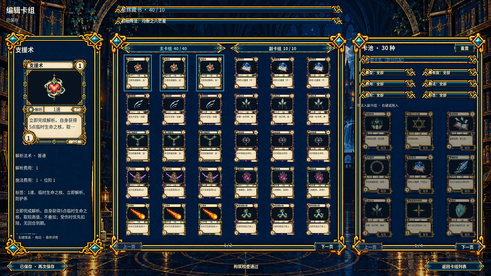
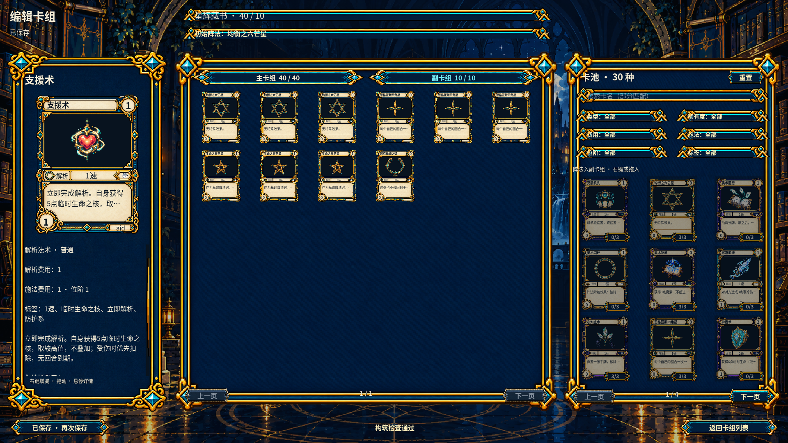
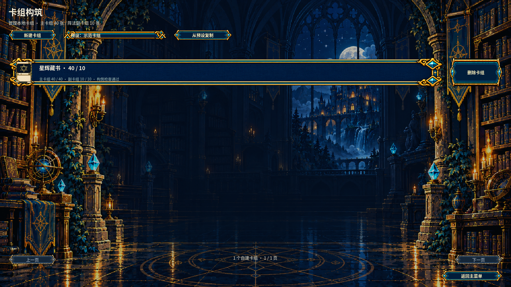

# C 版卡组构筑与编辑资源

采用月夜藏书室、深蓝、古金与青色魔晶的精致像素奇幻风。Godot 页面保留 v1.1 的三栏、工具栏、卡组条目和分页位置；用户最新修正为 **40 张主卡组 + 10 张阵法副卡组**。

## 本批资产清单

七份组件由内置 ImageGen 分别生成，全部交付精确 **1920×1080 RGBA PNG**。背景不透明，其余组件保留真实透明外缘；透明组件放在全尺寸画布中央，运行时依 manifest 的 `region` 取出。

| 文件（`export/`） | 使用位置 | 有效尺寸 | 拉伸 |
|---|---|---|---|
| `background-1080p.png` | 构筑列表、编辑页背景 | 1920×1080 | 整幅 |
| `detail-panel-1080p.png` | 左侧卡牌详情 | 360×760 | 九宫格 |
| `grid-panel-1080p.png` | 中部卡组、右侧卡池 | 640×640 | 九宫格 |
| `list-entry-1080p.png` | 纵向卡组条目 | 1200×112 | 九宫格 |
| `empty-slot-1080p.png` | 3:4 空卡槽 | 150×200 | 等比例 |
| `quantity-badge-1080p.png` | 卡池同名份数角标 | 64×26 | 等比例 |
| `drop-highlight-1080p.png` | 有效拖放目标 | 150×200 | 九宫格，中心透明 |

`source/` 保留未经修改的生成原稿，`generation-prompts.json` 保留完整提示词，`manifest.json` 记录尺寸、透明性、有效区域、九宫格参数和 SHA-256。`tools/prepare_deck_builder_art.py` 只执行用户已授权的尺寸归一化及透明留白区域取样，使用最近邻缩放，没有重绘、改色或移除背景。

## 复用资源与交互

卡牌采用已有五种 **1086×1448 原始 ImageGen 完整卡框**与实际卡池插图；文字、卡名和数值由 Godot 绘制。按钮、搜索/下拉、滚动条、确认弹窗和开源中文字体复用现有 C 版共享组件。

主卡组每页 30 张，40 张通过两页浏览；副卡组独立页签与十个卡槽。两组同名份数逐张显示，卡池为 3×3；阵法加入副卡组，初始阵法从自己的副卡组选择。搜索、六项组合筛选、右键增减、双向拖放、取消拖动、草稿保存、删除确认和未保存离开均已接入原生服务。

本轮使用原生正式卡池的 30 个定义。图鉴中的 2.0 预览卡尚未进入原生内容，不把展示数据当作合法构筑内容；新增 40/10 草稿也不会提交到旧版对局内核。

## Godot 实际截图

`previews/` 还包含主卡组第二页、未保存弹窗，以及 1600×1000 和 1280×720 实际截图。验证结果见 [接入报告](../../../../docs/reports/deck-builder-art-integration.md)。
