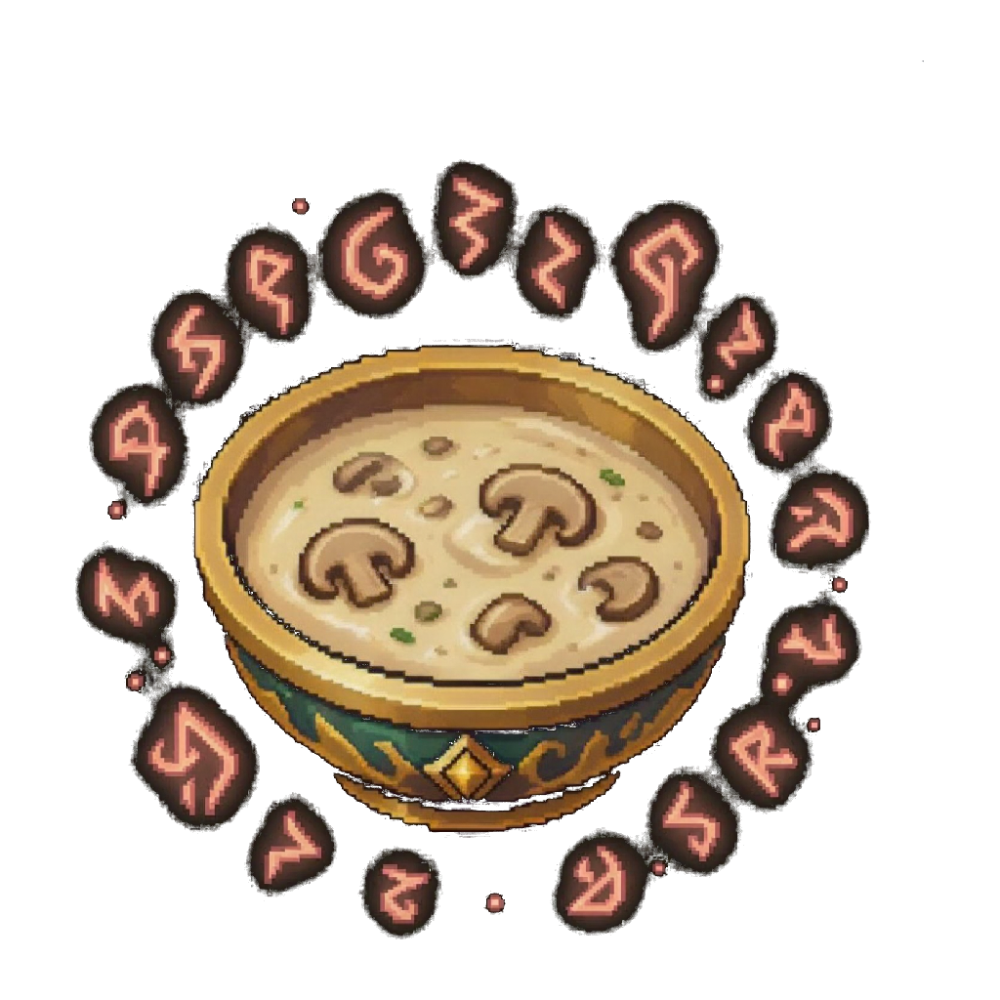
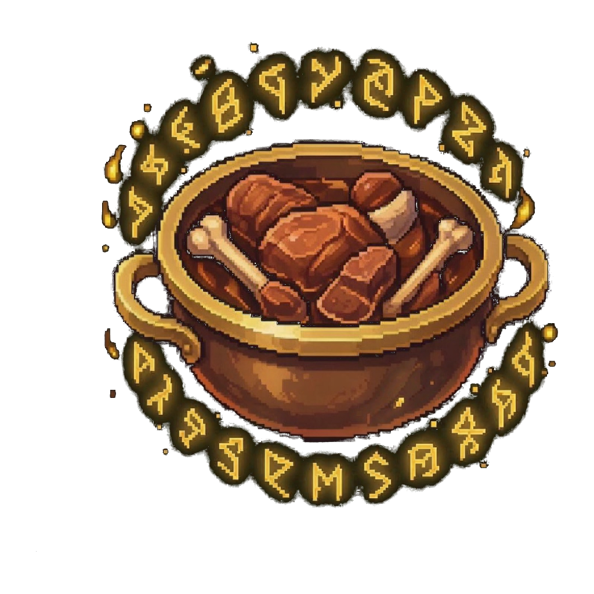
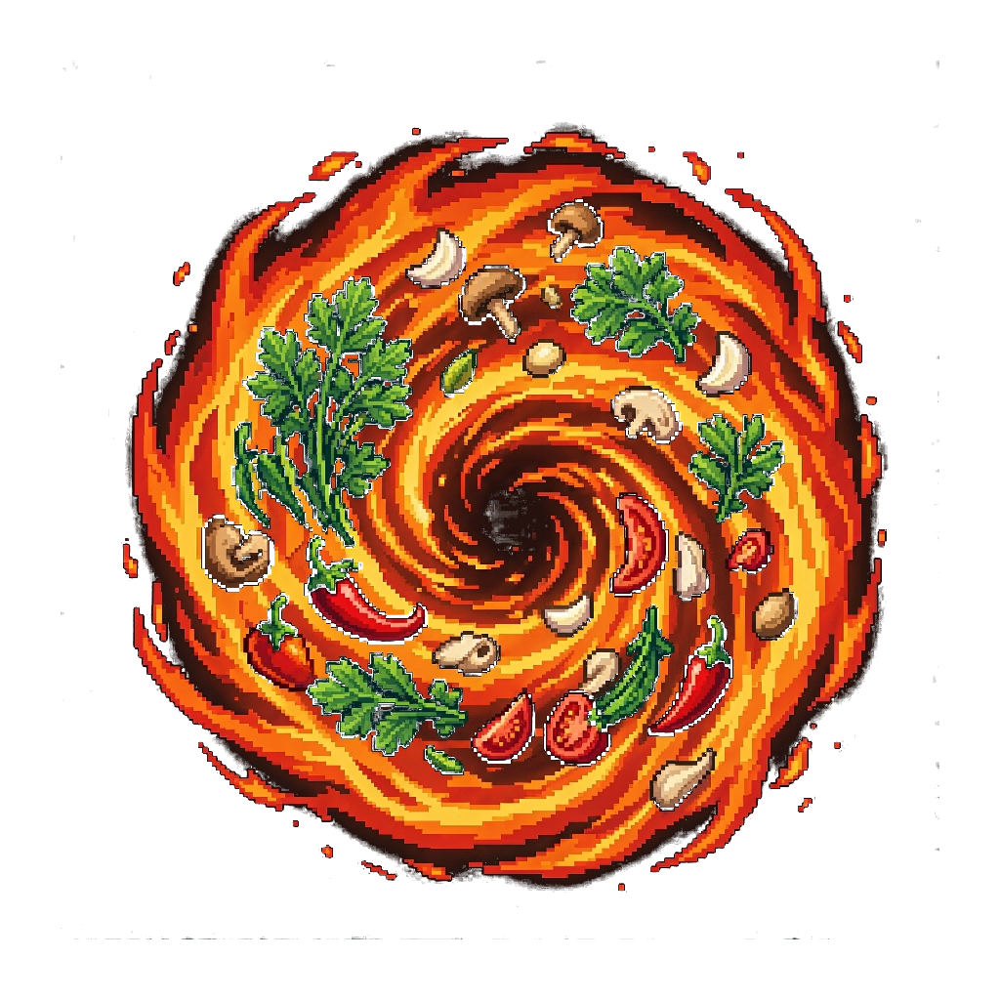

# 巫师牌卡池图鉴

规则 2.5.1 · 卡池 2.5.1 · 78 种正式卡牌 · 10 套 40+10 预设。

本页由正式定义生成。规则见 [Alpha v2.5](alpha-v2.5-rules.md)，卡面召唤条件由正式字段生成，效果以正式规则为准。

编号前两位：01 阵法、02 解析、03 言灵、04 咒符、05 符文；后四位为该类序号。稳定内容 ID 用于存档和资源关联。

| 编号 | 卡名 | 类型 |
|---|---|---|
| 010001 | [阿克乌姆之弧](#reservoir) | 阵法 |
| 010002 | [生命之五芒星](#pentagram-of-life) | 阵法 |
| 010003 | [恩格亚斯四角星](#engeas-four-point-star) | 阵法 |
| 010004 | [运行之三角星](#small-hexagram) | 阵法 |
| 010005 | [均衡之六芒星](#hexagram) | 阵法 |
| 010006 | [秩序之八芒星](#octagram) | 阵法 |
| 010007 | [至圣之太阳星](#sun) | 阵法 |
| 010008 | [正十字](#upright-cross) | 阵法 |
| 010009 | [逆十字](#inverted-cross) | 阵法 |
| 010010 | [安卡十字](#ankh) | 阵法 |
| 010011 | [元素之环](#elemental-ring) | 阵法 |
| 010012 | [混沌之环](#chaos-ring) | 阵法 |
| 010013 | [硫磺](#sulfur) | 阵法 |
| 010014 | [风暴纹章](#storm-crest) | 阵法 |
| 010015 | [风暴之心](#storm-heart) | 阵法 |
| 010016 | [味契·柴堆](#sique-woodpile) | 阵法 |
| 010017 | [味契·篝火](#sique-campfire) | 阵法 |
| 010018 | [味契·魔力坩埚](#sique-cauldron) | 阵法 |
| 020001 | [火球术](#fireball) | 解析法术 |
| 020002 | [缝合生命](#mend) | 解析法术 |
| 020003 | [碎环术](#unravel) | 解析法术 |
| 020004 | [炽燃结界](#ward) | 解析法术 |
| 020005 | [紊乱波动](#messy-wave) | 解析法术 |
| 020006 | [昏昏入睡](#instantly-sleep) | 解析法术 |
| 020007 | [魔法飞弹](#magic-missile) | 解析法术 |
| 020008 | [支援术](#aid) | 解析法术 |
| 020009 | [寒霜射线](#ray-of-frost) | 解析法术 |
| 020010 | [闪电束](#lightning-bolt) | 解析法术 |
| 020011 | [次级复原](#lesser-restoration) | 解析法术 |
| 020012 | [虚假生命](#false-life) | 解析法术 |
| 020013 | [繁彩球](#chromatic-orb) | 解析法术 |
| 020014 | [曳光弹](#guiding-bolt) | 解析法术 |
| 020015 | [炽热射线](#scorching-ray) | 解析法术 |
| 020016 | [阳炎爆](#sunburst) | 解析法术 |
| 020017 | [治疗之环](#healing-circle) | 解析法术 |
| 020018 | [冰风暴](#ice-storm) | 解析法术 |
| 020019 | [切割之风](#cutting-wind) | 解析法术 |
| 020020 | [大风暴术](#great-storm) | 解析法术 |
| 020021 | [云雾术](#cloud-mist) | 解析法术 |
| 020022 | [召雷术](#thunder-summon) | 解析法术 |
| 020023 | [味契·奶油蘑菇浓汤](#sique-mushroom-soup) | 解析法术 |
| 020024 | [味契·糖浆煎饼](#sique-pancakes) | 解析法术 |
| 020025 | [味契·神恩炖肉](#sique-divine-stew) | 解析法术 |
| 030001 | [奥术回想](#recall) | 言灵法术 |
| 030002 | [火花术](#spark) | 言灵法术 |
| 030003 | [魔力扰动](#disrupt) | 言灵法术 |
| 030004 | [心如止水](#clarity) | 言灵法术 |
| 030005 | [克敌机先](#true-strike) | 言灵法术 |
| 030007 | [瞬发回路过载](#instant-circuit-overload) | 言灵法术 |
| 030008 | [奥术复苏](#arcane-recovery) | 言灵法术 |
| 030009 | [风语术](#wind-whisper) | 言灵法术 |
| 030010 | [极速之风](#swift-wind) | 言灵法术 |
| 030011 | [雪雨暴](#snow-rain-storm) | 言灵法术 |
| 030012 | [造风术](#windmaking) | 言灵法术 |
| 030013 | [风暴导向](#storm-guidance) | 言灵法术 |
| 030014 | [味契·原料召来](#sique-ingredients) | 言灵法术 |
| 030015 | [味契·风味转化](#sique-flavor-shift) | 言灵法术 |
| 030016 | [味契·烈火回炉](#sique-refire) | 言灵法术 |
| 040001 | [银光锐语](#barbs) | 咒符法术 |
| 040002 | [法术反制](#counter-spell) | 咒符法术 |
| 040003 | [护盾术](#shield) | 咒符法术 |
| 040004 | [滑稽魔盒](#funny-box) | 咒符法术 |
| 040005 | [避火咒](#protective-flame) | 咒符法术 |
| 040006 | [风暴气旋](#storm-vortex) | 咒符法术 |
| 040007 | [风击术](#wind-strike) | 咒符法术 |
| 040008 | [大旋风术](#great-cyclone) | 咒符法术 |
| 040009 | [味契·沸汤滚袭](#sique-boiling-surge) | 咒符法术 |
| 040010 | [味契·飘香诱惑](#sique-aroma-lure) | 咒符法术 |
| 050001 | [奥术圆环](#ring) | 符文 |
| 050002 | [逆三角星符](#conduit) | 符文 |
| 050003 | [昂扬](#uplift) | 符文 |
| 050004 | [风暴烙印](#storm-brand) | 符文 |
| 050005 | [风暴湮灭之纹章](#storm-annihilation-crest) | 符文 |
| 050006 | [味契·香醋](#sique-vinegar) | 符文 |
| 050007 | [味契·冰糖](#sique-sugar) | 符文 |
| 050008 | [味契·海盐](#sique-salt) | 符文 |
| 050009 | [味契·辣椒](#sique-chili) | 符文 |
| 050010 | [味契·欧芹](#sique-parsley) | 符文 |

## 010001 · 阿克乌姆之弧

| 属性 | 数值 |
|---|---|
| 编号 | 010001 |
| 类型 | 阵法 |
| 等级 | 0 |
| 阵体 | 1 |
| 荷载上限 | 15 |
| 魔素收入 | 0 |
| 环位 | 0 |
| 承载位阶 | 1 |
| 召唤条件 | 2张手牌。 |

以两张手牌为材料设置。没有环位；无特殊效果。

莱德·阿克乌姆在进行生命力相关的研究时发明出了这个符文，他以缺失的圆环作为法阵的基底，发现这个简洁的阵法代表着空洞的虚无。

内容 ID：`reservoir`。

## 010002 · 生命之五芒星

| 属性 | 数值 |
|---|---|
| 编号 | 010002 |
| 类型 | 阵法 |
| 等级 | 5 |
| 阵体 | 2 |
| 荷载上限 | 8 |
| 魔素收入 | 3 |
| 环位 | 3 |
| 承载位阶 | 5 |
| 召唤条件 | 【均衡之六芒星】+已解析的法术。 |

己方准备阶段开始时，获得1点独立荷载。

生命之五芒星以魔素高活跃性和高控制性著称。

内容 ID：`pentagram-of-life`。

## 010003 · 恩格亚斯四角星

| 属性 | 数值 |
|---|---|
| 编号 | 010003 |
| 类型 | 阵法 |
| 等级 | 3 |
| 阵体 | 1 |
| 荷载上限 | 2 |
| 魔素收入 | 3 |
| 环位 | 1 |
| 承载位阶 | 3 |
| 召唤条件 | 3魔素+已解析的法术。 |

每个自己的回合一次：在本阵法上开始解析的第一张位阶不超过1、需要解析时间的法术，立即完成解析。

贤者恩格亚斯发明的精简阵法，以快速聚能和快速释放闻名。

内容 ID：`engeas-four-point-star`。

## 010004 · 运行之三角星

| 属性 | 数值 |
|---|---|
| 编号 | 010004 |
| 类型 | 阵法 |
| 等级 | 1 |
| 阵体 | 1 |
| 荷载上限 | 5 |
| 魔素收入 | 1 |
| 环位 | 1 |
| 承载位阶 | 1 |
| 召唤条件 | 2魔素。 |

此卡在己方阵法槽内仅可存在一张。

内容 ID：`small-hexagram`。

## 010005 · 均衡之六芒星

| 属性 | 数值 |
|---|---|
| 编号 | 010005 |
| 类型 | 阵法 |
| 等级 | 3 |
| 阵体 | 2 |
| 荷载上限 | 8 |
| 魔素收入 | 2 |
| 环位 | 3 |
| 承载位阶 | 3 |
| 召唤条件 | 【运行之三角星】+魔素×2。 |

此卡不会被效果破坏。

魔法界最流行的一种法阵，你几乎可以在任何一种复杂术式中看到它的身影。六芒星诉说着它的信念：秩序不偏向任何一边。

内容 ID：`hexagram`。

## 010006 · 秩序之八芒星

| 属性 | 数值 |
|---|---|
| 编号 | 010006 |
| 类型 | 阵法 |
| 等级 | 6 |
| 阵体 | 2 |
| 荷载上限 | 10 |
| 魔素收入 | 4 |
| 环位 | 4 |
| 承载位阶 | 6 |
| 召唤条件 | 【运行之三角星】+【均衡之六芒星】 |

此卡不会被效果破坏。己方每有一张解析法术解析完成，清除1点荷载。

内容 ID：`octagram`。

## 010007 · 至圣之太阳星

| 属性 | 数值 |
|---|---|
| 编号 | 010007 |
| 类型 | 阵法 |
| 等级 | 7 |
| 阵体 | 4 |
| 荷载上限 | 15 |
| 魔素收入 | 8 |
| 环位 | 7 |
| 承载位阶 | 7 |
| 召唤条件 | 【生命之五芒星】+【秩序之八芒星】 |

此卡不受其他卡的效果影响。在己方阵法槽内存在时，可随时查看对方解析区盖伏法术。

内容 ID：`sun`。

## 010008 · 正十字

| 属性 | 数值 |
|---|---|
| 编号 | 010008 |
| 类型 | 阵法 |
| 等级 | 3 |
| 阵体 | 1 |
| 荷载上限 | 5 |
| 魔素收入 | 0 |
| 环位 | 2 |
| 承载位阶 | 3 |
| 召唤条件 | 1魔素+【死灵】法术。 |

于该法阵释放的法术，回复生命时额外回复1点生命。

内容 ID：`upright-cross`。

## 010009 · 逆十字

| 属性 | 数值 |
|---|---|
| 编号 | 010009 |
| 类型 | 阵法 |
| 等级 | 3 |
| 阵体 | 1 |
| 荷载上限 | 5 |
| 魔素收入 | 0 |
| 环位 | 2 |
| 承载位阶 | 3 |
| 召唤条件 | 1魔素+【死灵】法术。 |

于该法阵施法时，失去一点生命，获得两点临时生命。

内容 ID：`inverted-cross`。

## 010010 · 安卡十字

| 属性 | 数值 |
|---|---|
| 编号 | 010010 |
| 类型 | 阵法 |
| 等级 | 3 |
| 阵体 | 2 |
| 荷载上限 | 5 |
| 魔素收入 | 1 |
| 环位 | 1 |
| 承载位阶 | 3 |
| 召唤条件 | 1魔素+已解析的【死灵】法术。 |

设置时，可以将己方灰烬区一张表侧阵法卡加入副卡组。本卡进入灰烬区时背面朝上放置。

内容 ID：`ankh`。

## 010011 · 元素之环

| 属性 | 数值 |
|---|---|
| 编号 | 010011 |
| 类型 | 阵法 |
| 等级 | 3 |
| 阵体 | 2 |
| 荷载上限 | 8 |
| 魔素收入 | 1 |
| 环位 | 2 |
| 承载位阶 | 3 |
| 召唤条件 | 1魔素+已解析的【塑能】法术。 |

在此阵法上解析的塑能法术伤害+1。

内容 ID：`elemental-ring`。

## 010012 · 混沌之环

| 属性 | 数值 |
|---|---|
| 编号 | 010012 |
| 类型 | 阵法 |
| 等级 | 3 |
| 阵体 | 2 |
| 荷载上限 | 12 |
| 魔素收入 | 1 |
| 环位 | 5 |
| 承载位阶 | 3 |
| 召唤条件 | 已解析的不同派系法术×2。 |

此阵法不能同时解析相同学派法术。

内容 ID：`chaos-ring`。

## 010013 · 硫磺

| 属性 | 数值 |
|---|---|
| 编号 | 010013 |
| 类型 | 阵法 |
| 等级 | 6 |
| 阵体 | 2 |
| 荷载上限 | 6 |
| 魔素收入 | 3 |
| 环位 | 6 |
| 承载位阶 | 6 |
| 召唤条件 | 已解析的火焰伤害法术×2。 |

此阵法只能解析火焰伤害法术。每当己方法术从施法区进入灰烬区，对对方玩家造成1点火焰伤害。

内容 ID：`sulfur`。

## 010014 · 风暴纹章

| 属性 | 数值 |
|---|---|
| 编号 | 010014 |
| 类型 | 阵法 |
| 等级 | 1 |
| 阵体 | 2 |
| 荷载上限 | 5 |
| 魔素收入 | 1 |
| 环位 | 2 |
| 承载位阶 | 1 |
| 召唤条件 | 支付1魔素。 |

这张卡在场上只能存在一张。阵法属性由其上的风暴点数决定：0至2点时为1级、最大解析数1、荷载上限5、魔素收入1；3至5点时为2级、最大解析数2、荷载上限8、魔素收入1；5点以上时为3级、最大解析数3、荷载上限10、魔素收入2。每发动一张风暴法术卡，获得1个风暴点数。一回合一次，移除这张卡上的2个风暴点数，从牌库将一张风暴法术卡加入手牌。

内容 ID：`storm-crest`。

## 010015 · 风暴之心

| 属性 | 数值 |
|---|---|
| 编号 | 010015 |
| 类型 | 阵法 |
| 等级 | 7 |
| 阵体 | 5 |
| 荷载上限 | 20 |
| 魔素收入 | 7 |
| 环位 | 5 |
| 承载位阶 | 7 |
| 召唤条件 | 将己方风暴纹章送入灰烬区并支付4魔素。 |

这张卡被设置时，从牌库将一张大风暴术加入手牌。每发动一张风暴法术卡，获得1个风暴点数。可以移除这张卡上的1个风暴点数，代为销毁或破坏。一回合一次，移除这张卡上的2个风暴点数，并选择一项：抽1张卡；将灰烬区的一张风暴卡加入牌库并洗切。

内容 ID：`storm-heart`。

## 010016 · 味契·柴堆

| 属性 | 数值 |
|---|---|
| 编号 | 010016 |
| 类型 | 阵法 |
| 等级 | 1 |
| 阵体 | 1 |
| 荷载上限 | 5 |
| 魔素收入 | 2 |
| 环位 | 1 |
| 承载位阶 | 1 |
| 召唤条件 | 支付2魔素；己方场上只能存在1张。 |

此卡在己方场上只能存在1张。

内容 ID：`sique-woodpile`。

## 010017 · 味契·篝火

| 属性 | 数值 |
|---|---|
| 编号 | 010017 |
| 类型 | 阵法 |
| 等级 | 3 |
| 阵体 | 2 |
| 荷载上限 | 8 |
| 魔素收入 | 4 |
| 环位 | 3 |
| 承载位阶 | 3 |
| 召唤条件 | 祭品：己方场上1张味契·柴堆；弃置手牌中1张火焰伤害法术。 |

己方场上存在味契·魔力坩埚时，此卡不受其他卡的效果影响。此卡上设置的火焰伤害法术卡伤害+1。

内容 ID：`sique-campfire`。

## 010018 · 味契·魔力坩埚

| 属性 | 数值 |
|---|---|
| 编号 | 010018 |
| 类型 | 阵法 |
| 等级 | 5 |
| 阵体 | 3 |
| 荷载上限 | 11 |
| 魔素收入 | 6 |
| 环位 | 5 |
| 承载位阶 | 5 |
| 召唤条件 | 己方场上存在味契·篝火；支付2魔素并弃置2张手牌。 |

己方场上存在味契·篝火才能设置。此卡存在时，己方只能发动味契卡和火焰伤害法术卡。己方结束阶段开始时，将此卡上附着的全部符文送入灰烬区。

内容 ID：`sique-cauldron`。

## 020001 · 火球术

| 属性 | 数值 |
|---|---|
| 编号 | 020001 |
| 类型 | 解析法术 |
| 学派 | 塑能 |
| 位阶 | 3 |
| 速度 | 1 |
| 设置费用 | 3 |
| 施法费用 | 1 |
| 解析回合 | 1 |
| 持续方式 | 通常 |

对对方玩家造成10点火焰伤害。

没错，这确实是经典之选。“伟大的法师都精通了火球术使用！”阿克莉娅如是说，她本人是个术士。

内容 ID：`fireball`。

## 020002 · 缝合生命

| 属性 | 数值 |
|---|---|
| 编号 | 020002 |
| 类型 | 解析法术 |
| 学派 | 死灵 |
| 位阶 | 3 |
| 速度 | 2 |
| 设置费用 | 2 |
| 施法费用 | 1 |
| 解析回合 | 1 |
| 持续方式 | 通常 |

选择己方或对方玩家，为其恢复4点生命值。

把你的心我的心串一串……

内容 ID：`mend`。

## 020003 · 碎环术

| 属性 | 数值 |
|---|---|
| 编号 | 020003 |
| 类型 | 解析法术 |
| 学派 | 变化 |
| 位阶 | 1 |
| 速度 | 1 |
| 设置费用 | 2 |
| 施法费用 | 0 |
| 解析回合 | 1 |
| 持续方式 | 通常 |

指定对方场上一张没有承载法术的阵法。将己方副卡组一张阵法送入灰烬区，然后销毁目标阵法。

碎碎平安！

内容 ID：`unravel`。

## 020004 · 炽燃结界

| 属性 | 数值 |
|---|---|
| 编号 | 020004 |
| 类型 | 解析法术 |
| 学派 | 塑能 |
| 位阶 | 2 |
| 速度 | 1 |
| 设置费用 | 2 |
| 施法费用 | 0 |
| 解析回合 | 1 |
| 持续方式 | 专注 |

专注1。对对方玩家造成4点火焰伤害；成功维持专注时对对方玩家造成2点火焰伤害。

内容 ID：`ward`。

## 020005 · 紊乱波动

| 属性 | 数值 |
|---|---|
| 编号 | 020005 |
| 类型 | 解析法术 |
| 学派 | 塑能 |
| 位阶 | 2 |
| 速度 | 1 |
| 设置费用 | 4 |
| 施法费用 | 4 |
| 解析回合 | 1 |
| 持续方式 | 计时 3 |

计时3。首次发动时对方获得5点来源关联临时荷载；之后每个己方施法阶段对方获得3点来源关联临时荷载。这些荷载不在抽牌阶段清除，在本法术离场时清除。

为什么要使用这么坏心眼的法术？

内容 ID：`messy-wave`。

## 020006 · 昏昏入睡

| 属性 | 数值 |
|---|---|
| 编号 | 020006 |
| 类型 | 解析法术 |
| 学派 | 惑控 |
| 位阶 | 1 |
| 速度 | 1 |
| 设置费用 | 3 |
| 施法费用 | 1 |
| 解析回合 | 1 |
| 持续方式 | 通常 |

对方下一个自己的回合不能从手牌发动言灵法术；已盖伏的法术不受影响。

巫师牌安眠药。

内容 ID：`instantly-sleep`。

## 020007 · 魔法飞弹

| 属性 | 数值 |
|---|---|
| 编号 | 020007 |
| 类型 | 解析法术 |
| 学派 | 塑能 |
| 位阶 | 2 |
| 速度 | 2 |
| 设置费用 | 2 |
| 施法费用 | 2 |
| 解析回合 | 1 |
| 持续方式 | 通常 |

对对方玩家造成2点力场伤害。那之后，可以销毁对方解析区一张盖伏法术。

折磨你的对手。

内容 ID：`magic-missile`。

## 020008 · 支援术

| 属性 | 数值 |
|---|---|
| 编号 | 020008 |
| 类型 | 解析法术 |
| 学派 | 防护 |
| 位阶 | 1 |
| 速度 | 1 |
| 设置费用 | 1 |
| 施法费用 | 1 |
| 解析回合 | 0 |
| 持续方式 | 通常 |

立即完成解析。获得5点临时生命（不叠加，取较高值），在下次己方抽牌阶段清除。

你被增强了！

内容 ID：`aid`。

## 020009 · 寒霜射线

| 属性 | 数值 |
|---|---|
| 编号 | 020009 |
| 类型 | 解析法术 |
| 学派 | 塑能 |
| 位阶 | 2 |
| 速度 | 1 |
| 设置费用 | 2 |
| 施法费用 | 1 |
| 解析回合 | 1 |
| 持续方式 | 通常 |

对对方玩家造成6点寒冷伤害。那之后，可以使对方解析区一张解析法术的解析进度-1。

内容 ID：`ray-of-frost`。

## 020010 · 闪电束

| 属性 | 数值 |
|---|---|
| 编号 | 020010 |
| 类型 | 解析法术 |
| 学派 | 塑能 |
| 位阶 | 3 |
| 速度 | 1 |
| 设置费用 | 3 |
| 施法费用 | 2 |
| 解析回合 | 1 |
| 持续方式 | 通常 |

对对方玩家造成8点雷鸣伤害。那之后，可以销毁对方解析区一张解析法术。

内容 ID：`lightning-bolt`。

## 020011 · 次级复原

| 属性 | 数值 |
|---|---|
| 编号 | 020011 |
| 类型 | 解析法术 |
| 学派 | 防护 |
| 位阶 | 1 |
| 速度 | 1 |
| 设置费用 | 2 |
| 施法费用 | 1 |
| 解析回合 | 0 |
| 持续方式 | 通常 |

立即解析。清除自身所有临时荷载，然后恢复2点生命。不能清除独立或绑定荷载。

内容 ID：`lesser-restoration`。

## 020012 · 虚假生命

| 属性 | 数值 |
|---|---|
| 编号 | 020012 |
| 类型 | 解析法术 |
| 学派 | 死灵 |
| 位阶 | 3 |
| 速度 | 2 |
| 设置费用 | 2 |
| 施法费用 | 1 |
| 解析回合 | 1 |
| 持续方式 | 通常 |

获得6点临时生命值（不叠加，取较高值）。

内容 ID：`false-life`。

## 020013 · 繁彩球

| 属性 | 数值 |
|---|---|
| 编号 | 020013 |
| 类型 | 解析法术 |
| 学派 | 塑能 |
| 位阶 | 2 |
| 速度 | 1 |
| 设置费用 | 2 |
| 施法费用 | 2 |
| 解析回合 | 1 |
| 持续方式 | 通常 |

对对方玩家造成8点自选伤害，从强酸/寒冷/火焰/闪电/毒素/雷鸣中选择。

内容 ID：`chromatic-orb`。

## 020014 · 曳光弹

| 属性 | 数值 |
|---|---|
| 编号 | 020014 |
| 类型 | 解析法术 |
| 学派 | 塑能 |
| 位阶 | 2 |
| 速度 | 1 |
| 设置费用 | 2 |
| 施法费用 | 2 |
| 解析回合 | 1 |
| 持续方式 | 通常 |

对对方玩家造成8点光耀伤害。那之后，可以展示对方解析区一张盖伏法术（不反转）。

内容 ID：`guiding-bolt`。

## 020015 · 炽热射线

| 属性 | 数值 |
|---|---|
| 编号 | 020015 |
| 类型 | 解析法术 |
| 学派 | 塑能 |
| 位阶 | 5 |
| 速度 | 1 |
| 设置费用 | 4 |
| 施法费用 | 2 |
| 解析回合 | 2 |
| 持续方式 | 通常 |

对对方玩家造成5点火焰伤害，重复三次。

内容 ID：`scorching-ray`。

## 020016 · 阳炎爆

| 属性 | 数值 |
|---|---|
| 编号 | 020016 |
| 类型 | 解析法术 |
| 学派 | 塑能 |
| 位阶 | 6 |
| 速度 | 3 |
| 设置费用 | 20 |
| 施法费用 | 2 |
| 解析回合 | 2 |
| 持续方式 | 通常 |

对对方玩家造成15点火焰伤害。那之后，可以销毁对方一个阵法承载的所有法术。己方灰烬区每有一张塑能学派法术，此卡设置费用-1（最低0）；发动费用不变。

内容 ID：`sunburst`。

## 020017 · 治疗之环

| 属性 | 数值 |
|---|---|
| 编号 | 020017 |
| 类型 | 解析法术 |
| 学派 | 死灵 |
| 位阶 | 2 |
| 速度 | 1 |
| 设置费用 | 3 |
| 施法费用 | 0 |
| 解析回合 | 2 |
| 持续方式 | 计时 3 |

计时3。己方结束阶段开始时，恢复2点生命值。

内容 ID：`healing-circle`。

## 020018 · 冰风暴

| 属性 | 数值 |
|---|---|
| 编号 | 020018 |
| 类型 | 解析法术 |
| 学派 | 塑能 |
| 位阶 | 4 |
| 速度 | 1 |
| 设置费用 | 4 |
| 施法费用 | 1 |
| 解析回合 | 1 |
| 持续方式 | 通常 |

对目标造成8点寒冷伤害，选择对方解析区的所有解析法术卡使解析进度+1。

内容 ID：`ice-storm`。

## 020019 · 切割之风

| 属性 | 数值 |
|---|---|
| 编号 | 020019 |
| 类型 | 解析法术 |
| 学派 | 变化 |
| 位阶 | 1 |
| 速度 | 1 |
| 设置费用 | 1 |
| 施法费用 | 1 |
| 解析回合 | 1 |
| 持续方式 | 通常 |

场上有风暴阵法卡才能设置。销毁自己场上一张空闲阵法卡，对目标造成4点挥砍伤害，外加销毁阵法等级的雷鸣伤害。

内容 ID：`cutting-wind`。

## 020020 · 大风暴术

| 属性 | 数值 |
|---|---|
| 编号 | 020020 |
| 类型 | 解析法术 |
| 学派 | 变化 |
| 位阶 | 7 |
| 速度 | 1 |
| 设置费用 | 0 |
| 施法费用 | 10 |
| 解析回合 | 2 |
| 持续方式 | 计时 1 |

场上有风暴之心作为阵法才能设置。在风暴之心上的这张卡不受其他卡的效果影响；这张卡在解析区时，自己不能设置其他解析法术卡。计时。发动时，移除风暴之心上的所有风暴点数，并以移除的点数作为计时回合数；销毁对方场上所有卡，并对对方造成等同于销毁卡数量×4的挥砍伤害。计时回合中，对对方造成8点挥砍伤害，之后可以销毁对方场上一张法术卡。

内容 ID：`great-storm`。

## 020021 · 云雾术

| 属性 | 数值 |
|---|---|
| 编号 | 020021 |
| 类型 | 解析法术 |
| 学派 | 变化 |
| 位阶 | 2 |
| 速度 | 1 |
| 设置费用 | 2 |
| 施法费用 | 3 |
| 解析回合 | 1 |
| 持续方式 | 计时 2 |

计时2。最多选择场上的2张解析法术卡，被选择的卡在该法术持续时间内无法被准备。

内容 ID：`cloud-mist`。

## 020022 · 召雷术

| 属性 | 数值 |
|---|---|
| 编号 | 020022 |
| 类型 | 解析法术 |
| 学派 | 塑能 |
| 位阶 | 3 |
| 速度 | 1 |
| 设置费用 | 3 |
| 施法费用 | 2 |
| 解析回合 | 1 |
| 持续方式 | 通常 |

对目标造成9点闪电伤害，并给予对方5点荷载，对方的回合结束阶段清除。

内容 ID：`thunder-summon`。

## 020023 · 味契·奶油蘑菇浓汤

| 属性 | 数值 |
|---|---|
| 编号 | 020023 |
| 类型 | 解析法术 |
| 学派 | 防护 |
| 位阶 | 5 |
| 速度 | 1 |
| 设置费用 | 2 |
| 施法费用 | 1 |
| 解析回合 | 2 |
| 持续方式 | 通常 |

将2张味契符文解除附着才能发动。恢复4点生命，获得6点临时生命。

内容 ID：`sique-mushroom-soup`。

## 020024 · 味契·糖浆煎饼

| 属性 | 数值 |
|---|---|
| 编号 | 020024 |
| 类型 | 解析法术 |
| 学派 | 防护 |
| 位阶 | 5 |
| 速度 | 1 |
| 设置费用 | 2 |
| 施法费用 | 1 |
| 解析回合 | 1 |
| 持续方式 | 通常 |

将2张味契符文解除附着才能发动。直到下个己方准备阶段开始时，每次受到的伤害最多为4点。

内容 ID：`sique-pancakes`。

## 020025 · 味契·神恩炖肉

| 属性 | 数值 |
|---|---|
| 编号 | 020025 |
| 类型 | 解析法术 |
| 学派 | 死灵 |
| 位阶 | 5 |
| 速度 | 1 |
| 设置费用 | 2 |
| 施法费用 | 1 |
| 解析回合 | 5 |
| 持续方式 | 通常 |

将3张味契符文解除附着才能发动。这个回合，以对方生命值代替己方魔素费用。

内容 ID：`sique-divine-stew`。

## 030001 · 奥术回想

| 属性 | 数值 |
|---|---|
| 编号 | 030001 |
| 类型 | 言灵法术 |
| 学派 | 预言 |
| 位阶 | 1 |
| 速度 | 2 |
| 施法费用 | 3 |
| 持续方式 | 通常 |

抽两张卡，获得2点临时荷载。

尚未熄灭的记忆，也能成为下一道咒文。

内容 ID：`recall`。

## 030002 · 火花术

| 属性 | 数值 |
|---|---|
| 编号 | 030002 |
| 类型 | 言灵法术 |
| 学派 | 塑能 |
| 位阶 | 1 |
| 速度 | 2 |
| 施法费用 | 2 |
| 持续方式 | 通常 |

对对方玩家造成3点火焰伤害。

所有魔法学徒入门必学法术之一，告别火柴第一步！

内容 ID：`spark`。

## 030003 · 魔力扰动

| 属性 | 数值 |
|---|---|
| 编号 | 030003 |
| 类型 | 言灵法术 |
| 学派 | 咒法 |
| 位阶 | 2 |
| 速度 | 2 |
| 施法费用 | 2 |
| 持续方式 | 通常 |

对方玩家获得3点临时荷载，己方玩家获得1点临时荷载。

捣蛋鬼别捣蛋！

内容 ID：`disrupt`。

## 030004 · 心如止水

| 属性 | 数值 |
|---|---|
| 编号 | 030004 |
| 类型 | 言灵法术 |
| 学派 | 无 |
| 位阶 | 1 |
| 速度 | 2 |
| 施法费用 | 1 |
| 持续方式 | 通常 |

弃置一张手牌，移除自身所有的临时荷载。

向月亮诉说吧。

内容 ID：`clarity`。

## 030005 · 克敌机先

| 属性 | 数值 |
|---|---|
| 编号 | 030005 |
| 类型 | 言灵法术 |
| 学派 | 预言 |
| 位阶 | 3 |
| 速度 | 2 |
| 施法费用 | 3 |
| 持续方式 | 通常 |

将另一张手牌中的法术送入灰烬区作为发动成本。从牌库检索一张同学派法术加入手牌，然后洗切牌库。

魔法之洞见，它能指引你看到多远？

内容 ID：`true-strike`。

## 030007 · 瞬发回路过载

| 属性 | 数值 |
|---|---|
| 编号 | 030007 |
| 类型 | 言灵法术 |
| 学派 | 无 |
| 位阶 | 1 |
| 速度 | 2 |
| 施法费用 | 2 |
| 持续方式 | 通常 |

立即完成己方一张正在解析的法术；自身获得其实际解析费用等量的临时荷载，在下次己方抽牌阶段清除。

通过强行激发大量魔素流动，使法术的解析立即完成。铤而走险。

内容 ID：`instant-circuit-overload`。

## 030008 · 奥术复苏

| 属性 | 数值 |
|---|---|
| 编号 | 030008 |
| 类型 | 言灵法术 |
| 学派 | 无 |
| 位阶 | 1 |
| 速度 | 2 |
| 施法费用 | 0 |
| 持续方式 | 通常 |

获得3点魔素（不超过20），然后获得2点临时荷载，在下一次己方抽牌阶段清除。

内容 ID：`arcane-recovery`。

## 030009 · 风语术

| 属性 | 数值 |
|---|---|
| 编号 | 030009 |
| 类型 | 言灵法术 |
| 学派 | 变化 |
| 位阶 | 1 |
| 速度 | 2 |
| 施法费用 | 1 |
| 持续方式 | 通常 |

场上有风暴阵法卡才能发动。从牌库将一张位阶2及以下的风暴咒符法术加入手牌。

内容 ID：`wind-whisper`。

## 030010 · 极速之风

| 属性 | 数值 |
|---|---|
| 编号 | 030010 |
| 类型 | 言灵法术 |
| 学派 | 变化 |
| 位阶 | 1 |
| 速度 | 2 |
| 施法费用 | 3 |
| 持续方式 | 通常 |

场上有风暴阵法卡才能发动。将对方一张等级2及以下的阵法卡返回副卡组。

内容 ID：`swift-wind`。

## 030011 · 雪雨暴

| 属性 | 数值 |
|---|---|
| 编号 | 030011 |
| 类型 | 言灵法术 |
| 学派 | 变化 |
| 位阶 | 3 |
| 速度 | 2 |
| 施法费用 | 3 |
| 持续方式 | 专注 |

专注2。对方使用计时法术需要支付额外的2魔素，对方维持专注所需的魔素翻倍。

内容 ID：`snow-rain-storm`。

## 030012 · 造风术

| 属性 | 数值 |
|---|---|
| 编号 | 030012 |
| 类型 | 言灵法术 |
| 学派 | 变化 |
| 位阶 | 1 |
| 速度 | 2 |
| 施法费用 | 2 |
| 持续方式 | 通常 |

将对方一张法术卡弹回手卡。

内容 ID：`windmaking`。

## 030013 · 风暴导向

| 属性 | 数值 |
|---|---|
| 编号 | 030013 |
| 类型 | 言灵法术 |
| 学派 | 预言 |
| 位阶 | 2 |
| 速度 | 2 |
| 施法费用 | 3 |
| 持续方式 | 通常 |

场上有风暴阵法卡才能发动。将场上的一张卡送入灰烬区，然后选择一项：从牌库将一张风暴法术卡加入手牌；获得2个风暴点数；从牌库将一张云雾术或召雷术加入手牌。

内容 ID：`storm-guidance`。

## 030014 · 味契·原料召来

| 属性 | 数值 |
|---|---|
| 编号 | 030014 |
| 类型 | 言灵法术 |
| 学派 | 咒法 |
| 位阶 | 1 |
| 速度 | 2 |
| 施法费用 | 2 |
| 持续方式 | 通常 |

将牌库中2张味契符文加入手牌。在加手回合附着其中1张时，将仍在手牌中的另1张送入灰烬区。

内容 ID：`sique-ingredients`。

## 030015 · 味契·风味转化

| 属性 | 数值 |
|---|---|
| 编号 | 030015 |
| 类型 | 言灵法术 |
| 学派 | 变化 |
| 位阶 | 5 |
| 速度 | 2 |
| 施法费用 | 2 |
| 持续方式 | 通常 |

将1张味契符文解除附着才能发动。将牌库中1张味契符文附着到己方味契阵法上。

内容 ID：`sique-flavor-shift`。

## 030016 · 味契·烈火回炉

| 属性 | 数值 |
|---|---|
| 编号 | 030016 |
| 类型 | 言灵法术 |
| 学派 | 变化 |
| 位阶 | 3 |
| 速度 | 2 |
| 施法费用 | 3 |
| 持续方式 | 通常 |

将己方灰烬区最多5张味契卡返回牌库或副卡组。那之后，可以抽1张牌。

内容 ID：`sique-refire`。

## 040001 · 银光锐语

| 属性 | 数值 |
|---|---|
| 编号 | 040001 |
| 类型 | 咒符法术 |
| 学派 | 惑控 |
| 位阶 | 3 |
| 速度 | 3 |
| 盖伏费用 | 0 |
| 施法费用 | 5 |
| 持续方式 | 通常 |

对方准备施法时才能发动。将此次准备施法无效。那之后，可以将对方解析区一张解析法术弹回持有者手牌。

你神奇的话语将对手的失误转变为了自己的力量。

内容 ID：`barbs`。

## 040002 · 法术反制

| 属性 | 数值 |
|---|---|
| 编号 | 040002 |
| 类型 | 咒符法术 |
| 学派 | 防护 |
| 位阶 | 5 |
| 速度 | 4 |
| 盖伏费用 | 0 |
| 施法费用 | 5 |
| 持续方式 | 通常 |

对方发动法术时才能发动。将其无效并销毁。那之后，获得与其原本设置费用等量的临时荷载。

火球术！反制！反制你的反制！温馨提示，这种场景在奥术决斗中不会出现。

内容 ID：`counter-spell`。

## 040003 · 护盾术

| 属性 | 数值 |
|---|---|
| 编号 | 040003 |
| 类型 | 咒符法术 |
| 学派 | 防护 |
| 位阶 | 3 |
| 速度 | 2 |
| 盖伏费用 | 0 |
| 施法费用 | 3 |
| 持续方式 | 通常 |

此回合，每次受到伤害时降低至多5点；力场伤害降低至多10点。

内容 ID：`shield`。

## 040004 · 滑稽魔盒

| 属性 | 数值 |
|---|---|
| 编号 | 040004 |
| 类型 | 咒符法术 |
| 学派 | 惑控 |
| 位阶 | 5 |
| 速度 | 3 |
| 盖伏费用 | 0 |
| 施法费用 | 4 |
| 持续方式 | 通常 |

选择对方灰烬区一张5级及以下解析法术，将其在己方有合法空环位的阵法上盖伏。

内容 ID：`funny-box`。

## 040005 · 避火咒

| 属性 | 数值 |
|---|---|
| 编号 | 040005 |
| 类型 | 咒符法术 |
| 学派 | 防护 |
| 位阶 | 4 |
| 速度 | 2 |
| 盖伏费用 | 0 |
| 施法费用 | 2 |
| 持续方式 | 专注 |

专注2。受到的火焰伤害减半，火焰抗性不叠加。

内容 ID：`protective-flame`。

## 040006 · 风暴气旋

| 属性 | 数值 |
|---|---|
| 编号 | 040006 |
| 类型 | 咒符法术 |
| 学派 | 变化 |
| 位阶 | 1 |
| 速度 | 3 |
| 盖伏费用 | 0 |
| 施法费用 | 2 |
| 持续方式 | 通常 |

场上有风暴阵法卡才能发动。销毁对方场上一张法术卡。

内容 ID：`storm-vortex`。

## 040007 · 风击术

| 属性 | 数值 |
|---|---|
| 编号 | 040007 |
| 类型 | 咒符法术 |
| 学派 | 防护 |
| 位阶 | 3 |
| 速度 | 3 |
| 盖伏费用 | 0 |
| 施法费用 | 4 |
| 持续方式 | 通常 |

场上有风暴阵法卡才能发动。对方设置解析法术卡时才能发动，对方受到等同于那张卡位阶×2的钝击伤害；若那张卡的位阶低于风击术，销毁那张卡。

内容 ID：`wind-strike`。

## 040008 · 大旋风术

| 属性 | 数值 |
|---|---|
| 编号 | 040008 |
| 类型 | 咒符法术 |
| 学派 | 变化 |
| 位阶 | 5 |
| 速度 | 2 |
| 盖伏费用 | 0 |
| 施法费用 | 4 |
| 持续方式 | 通常 |

场上有风暴阵法卡才能发动。移除5个风暴点数，销毁对方一张阵法卡下的所有法术卡。并造成等同于销毁数量两倍的钝击伤害。

内容 ID：`great-cyclone`。

## 040009 · 味契·沸汤滚袭

| 属性 | 数值 |
|---|---|
| 编号 | 040009 |
| 类型 | 咒符法术 |
| 学派 | 塑能 |
| 位阶 | 5 |
| 速度 | 2 |
| 盖伏费用 | 0 |
| 施法费用 | 4 |
| 持续方式 | 通常 |

仅可响应对方发动的将销毁味契阵法的法术。将其无效并销毁。那之后，对对方造成10点火焰伤害。

内容 ID：`sique-boiling-surge`。

## 040010 · 味契·飘香诱惑

| 属性 | 数值 |
|---|---|
| 编号 | 040010 |
| 类型 | 咒符法术 |
| 学派 | 惑控 |
| 位阶 | 5 |
| 速度 | 3 |
| 盖伏费用 | 0 |
| 施法费用 | 4 |
| 持续方式 | 通常 |

己方场上存在味契·魔力坩埚才能发动。双方手牌全部返回各自牌库，然后各自可以抽取与放回数量相同的牌。

内容 ID：`sique-aroma-lure`。

## 050001 · 奥术圆环

| 属性 | 数值 |
|---|---|
| 编号 | 050001 |
| 类型 | 符文 |
| 附着费用 | 1 |

阵法附着效果：该阵法环位数+1。法术附着效果：宿主成功释放后，获得等于该法术设置时实际支付费用的魔素。

闭合的圆，会把尚未散去的力量带回起点。

内容 ID：`ring`。

## 050002 · 逆三角星符

| 属性 | 数值 |
|---|---|
| 编号 | 050002 |
| 类型 | 符文 |
| 附着费用 | 2 |

阵法附着：该阵法在抽牌阶段提供的魔素收入+2。法术附着：无额外效果。

聚能并非环。

内容 ID：`conduit`。

## 050003 · 昂扬

| 属性 | 数值 |
|---|---|
| 编号 | 050003 |
| 类型 | 符文 |
| 附着费用 | 1 |

阵法附着：等级上限+1、环位+1、抽牌阶段魔素收入-1。法术附着：实际施法费用+1，成功发动时额外对对方造成2点力场伤害。

沸腾的魔素是一把双刃剑。

内容 ID：`uplift`。

## 050004 · 风暴烙印

| 属性 | 数值 |
|---|---|
| 编号 | 050004 |
| 类型 | 符文 |
| 附着费用 | 2 |

阵法附着效果：只有风暴阵法卡能够附着此卡。附着后，每释放2次风暴法术卡额外获得1个风暴点数。法术附着效果：无。

内容 ID：`storm-brand`。

## 050005 · 风暴湮灭之纹章

| 属性 | 数值 |
|---|---|
| 编号 | 050005 |
| 类型 | 符文 |
| 附着费用 | 2 |

阵法附着效果：只有风暴阵法卡能够附着此卡。附着后，可以移除2个风暴点数销毁对方场上一张空闲的阵法卡。法术附着效果：额外造成4点雷鸣伤害。

内容 ID：`storm-annihilation-crest`。

## 050006 · 味契·香醋

| 属性 | 数值 |
|---|---|
| 编号 | 050006 |
| 类型 | 符文 |
| 附着费用 | 2 |

仅可附着于味契·魔力坩埚。己方受到的伤害降低2点。解除附着时，获得4点临时生命。

内容 ID：`sique-vinegar`。

## 050007 · 味契·冰糖

| 属性 | 数值 |
|---|---|
| 编号 | 050007 |
| 类型 | 符文 |
| 附着费用 | 2 |

仅可附着于味契·魔力坩埚。己方法术的设置和发动费用-1。解除附着时，获得2点魔素。

内容 ID：`sique-sugar`。

## 050008 · 味契·海盐

| 属性 | 数值 |
|---|---|
| 编号 | 050008 |
| 类型 | 符文 |
| 附着费用 | 2 |

仅可附着于味契·魔力坩埚。附着时，将牌库中1张味契符文送入灰烬区。解除附着时，将灰烬区1张味契法术加入手牌。

内容 ID：`sique-salt`。

## 050009 · 味契·辣椒

| 属性 | 数值 |
|---|---|
| 编号 | 050009 |
| 类型 | 符文 |
| 附着费用 | 2 |

仅可附着于味契·魔力坩埚。对方每抽1张牌，对其造成2点火焰伤害。解除附着时，对对方造成4点火焰伤害。

内容 ID：`sique-chili`。

## 050010 · 味契·欧芹

| 属性 | 数值 |
|---|---|
| 编号 | 050010 |
| 类型 | 符文 |
| 附着费用 | 2 |

仅可附着于味契·魔力坩埚。附着时，将牌库中1张味契法术送入灰烬区。解除附着时，将灰烬区1张味契符文加入手牌。

内容 ID：`sique-parsley`。

## 预设牌表

初始阵法来自副卡组；主卡组与副卡组分别限制同名最多三张。

### 综合示范

练习解析、言灵、咒符、符文与阵法配方。

初始阵法：运行之三角星。

主卡组 · 40 张

| 卡牌 | 份数 |
|---|---|
| 火球术 | 3 |
| 缝合生命 | 3 |
| 碎环术 | 3 |
| 炽燃结界 | 3 |
| 火花术 | 3 |
| 奥术回想 | 3 |
| 逆三角星符 | 3 |
| 奥术圆环 | 3 |
| 心如止水 | 3 |
| 奥术复苏 | 1 |
| 银光锐语 | 1 |
| 魔力扰动 | 1 |
| 紊乱波动 | 1 |
| 昏昏入睡 | 1 |
| 魔法飞弹 | 1 |
| 支援术 | 1 |
| 法术反制 | 1 |
| 克敌机先 | 1 |
| 避火咒 | 1 |
| 昂扬 | 1 |
| 瞬发回路过载 | 1 |
| 寒霜射线 | 1 |

副卡组 · 10 张

| 卡牌 | 份数 |
|---|---|
| 运行之三角星 | 3 |
| 均衡之六芒星 | 2 |
| 生命之五芒星 | 1 |
| 秩序之八芒星 | 1 |
| 阿克乌姆之弧 | 1 |
| 恩格亚斯四角星 | 1 |
| 元素之环 | 1 |

### 解析练习

初始阵法：运行之三角星。

主卡组 · 40 张

| 卡牌 | 份数 |
|---|---|
| 火球术 | 3 |
| 缝合生命 | 3 |
| 碎环术 | 3 |
| 炽燃结界 | 3 |
| 火花术 | 3 |
| 奥术回想 | 3 |
| 逆三角星符 | 3 |
| 奥术圆环 | 3 |
| 心如止水 | 3 |
| 奥术复苏 | 1 |
| 银光锐语 | 1 |
| 魔力扰动 | 1 |
| 紊乱波动 | 1 |
| 昏昏入睡 | 1 |
| 魔法飞弹 | 1 |
| 支援术 | 1 |
| 法术反制 | 1 |
| 克敌机先 | 1 |
| 避火咒 | 1 |
| 昂扬 | 1 |
| 瞬发回路过载 | 1 |
| 寒霜射线 | 1 |

副卡组 · 10 张

| 卡牌 | 份数 |
|---|---|
| 运行之三角星 | 3 |
| 均衡之六芒星 | 2 |
| 生命之五芒星 | 1 |
| 秩序之八芒星 | 1 |
| 阿克乌姆之弧 | 1 |
| 恩格亚斯四角星 | 1 |
| 元素之环 | 1 |

### 言灵与荷载

初始阵法：运行之三角星。

主卡组 · 40 张

| 卡牌 | 份数 |
|---|---|
| 银光锐语 | 3 |
| 魔力扰动 | 3 |
| 炽燃结界 | 3 |
| 火花术 | 3 |
| 缝合生命 | 3 |
| 心如止水 | 3 |
| 奥术回想 | 3 |
| 逆三角星符 | 3 |
| 奥术圆环 | 3 |
| 奥术复苏 | 1 |
| 火球术 | 1 |
| 碎环术 | 1 |
| 紊乱波动 | 1 |
| 昏昏入睡 | 1 |
| 魔法飞弹 | 1 |
| 支援术 | 1 |
| 法术反制 | 1 |
| 克敌机先 | 1 |
| 避火咒 | 1 |
| 昂扬 | 1 |
| 瞬发回路过载 | 1 |
| 寒霜射线 | 1 |

副卡组 · 10 张

| 卡牌 | 份数 |
|---|---|
| 运行之三角星 | 3 |
| 均衡之六芒星 | 2 |
| 生命之五芒星 | 1 |
| 秩序之八芒星 | 1 |
| 阿克乌姆之弧 | 1 |
| 恩格亚斯四角星 | 1 |
| 元素之环 | 1 |

### 专注练习

初始阵法：运行之三角星。

主卡组 · 40 张

| 卡牌 | 份数 |
|---|---|
| 炽燃结界 | 3 |
| 火球术 | 3 |
| 缝合生命 | 3 |
| 银光锐语 | 3 |
| 奥术回想 | 3 |
| 心如止水 | 3 |
| 逆三角星符 | 3 |
| 奥术圆环 | 3 |
| 火花术 | 3 |
| 奥术复苏 | 1 |
| 碎环术 | 1 |
| 魔力扰动 | 1 |
| 紊乱波动 | 1 |
| 昏昏入睡 | 1 |
| 魔法飞弹 | 1 |
| 支援术 | 1 |
| 法术反制 | 1 |
| 克敌机先 | 1 |
| 避火咒 | 1 |
| 昂扬 | 1 |
| 瞬发回路过载 | 1 |
| 寒霜射线 | 1 |

副卡组 · 10 张

| 卡牌 | 份数 |
|---|---|
| 运行之三角星 | 3 |
| 均衡之六芒星 | 2 |
| 生命之五芒星 | 1 |
| 秩序之八芒星 | 1 |
| 阿克乌姆之弧 | 1 |
| 恩格亚斯四角星 | 1 |
| 元素之环 | 1 |

### 速解与支援

初始阵法：运行之三角星。

主卡组 · 40 张

| 卡牌 | 份数 |
|---|---|
| 魔法飞弹 | 3 |
| 支援术 | 3 |
| 昏昏入睡 | 3 |
| 克敌机先 | 3 |
| 瞬发回路过载 | 3 |
| 逆三角星符 | 3 |
| 火花术 | 3 |
| 奥术复苏 | 3 |
| 奥术回想 | 1 |
| 奥术圆环 | 1 |
| 心如止水 | 1 |
| 火球术 | 1 |
| 银光锐语 | 1 |
| 缝合生命 | 1 |
| 碎环术 | 1 |
| 魔力扰动 | 1 |
| 炽燃结界 | 1 |
| 紊乱波动 | 1 |
| 法术反制 | 1 |
| 避火咒 | 1 |
| 昂扬 | 1 |
| 寒霜射线 | 1 |
| 闪电束 | 1 |
| 次级复原 | 1 |

副卡组 · 10 张

| 卡牌 | 份数 |
|---|---|
| 运行之三角星 | 3 |
| 均衡之六芒星 | 2 |
| 生命之五芒星 | 1 |
| 秩序之八芒星 | 1 |
| 阿克乌姆之弧 | 1 |
| 恩格亚斯四角星 | 1 |
| 元素之环 | 1 |

### 持续荷载与防护

初始阵法：运行之三角星。

主卡组 · 40 张

| 卡牌 | 份数 |
|---|---|
| 紊乱波动 | 3 |
| 魔力扰动 | 3 |
| 法术反制 | 3 |
| 避火咒 | 3 |
| 昂扬 | 3 |
| 逆三角星符 | 3 |
| 心如止水 | 3 |
| 奥术回想 | 3 |
| 奥术复苏 | 1 |
| 奥术圆环 | 1 |
| 火球术 | 1 |
| 银光锐语 | 1 |
| 火花术 | 1 |
| 缝合生命 | 1 |
| 碎环术 | 1 |
| 炽燃结界 | 1 |
| 昏昏入睡 | 1 |
| 魔法飞弹 | 1 |
| 支援术 | 1 |
| 克敌机先 | 1 |
| 瞬发回路过载 | 1 |
| 寒霜射线 | 1 |
| 闪电束 | 1 |
| 次级复原 | 1 |

副卡组 · 10 张

| 卡牌 | 份数 |
|---|---|
| 运行之三角星 | 3 |
| 均衡之六芒星 | 2 |
| 生命之五芒星 | 1 |
| 秩序之八芒星 | 1 |
| 阿克乌姆之弧 | 1 |
| 恩格亚斯四角星 | 1 |
| 元素之环 | 1 |

### 五芒星塑能

初始阵法：运行之三角星。

主卡组 · 40 张

| 卡牌 | 份数 |
|---|---|
| 火球术 | 3 |
| 火花术 | 3 |
| 寒霜射线 | 3 |
| 奥术回想 | 3 |
| 心如止水 | 3 |
| 闪电束 | 3 |
| 昂扬 | 3 |
| 魔法飞弹 | 3 |
| 奥术复苏 | 1 |
| 奥术圆环 | 1 |
| 逆三角星符 | 1 |
| 银光锐语 | 1 |
| 缝合生命 | 1 |
| 碎环术 | 1 |
| 魔力扰动 | 1 |
| 炽燃结界 | 1 |
| 紊乱波动 | 1 |
| 昏昏入睡 | 1 |
| 支援术 | 1 |
| 法术反制 | 1 |
| 克敌机先 | 1 |
| 避火咒 | 1 |
| 瞬发回路过载 | 1 |
| 次级复原 | 1 |

副卡组 · 10 张

| 卡牌 | 份数 |
|---|---|
| 运行之三角星 | 3 |
| 均衡之六芒星 | 2 |
| 生命之五芒星 | 1 |
| 秩序之八芒星 | 1 |
| 阿克乌姆之弧 | 1 |
| 恩格亚斯四角星 | 1 |
| 元素之环 | 1 |

### 防护与续航

初始阵法：运行之三角星。

主卡组 · 40 张

| 卡牌 | 份数 |
|---|---|
| 护盾术 | 3 |
| 避火咒 | 3 |
| 虚假生命 | 3 |
| 次级复原 | 3 |
| 炽燃结界 | 3 |
| 寒霜射线 | 3 |
| 缝合生命 | 3 |
| 奥术回想 | 3 |
| 逆三角星符 | 3 |
| 奥术复苏 | 1 |
| 奥术圆环 | 1 |
| 心如止水 | 1 |
| 火球术 | 1 |
| 银光锐语 | 1 |
| 火花术 | 1 |
| 碎环术 | 1 |
| 魔力扰动 | 1 |
| 紊乱波动 | 1 |
| 昏昏入睡 | 1 |
| 魔法飞弹 | 1 |
| 支援术 | 1 |
| 法术反制 | 1 |

副卡组 · 10 张

| 卡牌 | 份数 |
|---|---|
| 运行之三角星 | 3 |
| 均衡之六芒星 | 2 |
| 生命之五芒星 | 1 |
| 秩序之八芒星 | 1 |
| 阿克乌姆之弧 | 1 |
| 恩格亚斯四角星 | 1 |
| 元素之环 | 1 |

### 言灵与节奏

初始阵法：运行之三角星。

主卡组 · 40 张

| 卡牌 | 份数 |
|---|---|
| 火花术 | 3 |
| 护盾术 | 3 |
| 克敌机先 | 3 |
| 银光锐语 | 3 |
| 魔法飞弹 | 3 |
| 火球术 | 3 |
| 支援术 | 3 |
| 奥术复苏 | 3 |
| 奥术回想 | 3 |
| 奥术圆环 | 1 |
| 逆三角星符 | 1 |
| 心如止水 | 1 |
| 缝合生命 | 1 |
| 碎环术 | 1 |
| 魔力扰动 | 1 |
| 炽燃结界 | 1 |
| 紊乱波动 | 1 |
| 昏昏入睡 | 1 |
| 法术反制 | 1 |
| 避火咒 | 1 |
| 昂扬 | 1 |
| 瞬发回路过载 | 1 |

副卡组 · 10 张

| 卡牌 | 份数 |
|---|---|
| 运行之三角星 | 3 |
| 均衡之六芒星 | 2 |
| 生命之五芒星 | 1 |
| 秩序之八芒星 | 1 |
| 阿克乌姆之弧 | 1 |
| 恩格亚斯四角星 | 1 |
| 元素之环 | 1 |

### 默认预设（旧版）

初始阵法：运行之三角星。

主卡组 · 40 张

| 卡牌 | 份数 |
|---|---|
| 火球术 | 3 |
| 火花术 | 3 |
| 缝合生命 | 3 |
| 奥术回想 | 3 |
| 奥术圆环 | 3 |
| 炽燃结界 | 3 |
| 银光锐语 | 3 |
| 魔力扰动 | 3 |
| 心如止水 | 3 |
| 逆三角星符 | 3 |
| 碎环术 | 3 |
| 奥术复苏 | 1 |
| 紊乱波动 | 1 |
| 昏昏入睡 | 1 |
| 魔法飞弹 | 1 |
| 支援术 | 1 |
| 法术反制 | 1 |
| 克敌机先 | 1 |

副卡组 · 10 张

| 卡牌 | 份数 |
|---|---|
| 运行之三角星 | 3 |
| 均衡之六芒星 | 2 |
| 生命之五芒星 | 1 |
| 秩序之八芒星 | 1 |
| 阿克乌姆之弧 | 1 |
| 恩格亚斯四角星 | 1 |
| 元素之环 | 1 |

## 生成依据

运行 `python tools/generate_card_catalog.py` 更新。

规范化 JSON SHA256：`06f97261347348d234a82f5e4c77406e65f2829109a79811c8c52678179a0699`。
