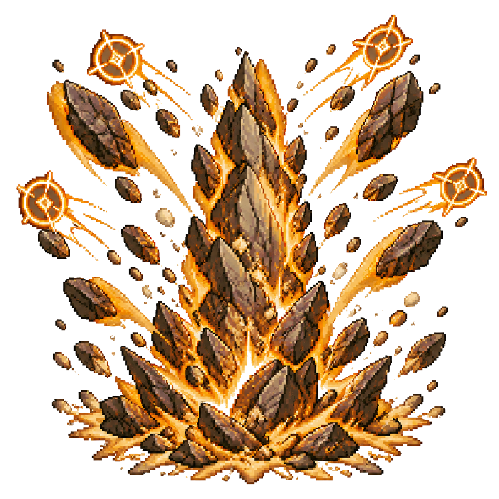

# 巫师牌卡池图鉴

规则 2.6.0 · 卡池 2.6.0 · 92 种正式卡牌 · 1 套 40+10 预设。

本页由正式定义生成。规则见 [Alpha v2.6.0](releases/2.6.0.md)，卡面召唤条件由正式字段生成，效果以正式规则为准。

编号前两位：01 阵法、02 解析、03 言灵、04 咒符、05 符文；后四位为该类序号。稳定内容 ID 用于存档和资源关联。

| 编号 | 卡名 | 类型 |
|---|---|---|
| 010001 | [正十字](#v260-formation-0001) | 阵法 |
| 010002 | [逆十字](#v260-formation-0002) | 阵法 |
| 010003 | [安卡十字](#v260-formation-0003) | 阵法 |
| 010004 | [恩格亚斯之星](#v260-formation-0004) | 阵法 |
| 010005 | [元素之环](#v260-formation-0005) | 阵法 |
| 010006 | [混沌之环](#v260-formation-0006) | 阵法 |
| 010007 | [阿克乌姆之弧](#v260-formation-0007) | 阵法 |
| 010008 | [硫磺](#v260-formation-0008) | 阵法 |
| 010009 | [基础法阵](#v260-formation-0009) | 阵法 |
| 010010 | [标准法阵](#v260-formation-0010) | 阵法 |
| 010011 | [强化法阵](#v260-formation-0011) | 阵法 |
| 010012 | [复合法阵](#v260-formation-0012) | 阵法 |
| 010013 | [增幅法阵](#v260-formation-0013) | 阵法 |
| 010014 | [守护法阵](#v260-formation-0014) | 阵法 |
| 010015 | [幻象法阵](#v260-formation-0015) | 阵法 |
| 010016 | [高阶法阵](#v260-formation-0016) | 阵法 |
| 010017 | [完美法阵](#v260-formation-0017) | 阵法 |
| 020001 | [火球术](#v260-analytic-0001) | 解析法术 |
| 020002 | [寒霜射线](#v260-analytic-0002) | 解析法术 |
| 020003 | [闪电束](#v260-analytic-0003) | 解析法术 |
| 020004 | [魔法飞弹](#v260-analytic-0004) | 解析法术 |
| 020005 | [繁彩球](#v260-analytic-0005) | 解析法术 |
| 020006 | [曳光弹](#v260-analytic-0006) | 解析法术 |
| 020007 | [炽热射线](#v260-analytic-0007) | 解析法术 |
| 020008 | [炽燃结界](#v260-analytic-0008) | 解析法术 |
| 020009 | [阳炎爆](#v260-analytic-0009) | 解析法术 |
| 020010 | [燃烧之手](#v260-analytic-0010) | 解析法术 |
| 020011 | [云雾术](#v260-analytic-0011) | 解析法术 |
| 020012 | [召雷术](#v260-analytic-0012) | 解析法术 |
| 020013 | [匕首之云](#v260-analytic-0013) | 解析法术 |
| 020014 | [臭云术](#v260-analytic-0014) | 解析法术 |
| 020015 | [油腻术](#v260-analytic-0015) | 解析法术 |
| 020016 | [次级复原](#v260-analytic-0016) | 解析法术 |
| 020017 | [吸收元素](#v260-analytic-0017) | 解析法术 |
| 020018 | [枯萎术](#v260-analytic-0018) | 解析法术 |
| 020019 | [缝合生命](#v260-analytic-0019) | 解析法术 |
| 020020 | [虚假生命](#v260-analytic-0020) | 解析法术 |
| 020021 | [治疗之环](#v260-analytic-0021) | 解析法术 |
| 020022 | [致病射线](#v260-analytic-0022) | 解析法术 |
| 020023 | [防死结界](#v260-analytic-0023) | 解析法术 |
| 020024 | [汲血之触](#v260-analytic-0024) | 解析法术 |
| 020025 | [沉默术](#v260-analytic-0025) | 解析法术 |
| 020026 | [朦胧术](#v260-analytic-0026) | 解析法术 |
| 020027 | [恐惧术](#v260-analytic-0027) | 解析法术 |
| 020028 | [精神监狱](#v260-analytic-0028) | 解析法术 |
| 020029 | [紊乱波动](#v260-analytic-0029) | 解析法术 |
| 020030 | [昏昏欲睡](#v260-analytic-0030) | 解析法术 |
| 020031 | [疯狂冠冕](#v260-analytic-0031) | 解析法术 |
| 020032 | [祝福术](#v260-analytic-0032) | 解析法术 |
| 020033 | [灾祸术](#v260-analytic-0033) | 解析法术 |
| 020034 | [心灵尖刺](#v260-analytic-0034) | 解析法术 |
| 020035 | [地震术](#v260-analytic-0035) | 解析法术 |
| 020036 | [碎环术](#v260-analytic-0036) | 解析法术 |
| 020037 | [土石喷发](#v260-analytic-0037) | 解析法术 |
| 020038 | [弹射术](#v260-analytic-0038) | 解析法术 |
| 020039 | [加速术](#v260-analytic-0039) | 解析法术 |
| 030001 | [火花术](#v260-word-0001) | 言灵法术 |
| 030002 | [魔能爆](#v260-word-0002) | 言灵法术 |
| 030003 | [魔力扰动](#v260-word-0003) | 言灵法术 |
| 030004 | [法师之手](#v260-word-0004) | 言灵法术 |
| 030005 | [瞬发回路过载](#v260-word-0005) | 言灵法术 |
| 030006 | [奥术复苏](#v260-word-0006) | 言灵法术 |
| 030007 | [支援术](#v260-word-0007) | 言灵法术 |
| 030008 | [心如止水](#v260-word-0008) | 言灵法术 |
| 030009 | [扰神曲](#v260-word-0009) | 言灵法术 |
| 030010 | [降咒](#v260-word-0010) | 言灵法术 |
| 030011 | [七彩喷射](#v260-word-0011) | 言灵法术 |
| 030012 | [幽影刃](#v260-word-0012) | 言灵法术 |
| 030013 | [不谐低语](#v260-word-0013) | 言灵法术 |
| 030014 | [脆弱诅咒](#v260-word-0014) | 言灵法术 |
| 030015 | [命令术](#v260-word-0015) | 言灵法术 |
| 030016 | [恶言相加](#v260-word-0016) | 言灵法术 |
| 030017 | [克敌机先](#v260-word-0017) | 言灵法术 |
| 030018 | [奥术回想](#v260-word-0018) | 言灵法术 |
| 030019 | [异界探知](#v260-word-0019) | 言灵法术 |
| 030020 | [卜筮术](#v260-word-0020) | 言灵法术 |
| 030021 | [强化属性](#v260-word-0021) | 言灵法术 |
| 040001 | [炼狱叱喝](#v260-talisman-0001) | 咒符法术 |
| 040002 | [捕获打击](#v260-talisman-0002) | 咒符法术 |
| 040003 | [护盾术](#v260-talisman-0003) | 咒符法术 |
| 040004 | [法术反制](#v260-talisman-0004) | 咒符法术 |
| 040005 | [避火咒](#v260-talisman-0005) | 咒符法术 |
| 040006 | [解除魔法](#v260-talisman-0006) | 咒符法术 |
| 040007 | [死佑护甲](#v260-talisman-0007) | 咒符法术 |
| 040008 | [步履维艰](#v260-talisman-0008) | 咒符法术 |
| 040009 | [银光锐语](#v260-talisman-0009) | 咒符法术 |
| 040010 | [滑稽魔盒](#v260-talisman-0010) | 咒符法术 |
| 040011 | [侦测善恶](#v260-talisman-0011) | 咒符法术 |
| 040012 | [荆棘丛生](#v260-talisman-0012) | 咒符法术 |
| 050001 | [逆三角星符](#v260-seal-0001) | 符文 |
| 050002 | [奥术圆环](#v260-seal-0002) | 符文 |
| 050003 | [昂扬](#v260-seal-0003) | 符文 |

## 010001 · 正十字

| 属性 | 数值 |
|---|---|
| 编号 | 010001 |
| 类型 | 阵法 |
| 等级 | 3 |
| 阵体 | 2 |
| 荷载上限 | 5 |
| 魔素收入 | 2 |
| 环位 | 2 |
| 承载位阶 | 0 |
| 召唤条件 | 解析区死灵派系法术卡×1＋魔素×1 |

己方结束阶段开始时，恢复1点生命值。

内容 ID：`v260-formation-0001`。

## 010002 · 逆十字

| 属性 | 数值 |
|---|---|
| 编号 | 010002 |
| 类型 | 阵法 |
| 等级 | 3 |
| 阵体 | 2 |
| 荷载上限 | 5 |
| 魔素收入 | 2 |
| 环位 | 2 |
| 承载位阶 | 0 |
| 召唤条件 | 解析区死灵派系法术卡×1＋魔素×1 |

己方结束阶段开始时，失去1点生命值，获得3点临时生命值。

内容 ID：`v260-formation-0002`。

## 010003 · 安卡十字

| 属性 | 数值 |
|---|---|
| 编号 | 010003 |
| 类型 | 阵法 |
| 等级 | 3 |
| 阵体 | 2 |
| 荷载上限 | 5 |
| 魔素收入 | 1 |
| 环位 | 1 |
| 承载位阶 | 0 |
| 召唤条件 | 解析区死灵派系法术卡×1 |

此阵法卡离场时才能发动。此阵法卡抹除。那之后，可以将1张阵法卡从己方灰烬区返回副卡组。

内容 ID：`v260-formation-0003`。

## 010004 · 恩格亚斯之星

| 属性 | 数值 |
|---|---|
| 编号 | 010004 |
| 类型 | 阵法 |
| 等级 | 2 |
| 阵体 | 1 |
| 荷载上限 | 2 |
| 魔素收入 | 2 |
| 环位 | 1 |
| 承载位阶 | 0 |
| 召唤条件 | 解析完成的法术卡×1+魔素×3 |

1回合1次，此阵法卡上设置的解析法术卡的解析时间-1。

内容 ID：`v260-formation-0004`。

## 010005 · 元素之环

| 属性 | 数值 |
|---|---|
| 编号 | 010005 |
| 类型 | 阵法 |
| 等级 | 3 |
| 阵体 | 2 |
| 荷载上限 | 8 |
| 魔素收入 | 1 |
| 环位 | 2 |
| 承载位阶 | 0 |
| 召唤条件 | 解析完成的塑能派系法术卡×1＋魔素×1 |

此阵法卡上设置的塑能法术卡造成的伤害+1。

内容 ID：`v260-formation-0005`。

## 010006 · 混沌之环

| 属性 | 数值 |
|---|---|
| 编号 | 010006 |
| 类型 | 阵法 |
| 等级 | 3 |
| 阵体 | 2 |
| 荷载上限 | 12 |
| 魔素收入 | 1 |
| 环位 | 5 |
| 承载位阶 | 0 |
| 召唤条件 | 解析完成的不同派系法术卡×2 |

此阵法卡上不可同时设置相同派系的法术卡。

内容 ID：`v260-formation-0006`。

## 010007 · 阿克乌姆之弧

| 属性 | 数值 |
|---|---|
| 编号 | 010007 |
| 类型 | 阵法 |
| 等级 | 0 |
| 阵体 | 1 |
| 荷载上限 | 15 |
| 魔素收入 | 0 |
| 环位 | 0 |
| 承载位阶 | 0 |
| 召唤条件 | 手卡×2 |

己方场上阵法卡被销毁时，可以将此阵法送去灰烬区作为替代。

内容 ID：`v260-formation-0007`。

## 010008 · 硫磺

| 属性 | 数值 |
|---|---|
| 编号 | 010008 |
| 类型 | 阵法 |
| 等级 | 6 |
| 阵体 | 2 |
| 荷载上限 | 6 |
| 魔素收入 | 3 |
| 环位 | 6 |
| 承载位阶 | 0 |
| 召唤条件 | 解析完成的火焰伤害法术卡×2 |

此阵法卡上仅可设置火焰伤害法术卡。己方每有1张法术卡从施法区进入灰烬区，对对方造成2点火焰伤害。

内容 ID：`v260-formation-0008`。

## 010009 · 基础法阵

| 属性 | 数值 |
|---|---|
| 编号 | 010009 |
| 类型 | 阵法 |
| 等级 | 1 |
| 阵体 | 1 |
| 荷载上限 | 5 |
| 魔素收入 | 1 |
| 环位 | 1 |
| 承载位阶 | 0 |
| 召唤条件 | 手卡×1 |

无效果。

内容 ID：`v260-formation-0009`。

## 010010 · 标准法阵

| 属性 | 数值 |
|---|---|
| 编号 | 010010 |
| 类型 | 阵法 |
| 等级 | 2 |
| 阵体 | 2 |
| 荷载上限 | 8 |
| 魔素收入 | 2 |
| 环位 | 2 |
| 承载位阶 | 0 |
| 召唤条件 | 【基础法阵】+魔素×2 |

无效果。

内容 ID：`v260-formation-0010`。

## 010011 · 强化法阵

| 属性 | 数值 |
|---|---|
| 编号 | 010011 |
| 类型 | 阵法 |
| 等级 | 3 |
| 阵体 | 2 |
| 荷载上限 | 10 |
| 魔素收入 | 3 |
| 环位 | 3 |
| 承载位阶 | 0 |
| 召唤条件 | 【标准法阵】+解析区法术卡×1 |

无效果。

内容 ID：`v260-formation-0011`。

## 010012 · 复合法阵

| 属性 | 数值 |
|---|---|
| 编号 | 010012 |
| 类型 | 阵法 |
| 等级 | 4 |
| 阵体 | 2 |
| 荷载上限 | 10 |
| 魔素收入 | 4 |
| 环位 | 3 |
| 承载位阶 | 0 |
| 召唤条件 | 【基础法阵】+【标准法阵】 |

无效果。

内容 ID：`v260-formation-0012`。

## 010013 · 增幅法阵

| 属性 | 数值 |
|---|---|
| 编号 | 010013 |
| 类型 | 阵法 |
| 等级 | 5 |
| 阵体 | 3 |
| 荷载上限 | 15 |
| 魔素收入 | 5 |
| 环位 | 5 |
| 承载位阶 | 0 |
| 召唤条件 | 【复合法阵】+解析区塑能/咒法派系法术卡×1 |

无效果。

内容 ID：`v260-formation-0013`。

## 010014 · 守护法阵

| 属性 | 数值 |
|---|---|
| 编号 | 010014 |
| 类型 | 阵法 |
| 等级 | 5 |
| 阵体 | 3 |
| 荷载上限 | 15 |
| 魔素收入 | 5 |
| 环位 | 5 |
| 承载位阶 | 0 |
| 召唤条件 | 【基础法阵】+【强化法阵】+解析区防护/死灵派系法术卡×1 |

无效果。

内容 ID：`v260-formation-0014`。

## 010015 · 幻象法阵

| 属性 | 数值 |
|---|---|
| 编号 | 010015 |
| 类型 | 阵法 |
| 等级 | 5 |
| 阵体 | 3 |
| 荷载上限 | 15 |
| 魔素收入 | 5 |
| 环位 | 5 |
| 承载位阶 | 0 |
| 召唤条件 | 【基础法阵】+【强化法阵】+解析区幻术/惑控派系法术卡×1 |

无效果。

内容 ID：`v260-formation-0015`。

## 010016 · 高阶法阵

| 属性 | 数值 |
|---|---|
| 编号 | 010016 |
| 类型 | 阵法 |
| 等级 | 6 |
| 阵体 | 3 |
| 荷载上限 | 18 |
| 魔素收入 | 6 |
| 环位 | 6 |
| 承载位阶 | 0 |
| 召唤条件 | 【增幅法阵】或【守护法阵】或【幻象法阵】+解析完成的法术卡×1+魔素×3 |

无效果。

内容 ID：`v260-formation-0016`。

## 010017 · 完美法阵

| 属性 | 数值 |
|---|---|
| 编号 | 010017 |
| 类型 | 阵法 |
| 等级 | 7 |
| 阵体 | 4 |
| 荷载上限 | 21 |
| 魔素收入 | 7 |
| 环位 | 7 |
| 承载位阶 | 0 |
| 召唤条件 | 【高阶法阵】+解析完成的法术卡×2+魔素×5 |

无效果。

内容 ID：`v260-formation-0017`。

## 020001 · 火球术

| 属性 | 数值 |
|---|---|
| 编号 | 020001 |
| 类型 | 解析法术 |
| 学派 | 塑能 |
| 位阶 | 3 |
| 速度 | 1 |
| 设置费用 | 3 |
| 施法费用 | 1 |
| 解析回合 | 1 |
| 持续方式 | 通常 |

选择1个目标才能发动。对其造成7点火焰伤害。

内容 ID：`v260-analytic-0001`。

## 020002 · 寒霜射线

| 属性 | 数值 |
|---|---|
| 编号 | 020002 |
| 类型 | 解析法术 |
| 学派 | 塑能 |
| 位阶 | 2 |
| 速度 | 1 |
| 设置费用 | 2 |
| 施法费用 | 1 |
| 解析回合 | 1 |
| 持续方式 | 通常 |

选择1个目标才能发动。对其造成5点寒冷伤害。那之后，可以使对方解析区1张解析法术卡的解析时间+1。

内容 ID：`v260-analytic-0002`。

## 020003 · 闪电束

| 属性 | 数值 |
|---|---|
| 编号 | 020003 |
| 类型 | 解析法术 |
| 学派 | 塑能 |
| 位阶 | 4 |
| 速度 | 1 |
| 设置费用 | 3 |
| 施法费用 | 2 |
| 解析回合 | 1 |
| 持续方式 | 通常 |

选择1个目标才能发动。对其造成8点闪电伤害。那之后，可以销毁对方解析区1张解析法术卡。

内容 ID：`v260-analytic-0003`。

## 020004 · 魔法飞弹

| 属性 | 数值 |
|---|---|
| 编号 | 020004 |
| 类型 | 解析法术 |
| 学派 | 塑能 |
| 位阶 | 2 |
| 速度 | 2 |
| 设置费用 | 2 |
| 施法费用 | 2 |
| 解析回合 | 1 |
| 持续方式 | 通常 |

选择1个目标才能发动。对其造成4点力场伤害。那之后，可以销毁对方解析区1张盖伏卡。

内容 ID：`v260-analytic-0004`。

## 020005 · 繁彩球

| 属性 | 数值 |
|---|---|
| 编号 | 020005 |
| 类型 | 解析法术 |
| 学派 | 塑能 |
| 位阶 | 2 |
| 速度 | 1 |
| 设置费用 | 2 |
| 施法费用 | 2 |
| 解析回合 | 1 |
| 持续方式 | 通常 |

选择1个目标才能发动。对其造成7点自选伤害，伤害类型从强酸/寒冷/火焰/闪电/毒素/雷鸣中选择。

内容 ID：`v260-analytic-0005`。

## 020006 · 曳光弹

| 属性 | 数值 |
|---|---|
| 编号 | 020006 |
| 类型 | 解析法术 |
| 学派 | 塑能 |
| 位阶 | 2 |
| 速度 | 1 |
| 设置费用 | 2 |
| 施法费用 | 1 |
| 解析回合 | 1 |
| 持续方式 | 通常 |

选择1个目标才能发动。对其造成5点光耀伤害。那之后，可以查看对方解析区1张盖伏卡。

内容 ID：`v260-analytic-0006`。

## 020007 · 炽热射线

| 属性 | 数值 |
|---|---|
| 编号 | 020007 |
| 类型 | 解析法术 |
| 学派 | 塑能 |
| 位阶 | 5 |
| 速度 | 1 |
| 设置费用 | 4 |
| 施法费用 | 2 |
| 解析回合 | 2 |
| 持续方式 | 通常 |

选择1个目标才能发动。对其造成4点火焰伤害。重复3次，每次可以选择不同目标。

内容 ID：`v260-analytic-0007`。

## 020008 · 炽燃结界

| 属性 | 数值 |
|---|---|
| 编号 | 020008 |
| 类型 | 解析法术 |
| 学派 | 塑能 |
| 位阶 | 3 |
| 速度 | 1 |
| 设置费用 | 2 |
| 施法费用 | 0 |
| 解析回合 | 1 |
| 持续方式 | 专注 |

专注2。发动时，对对方造成4点火焰伤害。维持专注时，对对方造成3点火焰伤害。

内容 ID：`v260-analytic-0008`。

## 020009 · 阳炎爆

| 属性 | 数值 |
|---|---|
| 编号 | 020009 |
| 类型 | 解析法术 |
| 学派 | 塑能 |
| 位阶 | 6 |
| 速度 | 3 |
| 设置费用 | 20 |
| 施法费用 | 2 |
| 解析回合 | 2 |
| 持续方式 | 通常 |

对对方造成15点火焰伤害。那之后，可以销毁对方1张阵法卡上的全部法术卡。己方灰烬区每存在1张塑能派系法术卡，此法术卡的设置费用-1。

内容 ID：`v260-analytic-0009`。

## 020010 · 燃烧之手

| 属性 | 数值 |
|---|---|
| 编号 | 020010 |
| 类型 | 解析法术 |
| 学派 | 塑能 |
| 位阶 | 4 |
| 速度 | 1 |
| 设置费用 | 3 |
| 施法费用 | 3 |
| 解析回合 | 1 |
| 持续方式 | 通常 |

对对方以及对方场上全部目标各造成6点火焰伤害。

内容 ID：`v260-analytic-0010`。

## 020011 · 云雾术

| 属性 | 数值 |
|---|---|
| 编号 | 020011 |
| 类型 | 解析法术 |
| 学派 | 咒法 |
| 位阶 | 2 |
| 速度 | 1 |
| 设置费用 | 2 |
| 施法费用 | 3 |
| 解析回合 | 1 |
| 持续方式 | 计时 2 |

计时2。选择双方解析区共1至2张解析法术卡，使其直到此法术卡离场不可准备施法。

内容 ID：`v260-analytic-0011`。

## 020012 · 召雷术

| 属性 | 数值 |
|---|---|
| 编号 | 020012 |
| 类型 | 解析法术 |
| 学派 | 咒法 |
| 位阶 | 4 |
| 速度 | 1 |
| 设置费用 | 3 |
| 施法费用 | 2 |
| 解析回合 | 1 |
| 持续方式 | 通常 |

选择1个目标才能发动。对其造成9点雷鸣伤害。那之后，使对方获得5点独立荷载，对方结束阶段开始时清除。

内容 ID：`v260-analytic-0012`。

## 020013 · 匕首之云

| 属性 | 数值 |
|---|---|
| 编号 | 020013 |
| 类型 | 解析法术 |
| 学派 | 咒法 |
| 位阶 | 3 |
| 速度 | 1 |
| 设置费用 | 2 |
| 施法费用 | 2 |
| 解析回合 | 1 |
| 持续方式 | 专注 |

专注1。发动时，对对方造成5点挥砍伤害。维持专注时，对对方造成2点挥砍伤害。

内容 ID：`v260-analytic-0013`。

## 020014 · 臭云术

| 属性 | 数值 |
|---|---|
| 编号 | 020014 |
| 类型 | 解析法术 |
| 学派 | 咒法 |
| 位阶 | 3 |
| 速度 | 1 |
| 设置费用 | 3 |
| 施法费用 | 0 |
| 解析回合 | 1 |
| 持续方式 | 专注 |

专注1。双方准备阶段开始时，双方各受到1点毒素伤害。

内容 ID：`v260-analytic-0014`。

## 020015 · 油腻术

| 属性 | 数值 |
|---|---|
| 编号 | 020015 |
| 类型 | 解析法术 |
| 学派 | 咒法 |
| 位阶 | 3 |
| 速度 | 2 |
| 设置费用 | 3 |
| 施法费用 | 1 |
| 解析回合 | 1 |
| 持续方式 | 通常 |

选择对方场上1张阵法卡才能发动。直到下个己方准备阶段开始时，此阵法卡的环位减半。

内容 ID：`v260-analytic-0015`。

## 020016 · 次级复原

| 属性 | 数值 |
|---|---|
| 编号 | 020016 |
| 类型 | 解析法术 |
| 学派 | 防护 |
| 位阶 | 2 |
| 速度 | 1 |
| 设置费用 | 2 |
| 施法费用 | 2 |
| 解析回合 | 1 |
| 持续方式 | 通常 |

选择1个目标才能发动。为其恢复2点生命值。那之后，清除己方6点荷载。

内容 ID：`v260-analytic-0016`。

## 020017 · 吸收元素

| 属性 | 数值 |
|---|---|
| 编号 | 020017 |
| 类型 | 解析法术 |
| 学派 | 防护 |
| 位阶 | 4 |
| 速度 | 1 |
| 设置费用 | 3 |
| 施法费用 | 2 |
| 解析回合 | 1 |
| 持续方式 | 专注 |

专注1。己方每受到1次强酸/寒冷/火焰/闪电/毒素/雷鸣伤害，获得1点魔素。

内容 ID：`v260-analytic-0017`。

## 020018 · 枯萎术

| 属性 | 数值 |
|---|---|
| 编号 | 020018 |
| 类型 | 解析法术 |
| 学派 | 死灵 |
| 位阶 | 4 |
| 速度 | 1 |
| 设置费用 | 3 |
| 施法费用 | 1 |
| 解析回合 | 1 |
| 持续方式 | 通常 |

选择1个目标才能发动。对其造成8点暗蚀伤害。

内容 ID：`v260-analytic-0018`。

## 020019 · 缝合生命

| 属性 | 数值 |
|---|---|
| 编号 | 020019 |
| 类型 | 解析法术 |
| 学派 | 死灵 |
| 位阶 | 3 |
| 速度 | 1 |
| 设置费用 | 2 |
| 施法费用 | 1 |
| 解析回合 | 1 |
| 持续方式 | 通常 |

选择1个目标才能发动。为其恢复6点生命值。

内容 ID：`v260-analytic-0019`。

## 020020 · 虚假生命

| 属性 | 数值 |
|---|---|
| 编号 | 020020 |
| 类型 | 解析法术 |
| 学派 | 死灵 |
| 位阶 | 3 |
| 速度 | 2 |
| 设置费用 | 2 |
| 施法费用 | 1 |
| 解析回合 | 1 |
| 持续方式 | 通常 |

获得6点临时生命值。

内容 ID：`v260-analytic-0020`。

## 020021 · 治疗之环

| 属性 | 数值 |
|---|---|
| 编号 | 020021 |
| 类型 | 解析法术 |
| 学派 | 死灵 |
| 位阶 | 2 |
| 速度 | 1 |
| 设置费用 | 3 |
| 施法费用 | 0 |
| 解析回合 | 2 |
| 持续方式 | 计时 4 |

计时4。己方结束阶段开始时，恢复2点生命值。

内容 ID：`v260-analytic-0021`。

## 020022 · 致病射线

| 属性 | 数值 |
|---|---|
| 编号 | 020022 |
| 类型 | 解析法术 |
| 学派 | 死灵 |
| 位阶 | 2 |
| 速度 | 2 |
| 设置费用 | 2 |
| 施法费用 | 1 |
| 解析回合 | 1 |
| 持续方式 | 通常 |

选择1个目标才能发动。对其造成4点毒素伤害。那之后，直到下个己方抽卡阶段开始时，对方每设置1张法术卡，使对方受到1点毒素伤害。

内容 ID：`v260-analytic-0022`。

## 020023 · 防死结界

| 属性 | 数值 |
|---|---|
| 编号 | 020023 |
| 类型 | 解析法术 |
| 学派 | 死灵 |
| 位阶 | 7 |
| 速度 | 1 |
| 设置费用 | 7 |
| 施法费用 | 7 |
| 解析回合 | 1 |
| 持续方式 | 永续 |

永续。此卡在己方解析区仅可存在1张。当己方生命值归零时，可以将此法术卡抹除作为替代。那之后，己方生命值变为1。

内容 ID：`v260-analytic-0023`。

## 020024 · 汲血之触

| 属性 | 数值 |
|---|---|
| 编号 | 020024 |
| 类型 | 解析法术 |
| 学派 | 死灵 |
| 位阶 | 3 |
| 速度 | 1 |
| 设置费用 | 2 |
| 施法费用 | 2 |
| 解析回合 | 0 |
| 持续方式 | 通常 |

选择1个目标才能发动。对其造成5点暗蚀伤害，己方恢复2点生命值。

内容 ID：`v260-analytic-0024`。

## 020025 · 沉默术

| 属性 | 数值 |
|---|---|
| 编号 | 020025 |
| 类型 | 解析法术 |
| 学派 | 幻术 |
| 位阶 | 4 |
| 速度 | 1 |
| 设置费用 | 3 |
| 施法费用 | 1 |
| 解析回合 | 1 |
| 持续方式 | 通常 |

直到下个己方抽卡阶段开始时，双方言灵法术不可发动。

内容 ID：`v260-analytic-0025`。

## 020026 · 朦胧术

| 属性 | 数值 |
|---|---|
| 编号 | 020026 |
| 类型 | 解析法术 |
| 学派 | 幻术 |
| 位阶 | 5 |
| 速度 | 2 |
| 设置费用 | 3 |
| 施法费用 | 2 |
| 解析回合 | 1 |
| 持续方式 | 通常 |

选择1个伤害类型才能发动。直到下个己方准备阶段开始时，己方受到的此类型伤害减半。

内容 ID：`v260-analytic-0026`。

## 020027 · 恐惧术

| 属性 | 数值 |
|---|---|
| 编号 | 020027 |
| 类型 | 解析法术 |
| 学派 | 幻术 |
| 位阶 | 5 |
| 速度 | 1 |
| 设置费用 | 4 |
| 施法费用 | 2 |
| 解析回合 | 1 |
| 持续方式 | 专注 |

专注4。对方不可选择己方为法术卡的目标。

内容 ID：`v260-analytic-0027`。

## 020028 · 精神监狱

| 属性 | 数值 |
|---|---|
| 编号 | 020028 |
| 类型 | 解析法术 |
| 学派 | 幻术 |
| 位阶 | 6 |
| 速度 | 1 |
| 设置费用 | 5 |
| 施法费用 | 5 |
| 解析回合 | 1 |
| 持续方式 | 专注 |

专注6。对方结束阶段开始时，对方必须将1张卡从手卡送去灰烬区，否则使对方受到10点心灵伤害。

内容 ID：`v260-analytic-0028`。

## 020029 · 紊乱波动

| 属性 | 数值 |
|---|---|
| 编号 | 020029 |
| 类型 | 解析法术 |
| 学派 | 惑控 |
| 位阶 | 4 |
| 速度 | 1 |
| 设置费用 | 4 |
| 施法费用 | 4 |
| 解析回合 | 2 |
| 持续方式 | 计时 3 |

计时3。对方每发动1张法术卡，使对方获得4点临时荷载。

内容 ID：`v260-analytic-0029`。

## 020030 · 昏昏欲睡

| 属性 | 数值 |
|---|---|
| 编号 | 020030 |
| 类型 | 解析法术 |
| 学派 | 惑控 |
| 位阶 | 4 |
| 速度 | 1 |
| 设置费用 | 3 |
| 施法费用 | 1 |
| 解析回合 | 1 |
| 持续方式 | 通常 |

直到下个己方抽卡阶段开始时，双方解析法术不可发动。

内容 ID：`v260-analytic-0030`。

## 020031 · 疯狂冠冕

| 属性 | 数值 |
|---|---|
| 编号 | 020031 |
| 类型 | 解析法术 |
| 学派 | 惑控 |
| 位阶 | 2 |
| 速度 | 1 |
| 设置费用 | 2 |
| 施法费用 | 1 |
| 解析回合 | 1 |
| 持续方式 | 专注 |

专注2。对方每对己方造成1次伤害，使对方受到2点心灵伤害。

内容 ID：`v260-analytic-0031`。

## 020032 · 祝福术

| 属性 | 数值 |
|---|---|
| 编号 | 020032 |
| 类型 | 解析法术 |
| 学派 | 惑控 |
| 位阶 | 4 |
| 速度 | 1 |
| 设置费用 | 3 |
| 施法费用 | 1 |
| 解析回合 | 1 |
| 持续方式 | 计时 3 |

计时3。己方结束阶段开始时，选择以下1个效果适用：◎恢复2点生命值；◎清除2点荷载；◎获得1点魔素。

内容 ID：`v260-analytic-0032`。

## 020033 · 灾祸术

| 属性 | 数值 |
|---|---|
| 编号 | 020033 |
| 类型 | 解析法术 |
| 学派 | 惑控 |
| 位阶 | 4 |
| 速度 | 1 |
| 设置费用 | 4 |
| 施法费用 | 1 |
| 解析回合 | 1 |
| 持续方式 | 计时 3 |

计时3。己方结束阶段开始时，选择以下1个效果适用：◎对对方造成2点暗蚀伤害；◎使对方获得2点独立荷载，对方结束阶段清除；◎对方魔素-1。

内容 ID：`v260-analytic-0033`。

## 020034 · 心灵尖刺

| 属性 | 数值 |
|---|---|
| 编号 | 020034 |
| 类型 | 解析法术 |
| 学派 | 预言 |
| 位阶 | 5 |
| 速度 | 1 |
| 设置费用 | 3 |
| 施法费用 | 3 |
| 解析回合 | 1 |
| 持续方式 | 通常 |

选择1个目标才能发动。对其造成10点心灵伤害。那之后，可以查看对方解析区全部盖伏卡。

内容 ID：`v260-analytic-0034`。

## 020035 · 地震术

| 属性 | 数值 |
|---|---|
| 编号 | 020035 |
| 类型 | 解析法术 |
| 学派 | 变化 |
| 位阶 | 4 |
| 速度 | 1 |
| 设置费用 | 4 |
| 施法费用 | 0 |
| 解析回合 | 2 |
| 持续方式 | 计时 2 |

计时2。己方主要阶段开始时，将双方解析区盖伏卡全部送去灰烬区。

内容 ID：`v260-analytic-0035`。

## 020036 · 碎环术

| 属性 | 数值 |
|---|---|
| 编号 | 020036 |
| 类型 | 解析法术 |
| 学派 | 变化 |
| 位阶 | 5 |
| 速度 | 1 |
| 设置费用 | 3 |
| 施法费用 | 2 |
| 解析回合 | 1 |
| 持续方式 | 通常 |

选择对方场上1张空白阵法卡才能发动。将1张阵法卡从副卡组送去灰烬区，销毁那张空白阵法卡。

内容 ID：`v260-analytic-0036`。

## 020037 · 土石喷发

| 属性 | 数值 |
|---|---|
| 编号 | 020037 |
| 类型 | 解析法术 |
| 学派 | 变化 |
| 位阶 | 5 |
| 速度 | 1 |
| 设置费用 | 5 |
| 施法费用 | 3 |
| 解析回合 | 2 |
| 持续方式 | 通常 |

对对方以及对方场上全部目标各造成10点钝击伤害。那之后，直到己方下个准备阶段开始时，对方施法槽数量减半。

内容 ID：`v260-analytic-0037`。

## 020038 · 弹射术

| 属性 | 数值 |
|---|---|
| 编号 | 020038 |
| 类型 | 解析法术 |
| 学派 | 变化 |
| 位阶 | 3 |
| 速度 | 1 |
| 设置费用 | 4 |
| 施法费用 | 1 |
| 解析回合 | 1 |
| 持续方式 | 通常 |

将1张法术卡从己方解析区送去灰烬区，选择1个目标才能发动。对其造成10点钝击伤害。

内容 ID：`v260-analytic-0038`。

## 020039 · 加速术

| 属性 | 数值 |
|---|---|
| 编号 | 020039 |
| 类型 | 解析法术 |
| 学派 | 变化 |
| 位阶 | 6 |
| 速度 | 1 |
| 设置费用 | 6 |
| 施法费用 | 6 |
| 解析回合 | 1 |
| 持续方式 | 通常 |

获得1个额外的己方回合。那之后，直到下个回合结束阶段结束时，己方获得的荷载×2。

内容 ID：`v260-analytic-0039`。

## 030001 · 火花术

| 属性 | 数值 |
|---|---|
| 编号 | 030001 |
| 类型 | 言灵法术 |
| 学派 | 塑能 |
| 位阶 | 1 |
| 速度 | 2 |
| 施法费用 | 2 |
| 持续方式 | 通常 |

选择1个目标才能发动。对其造成3点火焰伤害。

内容 ID：`v260-word-0001`。

## 030002 · 魔能爆

| 属性 | 数值 |
|---|---|
| 编号 | 030002 |
| 类型 | 言灵法术 |
| 学派 | 塑能 |
| 位阶 | 1 |
| 速度 | 2 |
| 施法费用 | 2 |
| 持续方式 | 通常 |

选择1个目标才能发动，对其造成3点力场伤害。

内容 ID：`v260-word-0002`。

## 030003 · 魔力扰动

| 属性 | 数值 |
|---|---|
| 编号 | 030003 |
| 类型 | 言灵法术 |
| 学派 | 咒法 |
| 位阶 | 2 |
| 速度 | 2 |
| 施法费用 | 2 |
| 持续方式 | 通常 |

获得3点临时荷载，使对方获得6点临时荷载。

内容 ID：`v260-word-0003`。

## 030004 · 法师之手

| 属性 | 数值 |
|---|---|
| 编号 | 030004 |
| 类型 | 言灵法术 |
| 学派 | 咒法 |
| 位阶 | 5 |
| 速度 | 2 |
| 施法费用 | 3 |
| 持续方式 | 通常 |

选择对方解析区1张法术卡才能发动。将其移入己方解析区。己方准备阶段结束时，返回对方解析区。

内容 ID：`v260-word-0004`。

## 030005 · 瞬发回路过载

| 属性 | 数值 |
|---|---|
| 编号 | 030005 |
| 类型 | 言灵法术 |
| 学派 | 咒法 |
| 位阶 | 2 |
| 速度 | 2 |
| 施法费用 | 2 |
| 持续方式 | 通常 |

选择己方解析区1张解析法术卡才能发动。使其解析时间-2，获得其实际设置费用的临时荷载。

内容 ID：`v260-word-0005`。

## 030006 · 奥术复苏

| 属性 | 数值 |
|---|---|
| 编号 | 030006 |
| 类型 | 言灵法术 |
| 学派 | 防护 |
| 位阶 | 1 |
| 速度 | 2 |
| 施法费用 | 1 |
| 持续方式 | 通常 |

获得3点魔素和3点独立荷载。

内容 ID：`v260-word-0006`。

## 030007 · 支援术

| 属性 | 数值 |
|---|---|
| 编号 | 030007 |
| 类型 | 言灵法术 |
| 学派 | 防护 |
| 位阶 | 1 |
| 速度 | 2 |
| 施法费用 | 2 |
| 持续方式 | 通常 |

获得3点临时生命值。

内容 ID：`v260-word-0007`。

## 030008 · 心如止水

| 属性 | 数值 |
|---|---|
| 编号 | 030008 |
| 类型 | 言灵法术 |
| 学派 | 防护 |
| 位阶 | 2 |
| 速度 | 2 |
| 施法费用 | 2 |
| 持续方式 | 通常 |

将1张卡从手卡送去灰烬区才能发动。清除己方全部临时荷载。

内容 ID：`v260-word-0008`。

## 030009 · 扰神曲

| 属性 | 数值 |
|---|---|
| 编号 | 030009 |
| 类型 | 言灵法术 |
| 学派 | 防护 |
| 位阶 | 3 |
| 速度 | 3 |
| 施法费用 | 2 |
| 持续方式 | 通常 |

直到下个己方主要阶段开始时，双方不可维持专注。

内容 ID：`v260-word-0009`。

## 030010 · 降咒

| 属性 | 数值 |
|---|---|
| 编号 | 030010 |
| 类型 | 言灵法术 |
| 学派 | 死灵 |
| 位阶 | 3 |
| 速度 | 2 |
| 施法费用 | 3 |
| 持续方式 | 通常 |

直到下个己方抽卡阶段开始时，对方每发动1张言灵法术卡，使对方受到2点暗蚀伤害。

内容 ID：`v260-word-0010`。

## 030011 · 七彩喷射

| 属性 | 数值 |
|---|---|
| 编号 | 030011 |
| 类型 | 言灵法术 |
| 学派 | 幻术 |
| 位阶 | 4 |
| 速度 | 2 |
| 施法费用 | 5 |
| 持续方式 | 通常 |

选择1个目标才能发动。对其造成5点自选伤害，伤害类型从强酸/寒冷/火焰/闪电/毒素/雷鸣/光耀中选择。那之后，直到此回合结束阶段结束时，对方不可选择己方为法术卡的目标。

内容 ID：`v260-word-0011`。

## 030012 · 幽影刃

| 属性 | 数值 |
|---|---|
| 编号 | 030012 |
| 类型 | 言灵法术 |
| 学派 | 幻术 |
| 位阶 | 3 |
| 速度 | 2 |
| 施法费用 | 3 |
| 持续方式 | 通常 |

对对方造成5点心灵伤害。

内容 ID：`v260-word-0012`。

## 030013 · 不谐低语

| 属性 | 数值 |
|---|---|
| 编号 | 030013 |
| 类型 | 言灵法术 |
| 学派 | 惑控 |
| 位阶 | 2 |
| 速度 | 2 |
| 施法费用 | 2 |
| 持续方式 | 通常 |

选择1个目标才能发动。对其造成3点心灵伤害。那之后，可以将对方解析区1张盖伏卡弹回持有者手卡。

内容 ID：`v260-word-0013`。

## 030014 · 脆弱诅咒

| 属性 | 数值 |
|---|---|
| 编号 | 030014 |
| 类型 | 言灵法术 |
| 学派 | 惑控 |
| 位阶 | 6 |
| 速度 | 2 |
| 施法费用 | 6 |
| 持续方式 | 通常 |

此回合，对方受到的伤害+3。

内容 ID：`v260-word-0014`。

## 030015 · 命令术

| 属性 | 数值 |
|---|---|
| 编号 | 030015 |
| 类型 | 言灵法术 |
| 学派 | 惑控 |
| 位阶 | 4 |
| 速度 | 2 |
| 施法费用 | 5 |
| 持续方式 | 通常 |

选择以下1个效果对对方适用：◎将1张卡从卡组最上方送去灰烬区；◎将1张法术卡从解析区送去灰烬区；◎将1张卡从手卡送去灰烬区。

内容 ID：`v260-word-0015`。

## 030016 · 恶言相加

| 属性 | 数值 |
|---|---|
| 编号 | 030016 |
| 类型 | 言灵法术 |
| 学派 | 惑控 |
| 位阶 | 1 |
| 速度 | 2 |
| 施法费用 | 2 |
| 持续方式 | 通常 |

选择1个目标才能发动。对其造成3点心灵伤害。

内容 ID：`v260-word-0016`。

## 030017 · 克敌机先

| 属性 | 数值 |
|---|---|
| 编号 | 030017 |
| 类型 | 言灵法术 |
| 学派 | 预言 |
| 位阶 | 3 |
| 速度 | 2 |
| 施法费用 | 3 |
| 持续方式 | 通常 |

将1张法术卡从手卡送去灰烬区才能发动。将1张与那张卡同派系的法术卡从卡组加入手卡。

内容 ID：`v260-word-0017`。

## 030018 · 奥术回想

| 属性 | 数值 |
|---|---|
| 编号 | 030018 |
| 类型 | 言灵法术 |
| 学派 | 预言 |
| 位阶 | 1 |
| 速度 | 2 |
| 施法费用 | 3 |
| 持续方式 | 通常 |

抽2张卡，获得2点独立荷载。

内容 ID：`v260-word-0018`。

## 030019 · 异界探知

| 属性 | 数值 |
|---|---|
| 编号 | 030019 |
| 类型 | 言灵法术 |
| 学派 | 预言 |
| 位阶 | 3 |
| 速度 | 2 |
| 施法费用 | 2 |
| 持续方式 | 通常 |

将1张卡从手卡送去灰烬区才能发动。查看对方卡组最上方的3张卡，将其中1张送去灰烬区，其余卡返回卡组最下方。

内容 ID：`v260-word-0019`。

## 030020 · 卜筮术

| 属性 | 数值 |
|---|---|
| 编号 | 030020 |
| 类型 | 言灵法术 |
| 学派 | 预言 |
| 位阶 | 1 |
| 速度 | 2 |
| 施法费用 | 2 |
| 持续方式 | 通常 |

将1张卡从手卡送去灰烬区才能发动。查看己方卡组最上方的3张卡，将其中1张加入手卡，其余卡返回卡组最下方。

内容 ID：`v260-word-0020`。

## 030021 · 强化属性

| 属性 | 数值 |
|---|---|
| 编号 | 030021 |
| 类型 | 言灵法术 |
| 学派 | 变化 |
| 位阶 | 5 |
| 速度 | 2 |
| 施法费用 | 7 |
| 持续方式 | 通常 |

获得10点临时生命值。

内容 ID：`v260-word-0021`。

## 040001 · 炼狱叱喝

| 属性 | 数值 |
|---|---|
| 编号 | 040001 |
| 类型 | 咒符法术 |
| 学派 | 塑能 |
| 位阶 | 5 |
| 速度 | 3 |
| 盖伏费用 | 0 |
| 施法费用 | 0 |
| 持续方式 | 通常 |

己方受到伤害时才能发动。对对方造成等量火焰伤害。

内容 ID：`v260-talisman-0001`。

## 040002 · 捕获打击

| 属性 | 数值 |
|---|---|
| 编号 | 040002 |
| 类型 | 咒符法术 |
| 学派 | 咒法 |
| 位阶 | 4 |
| 速度 | 3 |
| 盖伏费用 | 0 |
| 施法费用 | 0 |
| 持续方式 | 通常 |

对方发动穿刺/挥砍/钝击伤害法术卡时才能发动。将其无效并盖伏在己方解析区。

内容 ID：`v260-talisman-0002`。

## 040003 · 护盾术

| 属性 | 数值 |
|---|---|
| 编号 | 040003 |
| 类型 | 咒符法术 |
| 学派 | 防护 |
| 位阶 | 4 |
| 速度 | 2 |
| 盖伏费用 | 0 |
| 施法费用 | 0 |
| 持续方式 | 通常 |

此回合，每次受到的伤害-3。若为力场伤害，则-6。

内容 ID：`v260-talisman-0003`。

## 040004 · 法术反制

| 属性 | 数值 |
|---|---|
| 编号 | 040004 |
| 类型 | 咒符法术 |
| 学派 | 防护 |
| 位阶 | 5 |
| 速度 | 4 |
| 盖伏费用 | 0 |
| 施法费用 | X |
| 持续方式 | 通常 |

对方发动法术卡时才能发动。将其无效并销毁。X为被连锁法术卡的实际设置和发动费用之和。

内容 ID：`v260-talisman-0004`。

## 040005 · 避火咒

| 属性 | 数值 |
|---|---|
| 编号 | 040005 |
| 类型 | 咒符法术 |
| 学派 | 防护 |
| 位阶 | 4 |
| 速度 | 2 |
| 盖伏费用 | 0 |
| 施法费用 | 0 |
| 持续方式 | 专注 |

专注2。受到的火焰伤害减半，此效果不可叠加。

内容 ID：`v260-talisman-0005`。

## 040006 · 解除魔法

| 属性 | 数值 |
|---|---|
| 编号 | 040006 |
| 类型 | 咒符法术 |
| 学派 | 防护 |
| 位阶 | 3 |
| 速度 | 2 |
| 盖伏费用 | 0 |
| 施法费用 | 0 |
| 持续方式 | 通常 |

对方设置法术卡时才能发动。将其无效并弹回持有者手卡。

内容 ID：`v260-talisman-0006`。

## 040007 · 死佑护甲

| 属性 | 数值 |
|---|---|
| 编号 | 040007 |
| 类型 | 咒符法术 |
| 学派 | 死灵 |
| 位阶 | 2 |
| 速度 | 2 |
| 盖伏费用 | 0 |
| 施法费用 | 0 |
| 持续方式 | 计时 3 |

计时3。己方每受到3点伤害，使对方受到1点暗蚀伤害。

内容 ID：`v260-talisman-0007`。

## 040008 · 步履维艰

| 属性 | 数值 |
|---|---|
| 编号 | 040008 |
| 类型 | 咒符法术 |
| 学派 | 幻术 |
| 位阶 | 2 |
| 速度 | 3 |
| 盖伏费用 | 0 |
| 施法费用 | 0 |
| 持续方式 | 通常 |

此回合，对方设置的全部解析法术卡的解析时间+1。

内容 ID：`v260-talisman-0008`。

## 040009 · 银光锐语

| 属性 | 数值 |
|---|---|
| 编号 | 040009 |
| 类型 | 咒符法术 |
| 学派 | 惑控 |
| 位阶 | 3 |
| 速度 | 3 |
| 盖伏费用 | 0 |
| 施法费用 | 0 |
| 持续方式 | 通常 |

对方准备施法时才能发动。将其取消。那之后，可以将对方解析区1张解析法术卡弹回持有者手卡。

内容 ID：`v260-talisman-0009`。

## 040010 · 滑稽魔盒

| 属性 | 数值 |
|---|---|
| 编号 | 040010 |
| 类型 | 咒符法术 |
| 学派 | 惑控 |
| 位阶 | 5 |
| 速度 | 3 |
| 盖伏费用 | 0 |
| 施法费用 | 0 |
| 持续方式 | 通常 |

选择对方灰烬区1张阶级5以下的解析法术卡才能发动。将其盖伏在己方解析区。

内容 ID：`v260-talisman-0010`。

## 040011 · 侦测善恶

| 属性 | 数值 |
|---|---|
| 编号 | 040011 |
| 类型 | 咒符法术 |
| 学派 | 预言 |
| 位阶 | 4 |
| 速度 | 4 |
| 盖伏费用 | 0 |
| 施法费用 | 0 |
| 持续方式 | 通常 |

查看对方解析区1张盖伏卡，若为解析/言灵法术卡，将其返回持有者卡组；若为咒符法术卡，则将其送去灰烬区。

内容 ID：`v260-talisman-0011`。

## 040012 · 荆棘丛生

| 属性 | 数值 |
|---|---|
| 编号 | 040012 |
| 类型 | 咒符法术 |
| 学派 | 变化 |
| 位阶 | 3 |
| 速度 | 2 |
| 盖伏费用 | 0 |
| 施法费用 | 0 |
| 持续方式 | 计时 2 |

计时2。对方每设置/盖伏1张法术卡，使对方受到2点穿刺伤害。

内容 ID：`v260-talisman-0012`。

## 050001 · 逆三角星符

| 属性 | 数值 |
|---|---|
| 编号 | 050001 |
| 类型 | 符文 |
| 附着费用 | 3 |

/

内容 ID：`v260-seal-0001`。

## 050002 · 奥术圆环

| 属性 | 数值 |
|---|---|
| 编号 | 050002 |
| 类型 | 符文 |
| 附着费用 | 2 |

/

内容 ID：`v260-seal-0002`。

## 050003 · 昂扬

| 属性 | 数值 |
|---|---|
| 编号 | 050003 |
| 类型 | 符文 |
| 附着费用 | 2 |

/

内容 ID：`v260-seal-0003`。

## 预设牌表

初始阵法来自副卡组；主卡组与副卡组分别限制同名最多三张。

### Alpha v2.6.0 入门

Alpha v2.6.0 正式卡池的 40+10 入门牌组。

初始阵法：基础法阵。

主卡组 · 40 张

| 卡牌 | 份数 |
|---|---|
| 火球术 | 3 |
| 寒霜射线 | 3 |
| 闪电束 | 3 |
| 魔法飞弹 | 3 |
| 繁彩球 | 3 |
| 曳光弹 | 3 |
| 炽热射线 | 3 |
| 炽燃结界 | 3 |
| 阳炎爆 | 3 |
| 燃烧之手 | 3 |
| 云雾术 | 3 |
| 召雷术 | 3 |
| 匕首之云 | 3 |
| 臭云术 | 1 |

副卡组 · 10 张

| 卡牌 | 份数 |
|---|---|
| 正十字 | 1 |
| 逆十字 | 1 |
| 安卡十字 | 1 |
| 恩格亚斯之星 | 1 |
| 元素之环 | 1 |
| 混沌之环 | 1 |
| 阿克乌姆之弧 | 1 |
| 硫磺 | 1 |
| 基础法阵 | 1 |
| 标准法阵 | 1 |

## 生成依据

运行 `python tools/generate_card_catalog.py` 更新。

规范化 JSON SHA256：`783070806f278fa09d890ce098a03b048f893f985769395911415373f303c8a8`。
