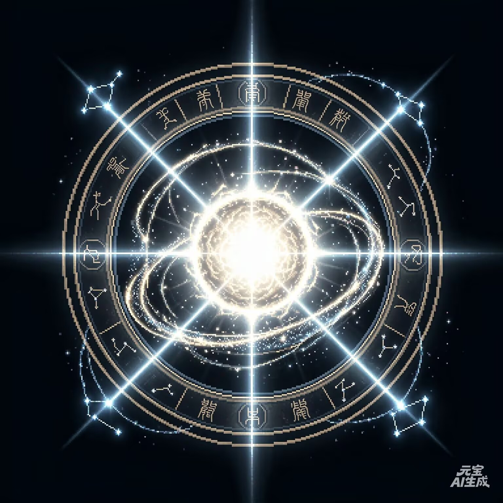
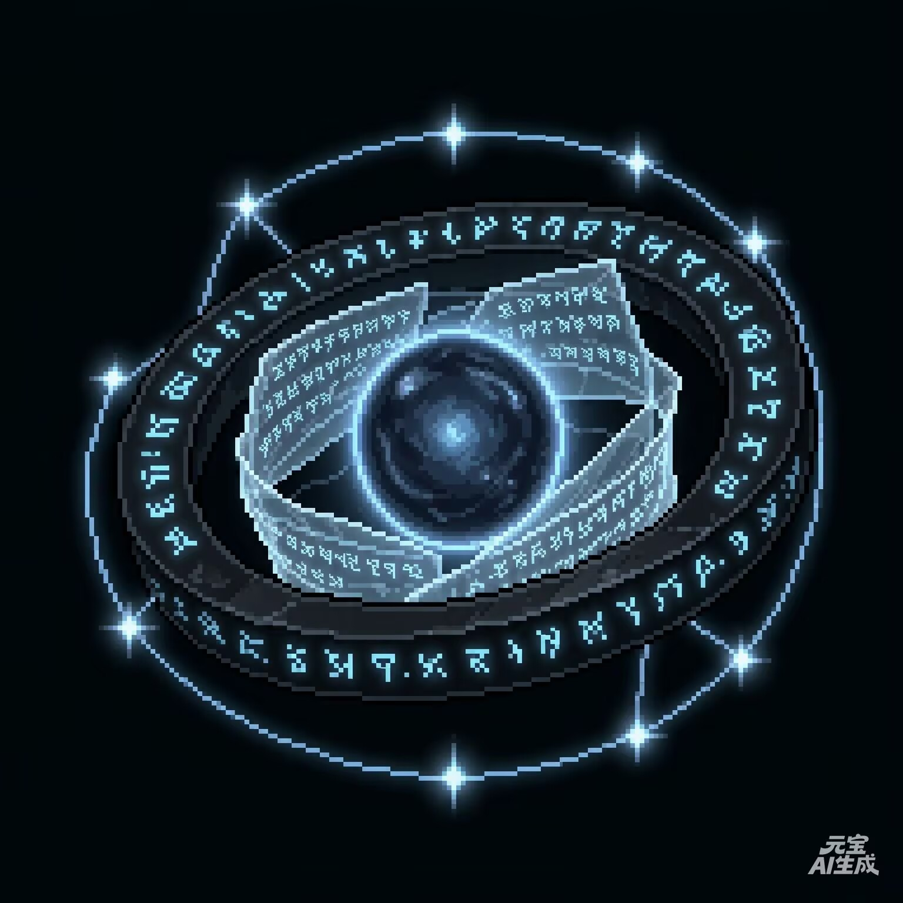

# 巫师牌卡池图鉴

规则 2.5.4 · 卡池 2.5.4 · 135 种正式卡牌 · 10 套 40+10 预设。

本页由正式定义生成。规则见 [Alpha v2.5](alpha-v2.5-rules.md)，卡面召唤条件由正式字段生成，效果以正式规则为准。

编号前两位：01 阵法、02 解析、03 言灵、04 咒符、05 符文；后四位为该类序号。稳定内容 ID 用于存档和资源关联。

| 编号 | 卡名 | 类型 |
|---|---|---|
| 010001 | [阿克乌姆之弧](#reservoir) | 阵法 |
| 010002 | [五芒星](#pentagram-of-life) | 阵法 |
| 010003 | [恩格亚斯之星](#engeas-four-point-star) | 阵法 |
| 010004 | [四芒星](#small-hexagram) | 阵法 |
| 010005 | [六芒星](#hexagram) | 阵法 |
| 010006 | [八芒星](#octagram) | 阵法 |
| 010007 | [太阳](#sun) | 阵法 |
| 010011 | [元素之环](#elemental-ring) | 阵法 |
| 010012 | [混沌之环](#chaos-ring) | 阵法 |
| 010013 | [硫磺](#sulfur) | 阵法 |
| 010014 | [风契·风暴纹章](#storm-crest) | 阵法 |
| 010015 | [风契·风暴之心](#storm-heart) | 阵法 |
| 010016 | [味契·柴堆](#sique-woodpile) | 阵法 |
| 010017 | [味契·篝火](#sique-campfire) | 阵法 |
| 010018 | [味契·魔力坩埚](#sique-cauldron) | 阵法 |
| 010019 | [三芒星](#three-star) | 阵法 |
| 010020 | [二芒星](#two-star) | 阵法 |
| 010021 | [月亮](#moon) | 阵法 |
| 010022 | [七星·天枢](#qixing-tianshu) | 阵法 |
| 010023 | [七星·天璇](#qixing-tianxuan) | 阵法 |
| 010024 | [七星·天玑](#qixing-tianji) | 阵法 |
| 010025 | [七星·天权](#qixing-tianquan) | 阵法 |
| 010026 | [七星·玉衡](#qixing-yuheng) | 阵法 |
| 010027 | [七星·开阳](#qixing-kaiyang) | 阵法 |
| 010028 | [七星·瑶光](#qixing-yaoguang) | 阵法 |
| 010029 | [血契·祭坛](#blood-altar) | 阵法 |
| 010030 | [血契·输血管](#blood-transfusion) | 阵法 |
| 010031 | [血契·祭品台](#blood-sacrificial-table) | 阵法 |
| 010032 | [血契·血池](#blood-pool) | 阵法 |
| 010033 | [血契·心脏](#blood-heart) | 阵法 |
| 020001 | [火球术](#fireball) | 解析法术 |
| 020002 | [缝合生命](#mend) | 解析法术 |
| 020003 | [碎环术](#unravel) | 解析法术 |
| 020004 | [炽燃结界](#ward) | 解析法术 |
| 020005 | [紊乱波动](#messy-wave) | 解析法术 |
| 020006 | [沉默术](#instantly-sleep) | 解析法术 |
| 020007 | [魔法飞弹](#magic-missile) | 解析法术 |
| 020009 | [寒霜射线](#ray-of-frost) | 解析法术 |
| 020010 | [闪电束](#lightning-bolt) | 解析法术 |
| 020011 | [次级复原术](#lesser-restoration) | 解析法术 |
| 020012 | [虚假生命](#false-life) | 解析法术 |
| 020013 | [繁彩球](#chromatic-orb) | 解析法术 |
| 020014 | [曳光弹](#guiding-bolt) | 解析法术 |
| 020015 | [炽热射线](#scorching-ray) | 解析法术 |
| 020016 | [阳炎爆](#sunburst) | 解析法术 |
| 020017 | [治疗之环](#healing-circle) | 解析法术 |
| 020018 | [风契·冰风暴](#ice-storm) | 解析法术 |
| 020019 | [风契·切割之风](#cutting-wind) | 解析法术 |
| 020020 | [风契·大风暴术](#great-storm) | 解析法术 |
| 020021 | [云雾术](#cloud-mist) | 解析法术 |
| 020022 | [召雷术](#thunder-summon) | 解析法术 |
| 020023 | [味契·奶油蘑菇浓汤](#sique-mushroom-soup) | 解析法术 |
| 020024 | [味契·糖浆煎饼](#sique-pancakes) | 解析法术 |
| 020025 | [味契·神恩炖肉](#sique-divine-stew) | 解析法术 |
| 020026 | [地震术](#earthquake) | 解析法术 |
| 020027 | [味契·炙烤](#sique-roast) | 解析法术 |
| 020028 | [皇后](#arcana-empress) | 解析法术 |
| 020029 | [恋人](#arcana-lovers) | 解析法术 |
| 020030 | [战车](#arcana-chariot) | 解析法术 |
| 020031 | [力量](#arcana-strength) | 解析法术 |
| 020032 | [隐士](#arcana-hermit) | 解析法术 |
| 020033 | [倒吊人](#arcana-hanged-man) | 解析法术 |
| 020034 | [死神](#arcana-death) | 解析法术 |
| 020035 | [节制](#arcana-temperance) | 解析法术 |
| 020036 | [恶魔](#arcana-devil) | 解析法术 |
| 020037 | [高塔](#arcana-tower) | 解析法术 |
| 020038 | [七星灯盏](#qixing-lamp) | 解析法术 |
| 020039 | [七星归墟](#qixing-ruin) | 解析法术 |
| 020040 | [血契·血刃](#blood-blade) | 解析法术 |
| 020041 | [血契·血债](#blood-debt) | 解析法术 |
| 020042 | [血契·续命](#blood-renewal) | 解析法术 |
| 020043 | [血契·血偿](#blood-repayment) | 解析法术 |
| 030001 | [奥术回想](#recall) | 言灵法术 |
| 030002 | [火花术](#spark) | 言灵法术 |
| 030003 | [魔力扰动](#disrupt) | 言灵法术 |
| 030004 | [心如止水](#clarity) | 言灵法术 |
| 030005 | [克敌机先](#true-strike) | 言灵法术 |
| 030007 | [瞬发回路过载](#instant-circuit-overload) | 言灵法术 |
| 030008 | [奥术复苏](#arcane-recovery) | 言灵法术 |
| 030009 | [风契·风语术](#wind-whisper) | 言灵法术 |
| 030010 | [风契·极速之风](#swift-wind) | 言灵法术 |
| 030012 | [风契·造风术](#windmaking) | 言灵法术 |
| 030013 | [风契·风暴导向](#storm-guidance) | 言灵法术 |
| 030014 | [味契·原料召来](#sique-ingredients) | 言灵法术 |
| 030015 | [味契·风味转化](#sique-flavor-shift) | 言灵法术 |
| 030016 | [味契·烈火回炉](#sique-refire) | 言灵法术 |
| 030017 | [支援术](#aid) | 言灵法术 |
| 030018 | [味契·吹火术](#sique-blowfire) | 言灵法术 |
| 030019 | [愚者](#arcana-fool) | 言灵法术 |
| 030020 | [魔术师](#arcana-magician) | 言灵法术 |
| 030021 | [女祭司](#arcana-priestess) | 言灵法术 |
| 030022 | [皇帝](#arcana-emperor) | 言灵法术 |
| 030023 | [正义](#arcana-justice) | 言灵法术 |
| 030024 | [世界](#arcana-world) | 言灵法术 |
| 030025 | [七星启曜](#qixing-awaken) | 言灵法术 |
| 030026 | [七星遥鉴](#qixing-divination) | 言灵法术 |
| 030027 | [七星星移](#qixing-shift) | 言灵法术 |
| 030028 | [血契·放血](#blood-letting) | 言灵法术 |
| 030029 | [血契·割腕](#blood-wrist) | 言灵法术 |
| 030030 | [血契·祭品](#blood-offering) | 言灵法术 |
| 030031 | [血契·背水](#blood-last-stand) | 言灵法术 |
| 040001 | [银光锐语](#barbs) | 咒符法术 |
| 040002 | [法术反制](#counter-spell) | 咒符法术 |
| 040003 | [护盾术](#shield) | 咒符法术 |
| 040004 | [滑稽魔盒](#funny-box) | 咒符法术 |
| 040005 | [避火咒](#protective-flame) | 咒符法术 |
| 040006 | [风契·风暴气旋](#storm-vortex) | 咒符法术 |
| 040007 | [风契·风击术](#wind-strike) | 咒符法术 |
| 040008 | [风契·大旋风术](#great-cyclone) | 咒符法术 |
| 040009 | [味契·沸汤滚袭](#sique-boiling-surge) | 咒符法术 |
| 040010 | [味契·飘香诱惑](#sique-aroma-lure) | 咒符法术 |
| 040011 | [味契·回火](#sique-backfire) | 咒符法术 |
| 040012 | [教皇](#arcana-hierophant) | 咒符法术 |
| 040013 | [风契·雪雨暴](#snow-rain-storm) | 咒符法术 |
| 040014 | [七星的注视](#qixing-gaze) | 咒符法术 |
| 040015 | [七星惩戒](#qixing-punishment) | 咒符法术 |
| 040016 | [七星归迹](#qixing-return) | 咒符法术 |
| 040017 | [血契·凝血](#blood-coagulation) | 咒符法术 |
| 040018 | [血契·血雨](#blood-rain) | 咒符法术 |
| 040019 | [血契·同源](#blood-same-origin) | 咒符法术 |
| 050001 | [奥术圆环](#ring) | 符文 |
| 050002 | [逆三角星符](#conduit) | 符文 |
| 050003 | [昂扬](#uplift) | 符文 |
| 050004 | [风契·风暴烙印](#storm-brand) | 符文 |
| 050005 | [风契·湮灭之纹章](#storm-annihilation-crest) | 符文 |
| 050006 | [味契·香醋](#sique-vinegar) | 符文 |
| 050007 | [味契·冰糖](#sique-sugar) | 符文 |
| 050008 | [味契·海盐](#sique-salt) | 符文 |
| 050009 | [味契·辣椒](#sique-chili) | 符文 |
| 050010 | [味契·欧芹](#sique-parsley) | 符文 |
| 050011 | [七星星帜](#qixing-banner) | 符文 |
| 050012 | [血契·血印](#blood-mark) | 符文 |
| 050013 | [血契·血脉](#blood-vein) | 符文 |
| 050014 | [血契·血咒](#blood-curse) | 符文 |
| 050015 | [血契·心印](#blood-heartmark) | 符文 |

## 010001 · 阿克乌姆之弧

| 属性 | 数值 |
|---|---|
| 编号 | 010001 |
| 类型 | 阵法 |
| 等级 | 0 |
| 阵体 | 1 |
| 荷载上限 | 15 |
| 魔素收入 | 0 |
| 环位 | 0 |
| 承载位阶 | 0 |
| 召唤条件 | 手卡×2 |

无效果。

莱德·阿克乌姆在进行生命力相关的研究时发明出了这个符文，他以缺失的圆环作为法阵的基底，发现这个简洁的阵法代表着空洞的虚无。

内容 ID：`reservoir`。

## 010002 · 五芒星

| 属性 | 数值 |
|---|---|
| 编号 | 010002 |
| 类型 | 阵法 |
| 等级 | 5 |
| 阵体 | 2 |
| 荷载上限 | 8 |
| 魔素收入 | 3 |
| 环位 | 3 |
| 承载位阶 | 5 |
| 召唤条件 | 【六芒星】+解析完成的法术卡×1 |

己方准备阶段开始时，获得1点荷载。

生命之五芒星以魔素高活跃性和高控制性著称。

内容 ID：`pentagram-of-life`。

## 010003 · 恩格亚斯之星

| 属性 | 数值 |
|---|---|
| 编号 | 010003 |
| 类型 | 阵法 |
| 等级 | 3 |
| 阵体 | 1 |
| 荷载上限 | 2 |
| 魔素收入 | 3 |
| 环位 | 1 |
| 承载位阶 | 3 |
| 召唤条件 | 解析完成的法术卡×1+魔素×3 |

1回合1次，此阵法卡上设置的1阶解析法术卡立即解析完成。

贤者恩格亚斯发明的精简阵法，以快速聚能和快速释放闻名。

内容 ID：`engeas-four-point-star`。

## 010004 · 四芒星

| 属性 | 数值 |
|---|---|
| 编号 | 010004 |
| 类型 | 阵法 |
| 等级 | 1 |
| 阵体 | 1 |
| 荷载上限 | 5 |
| 魔素收入 | 1 |
| 环位 | 1 |
| 承载位阶 | 1 |
| 召唤条件 | 魔素×2 |

此阵法卡在己方场上仅可存在1张。

内容 ID：`small-hexagram`。

## 010005 · 六芒星

| 属性 | 数值 |
|---|---|
| 编号 | 010005 |
| 类型 | 阵法 |
| 等级 | 3 |
| 阵体 | 2 |
| 荷载上限 | 8 |
| 魔素收入 | 2 |
| 环位 | 3 |
| 承载位阶 | 3 |
| 召唤条件 | 【四芒星】+魔素×2 |

此阵法卡不会被效果销毁。

魔法界最流行的一种法阵，你几乎可以在任何一种复杂术式中看到它的身影。六芒星诉说着它的信念：秩序不偏向任何一边。

内容 ID：`hexagram`。

## 010006 · 八芒星

| 属性 | 数值 |
|---|---|
| 编号 | 010006 |
| 类型 | 阵法 |
| 等级 | 6 |
| 阵体 | 2 |
| 荷载上限 | 10 |
| 魔素收入 | 3 |
| 环位 | 4 |
| 承载位阶 | 6 |
| 召唤条件 | 【四芒星】+【六芒星】 |

此阵法卡不会被效果销毁。己方玩家每有1张解析法术卡解析完成，清除1点荷载。

内容 ID：`octagram`。

## 010007 · 太阳

| 属性 | 数值 |
|---|---|
| 编号 | 010007 |
| 类型 | 阵法 |
| 等级 | 7 |
| 阵体 | 5 |
| 荷载上限 | 24 |
| 魔素收入 | 8 |
| 环位 | 7 |
| 承载位阶 | 7 |
| 召唤条件 | 【五芒星】+【八芒星】 |

此阵法卡不受其他卡的效果影响。双方结束阶段开始时，对方解析区盖伏的法术卡全部送去灰烬区。

内容 ID：`sun`。

## 010011 · 元素之环

| 属性 | 数值 |
|---|---|
| 编号 | 010011 |
| 类型 | 阵法 |
| 等级 | 3 |
| 阵体 | 2 |
| 荷载上限 | 8 |
| 魔素收入 | 1 |
| 环位 | 2 |
| 承载位阶 | 3 |
| 召唤条件 | 解析完成的塑能法术卡×1＋魔素×1 |

此阵法卡上设置的塑能法术卡造成的伤害+1。

内容 ID：`elemental-ring`。

## 010012 · 混沌之环

| 属性 | 数值 |
|---|---|
| 编号 | 010012 |
| 类型 | 阵法 |
| 等级 | 3 |
| 阵体 | 2 |
| 荷载上限 | 12 |
| 魔素收入 | 1 |
| 环位 | 5 |
| 承载位阶 | 3 |
| 召唤条件 | 解析完成的不同派系法术卡×2 |

此阵法卡上不可同时设置相同派系的法术卡。

内容 ID：`chaos-ring`。

## 010013 · 硫磺

| 属性 | 数值 |
|---|---|
| 编号 | 010013 |
| 类型 | 阵法 |
| 等级 | 6 |
| 阵体 | 2 |
| 荷载上限 | 6 |
| 魔素收入 | 3 |
| 环位 | 6 |
| 承载位阶 | 6 |
| 召唤条件 | 解析完成的火焰伤害法术卡×2 |

此阵法卡上仅可设置火焰伤害法术卡。己方每有1张法术卡从施法区进入灰烬区，对对方造成1点火焰伤害。

内容 ID：`sulfur`。

## 010014 · 风契·风暴纹章

| 属性 | 数值 |
|---|---|
| 编号 | 010014 |
| 类型 | 阵法 |
| 等级 | 1 |
| 阵体 | 2 |
| 荷载上限 | 5 |
| 魔素收入 | 1 |
| 环位 | 1 |
| 承载位阶 | 1 |
| 召唤条件 | 魔素x1 |

此阵法卡在己方场上仅可存在1张。 此阵法卡的阵法属性由此阵法卡上存在的【风契指示物】决定： 【风契指示物】为0-2时：阵法等级为1，环位为1，荷载上限为5，魔素收入为1。 【风契指示物】为3-4时：阵法等级为2，环位为2，荷载上限为8，魔素收入为1。 【风契指示物】为5以上时，阵法等级为3，环位为3，荷载上限为10，魔素收入为2。 每发动1张【风契】法术卡，此阵法卡获得1个【风契指示物】。 1回合1次，移除此阵法卡上的2个【风契指示物】，从卡组将1张【风契】法术卡加入手卡。

内容 ID：`storm-crest`。

## 010015 · 风契·风暴之心

| 属性 | 数值 |
|---|---|
| 编号 | 010015 |
| 类型 | 阵法 |
| 等级 | 7 |
| 阵体 | 5 |
| 荷载上限 | 20 |
| 魔素收入 | 7 |
| 环位 | 5 |
| 承载位阶 | 7 |
| 召唤条件 | 【风暴纹章】+【风契指示物】x 10 +【魔素】x 4 |

设置时，从卡组将1张【风契·大风暴术】加入手卡。 己方每发动1张【风契】法术卡，此阵法卡获得1个【风契指示物】。 此阵法卡被销毁时，可以移除此阵法卡上的1个【风契指示物】作为替代。 1回合1次，移除此阵法卡上的2个【风契指示物】，选择以下1个效果发动： 抽1张卡。 将己方灰烬区1张【风契】卡返回卡组。

内容 ID：`storm-heart`。

## 010016 · 味契·柴堆

| 属性 | 数值 |
|---|---|
| 编号 | 010016 |
| 类型 | 阵法 |
| 等级 | 1 |
| 阵体 | 1 |
| 荷载上限 | 5 |
| 魔素收入 | 1 |
| 环位 | 1 |
| 承载位阶 | 1 |
| 召唤条件 | 魔素×3 |

此阵法卡在己方场上仅可存在2张。

内容 ID：`sique-woodpile`。

## 010017 · 味契·篝火

| 属性 | 数值 |
|---|---|
| 编号 | 010017 |
| 类型 | 阵法 |
| 等级 | 3 |
| 阵体 | 2 |
| 荷载上限 | 8 |
| 魔素收入 | 3 |
| 环位 | 3 |
| 承载位阶 | 3 |
| 召唤条件 | 【味契·柴堆】×2＋手卡的火焰伤害法术卡×1+魔素×4 |

己方场上存在【味契·魔力坩埚】，此阵法卡不受其他卡的效果影响。此阵法卡上设置火焰伤害法术卡时，对对方造成1点火焰伤害。

内容 ID：`sique-campfire`。

## 010018 · 味契·魔力坩埚

| 属性 | 数值 |
|---|---|
| 编号 | 010018 |
| 类型 | 阵法 |
| 等级 | 5 |
| 阵体 | 3 |
| 荷载上限 | 11 |
| 魔素收入 | 4 |
| 环位 | 5 |
| 承载位阶 | 5 |
| 召唤条件 | 手卡×3+魔素×5 |

己方场上存在【味契·篝火】才能设置。此阵法卡只要在己方场上存在，己方仅可发动/附着【味契】卡。己方结束阶段开始时，将此阵法卡上附着的符文卡全部送去灰烬区。

内容 ID：`sique-cauldron`。

## 010019 · 三芒星

| 属性 | 数值 |
|---|---|
| 编号 | 010019 |
| 类型 | 阵法 |
| 等级 | 2 |
| 阵体 | 1 |
| 荷载上限 | 5 |
| 魔素收入 | 2 |
| 环位 | 3 |
| 承载位阶 | 2 |
| 召唤条件 | 【四芒星】+手卡×1 |

此阵法卡在己方场上仅可存在1张。此阵法卡上设置法术卡时，使其解析时间-1，获得1点荷载。

内容 ID：`three-star`。

## 010020 · 二芒星

| 属性 | 数值 |
|---|---|
| 编号 | 010020 |
| 类型 | 阵法 |
| 等级 | 4 |
| 阵体 | 1 |
| 荷载上限 | 5 |
| 魔素收入 | 3 |
| 环位 | 2 |
| 承载位阶 | 4 |
| 召唤条件 | 【三芒星】+手卡×1 |

此阵法卡在己方场上仅可存在1张。此阵法卡上设置法术卡时，使其解析时间-2，获得2点荷载。

内容 ID：`two-star`。

## 010021 · 月亮

| 属性 | 数值 |
|---|---|
| 编号 | 010021 |
| 类型 | 阵法 |
| 等级 | 7 |
| 阵体 | 5 |
| 荷载上限 | 20 |
| 魔素收入 | 8 |
| 环位 | 7 |
| 承载位阶 | 7 |
| 召唤条件 | 【四芒星】+【三芒星】+【二芒星】+阵体2【芒星】阵法卡×1 |

此阵法卡不受其他卡的效果影响。己方不会受到过载真实伤害，双方法术卡不可设置，只可盖伏。

内容 ID：`moon`。

## 010022 · 七星·天枢

| 属性 | 数值 |
|---|---|
| 编号 | 010022 |
| 类型 | 阵法 |
| 等级 | 1 |
| 阵体 | 5 |
| 荷载上限 | 7 |
| 魔素收入 | 1 |
| 环位 | 1 |
| 承载位阶 | 1 |
| 召唤条件 | 魔素×2 |

己方【七星】卡在奇数回合获得耀，在偶数回合获得黯。

内容 ID：`qixing-tianshu`。

## 010023 · 七星·天璇

| 属性 | 数值 |
|---|---|
| 编号 | 010023 |
| 类型 | 阵法 |
| 等级 | 2 |
| 阵体 | 5 |
| 荷载上限 | 7 |
| 魔素收入 | 2 |
| 环位 | 1 |
| 承载位阶 | 2 |
| 召唤条件 | 通过【七星】卡的效果才能设置 |

己方【七星】卡在奇数回合获得耀，在偶数回合获得黯。设置时，将1张【七星星移】从卡组加入手卡。

内容 ID：`qixing-tianxuan`。

## 010024 · 七星·天玑

| 属性 | 数值 |
|---|---|
| 编号 | 010024 |
| 类型 | 阵法 |
| 等级 | 3 |
| 阵体 | 5 |
| 荷载上限 | 14 |
| 魔素收入 | 3 |
| 环位 | 2 |
| 承载位阶 | 3 |
| 召唤条件 | 通过【七星】卡的效果才能设置 |

己方【七星】卡在奇数回合获得耀，在偶数回合获得黯。设置时，将1张【七星星移】从己方灰烬区加入手卡。

内容 ID：`qixing-tianji`。

## 010025 · 七星·天权

| 属性 | 数值 |
|---|---|
| 编号 | 010025 |
| 类型 | 阵法 |
| 等级 | 4 |
| 阵体 | 5 |
| 荷载上限 | 14 |
| 魔素收入 | 4 |
| 环位 | 2 |
| 承载位阶 | 4 |
| 召唤条件 | 通过【七星】卡的效果才能设置 |

己方【七星】卡在奇数回合获得耀，在偶数回合获得黯。设置时，将1张【七星】卡从卡组加入手卡。

内容 ID：`qixing-tianquan`。

## 010026 · 七星·玉衡

| 属性 | 数值 |
|---|---|
| 编号 | 010026 |
| 类型 | 阵法 |
| 等级 | 5 |
| 阵体 | 5 |
| 荷载上限 | 21 |
| 魔素收入 | 5 |
| 环位 | 3 |
| 承载位阶 | 5 |
| 召唤条件 | 通过【七星】卡的效果才能设置 |

己方【七星】卡在奇数回合获得耀，在偶数回合获得黯。设置时，将1张【七星】卡从灰烬区加入手卡。

内容 ID：`qixing-yuheng`。

## 010027 · 七星·开阳

| 属性 | 数值 |
|---|---|
| 编号 | 010027 |
| 类型 | 阵法 |
| 等级 | 6 |
| 阵体 | 5 |
| 荷载上限 | 21 |
| 魔素收入 | 6 |
| 环位 | 3 |
| 承载位阶 | 6 |
| 召唤条件 | 通过【七星】卡的效果才能设置 |

己方【七星】卡在奇数回合获得耀，在偶数回合获得黯。可以将手卡全部送去灰烬区，将此阵法卡替换为【七星·瑶光】。

内容 ID：`qixing-kaiyang`。

## 010028 · 七星·瑶光

| 属性 | 数值 |
|---|---|
| 编号 | 010028 |
| 类型 | 阵法 |
| 等级 | 7 |
| 阵体 | 5 |
| 荷载上限 | 28 |
| 魔素收入 | 7 |
| 环位 | 5 |
| 承载位阶 | 7 |
| 召唤条件 | 通过【七星·开阳】的效果才能设置 |

己方【七星】卡在奇数回合获得耀，在偶数回合获得黯。此阵法卡以外的【七星】卡不受其他卡的效果影响。设置时，将己方生命值恢复至上限，魔素变为0，抽5张卡。

内容 ID：`qixing-yaoguang`。

## 010029 · 血契·祭坛

| 属性 | 数值 |
|---|---|
| 编号 | 010029 |
| 类型 | 阵法 |
| 等级 | 2 |
| 阵体 | 1 |
| 荷载上限 | 6 |
| 魔素收入 | 1 |
| 环位 | 2 |
| 承载位阶 | 2 |
| 召唤条件 | 魔素×3 |

此阵法卡在己方场上存在，己方设置/发动法术卡时，可以将每2点生命值作为1点费用支付的替代。

内容 ID：`blood-altar`。

## 010030 · 血契·输血管

| 属性 | 数值 |
|---|---|
| 编号 | 010030 |
| 类型 | 阵法 |
| 等级 | 1 |
| 阵体 | 1 |
| 荷载上限 | 4 |
| 魔素收入 | 0 |
| 环位 | 1 |
| 承载位阶 | 1 |
| 召唤条件 | 魔素×3 |

此阵法卡在己方场上仅可存在1张。己方准备阶段开始时，可以支付2点生命值，获得2点魔素。

内容 ID：`blood-transfusion`。

## 010031 · 血契·祭品台

| 属性 | 数值 |
|---|---|
| 编号 | 010031 |
| 类型 | 阵法 |
| 等级 | 3 |
| 阵体 | 1 |
| 荷载上限 | 7 |
| 魔素收入 | 1 |
| 环位 | 2 |
| 承载位阶 | 3 |
| 召唤条件 | 魔素×4＋生命值×5 |

己方回合首次支付生命值时，抽1张卡。

内容 ID：`blood-sacrificial-table`。

## 010032 · 血契·血池

| 属性 | 数值 |
|---|---|
| 编号 | 010032 |
| 类型 | 阵法 |
| 等级 | 4 |
| 阵体 | 2 |
| 荷载上限 | 9 |
| 魔素收入 | 2 |
| 环位 | 3 |
| 承载位阶 | 4 |
| 召唤条件 | 【血契·祭坛】＋魔素×3 |

设置时，己方生命值上限-5。此阵法卡在己方场上存在，己方设置/发动法术卡时，可以将每1点生命值作为1点费用支付的替代。己方临时生命值清除时，为己方恢复等量生命值。

内容 ID：`blood-pool`。

## 010033 · 血契·心脏

| 属性 | 数值 |
|---|---|
| 编号 | 010033 |
| 类型 | 阵法 |
| 等级 | 6 |
| 阵体 | 3 |
| 荷载上限 | 12 |
| 魔素收入 | 3 |
| 环位 | 4 |
| 承载位阶 | 6 |
| 召唤条件 | 【血契·血池】＋魔素×5 |

设置时，己方生命值上限-5。此阵法卡在己方场上存在，己方设置/发动法术卡时，可以将每1点生命值作为1点费用支付的替代。己方【血契】法术卡造成伤害时，为己方恢复等量生命值。

内容 ID：`blood-heart`。

## 020001 · 火球术

| 属性 | 数值 |
|---|---|
| 编号 | 020001 |
| 类型 | 解析法术 |
| 学派 | 塑能 |
| 位阶 | 3 |
| 速度 | 1 |
| 设置费用 | 3 |
| 施法费用 | 1 |
| 解析回合 | 1 |
| 持续方式 | 通常 |

选择1个目标才能发动。对其造成10点火焰伤害。

没错，这确实是经典之选。“伟大的法师都精通了火球术使用！”阿克莉娅如是说，她本人是个术士。

内容 ID：`fireball`。

## 020002 · 缝合生命

| 属性 | 数值 |
|---|---|
| 编号 | 020002 |
| 类型 | 解析法术 |
| 学派 | 死灵 |
| 位阶 | 3 |
| 速度 | 2 |
| 设置费用 | 2 |
| 施法费用 | 1 |
| 解析回合 | 1 |
| 持续方式 | 通常 |

选择1个目标才能发动。为其恢复4点生命值。

把你的心我的心串一串……

内容 ID：`mend`。

## 020003 · 碎环术

| 属性 | 数值 |
|---|---|
| 编号 | 020003 |
| 类型 | 解析法术 |
| 学派 | 变化 |
| 位阶 | 4 |
| 速度 | 1 |
| 设置费用 | 2 |
| 施法费用 | 1 |
| 解析回合 | 1 |
| 持续方式 | 通常 |

选择对方场上1张空白阵法卡才能发动。将1张阵法卡从副卡组送去灰烬区，销毁那张空白阵法卡。

碎碎平安！

内容 ID：`unravel`。

## 020004 · 炽燃结界

| 属性 | 数值 |
|---|---|
| 编号 | 020004 |
| 类型 | 解析法术 |
| 学派 | 塑能 |
| 位阶 | 2 |
| 速度 | 1 |
| 设置费用 | 2 |
| 施法费用 | 0 |
| 解析回合 | 1 |
| 持续方式 | 专注 |

专注1。发动时，对对方造成4点火焰伤害。维持专注时，对对方造成2点火焰伤害。

内容 ID：`ward`。

## 020005 · 紊乱波动

| 属性 | 数值 |
|---|---|
| 编号 | 020005 |
| 类型 | 解析法术 |
| 学派 | 惑控 |
| 位阶 | 4 |
| 速度 | 1 |
| 设置费用 | 4 |
| 施法费用 | 4 |
| 解析回合 | 2 |
| 持续方式 | 计时 3 |

计时3。对方每发动1张法术卡，使对方获得4点临时荷载。

为什么要使用这么坏心眼的法术？

内容 ID：`messy-wave`。

## 020006 · 沉默术

| 属性 | 数值 |
|---|---|
| 编号 | 020006 |
| 类型 | 解析法术 |
| 学派 | 惑控 |
| 位阶 | 4 |
| 速度 | 1 |
| 设置费用 | 3 |
| 施法费用 | 1 |
| 解析回合 | 1 |
| 持续方式 | 通常 |

直到下个己方抽卡阶段开始时，双方言灵法术不可发动。

巫师牌安眠药。

内容 ID：`instantly-sleep`。

## 020007 · 魔法飞弹

| 属性 | 数值 |
|---|---|
| 编号 | 020007 |
| 类型 | 解析法术 |
| 学派 | 塑能 |
| 位阶 | 2 |
| 速度 | 2 |
| 设置费用 | 2 |
| 施法费用 | 2 |
| 解析回合 | 1 |
| 持续方式 | 通常 |

选择1个目标才能发动。对其造成4点力场伤害。那之后，可以销毁对方解析区1张盖伏的法术卡。

折磨你的对手。

内容 ID：`magic-missile`。

## 020009 · 寒霜射线

| 属性 | 数值 |
|---|---|
| 编号 | 020009 |
| 类型 | 解析法术 |
| 学派 | 塑能 |
| 位阶 | 2 |
| 速度 | 1 |
| 设置费用 | 2 |
| 施法费用 | 1 |
| 解析回合 | 1 |
| 持续方式 | 通常 |

选择1个目标才能发动。对其造成6点寒冷伤害。那之后，可以使对方解析区1张解析法术卡的解析时间+1。

内容 ID：`ray-of-frost`。

## 020010 · 闪电束

| 属性 | 数值 |
|---|---|
| 编号 | 020010 |
| 类型 | 解析法术 |
| 学派 | 塑能 |
| 位阶 | 3 |
| 速度 | 1 |
| 设置费用 | 3 |
| 施法费用 | 2 |
| 解析回合 | 1 |
| 持续方式 | 通常 |

选择1个目标才能发动。对其造成8点闪电伤害。那之后，可以销毁对方解析区1张解析法术卡。

内容 ID：`lightning-bolt`。

## 020011 · 次级复原术

| 属性 | 数值 |
|---|---|
| 编号 | 020011 |
| 类型 | 解析法术 |
| 学派 | 防护 |
| 位阶 | 2 |
| 速度 | 1 |
| 设置费用 | 1 |
| 施法费用 | 2 |
| 解析回合 | 1 |
| 持续方式 | 通常 |

选择1个目标才能发动。为其恢复2点生命值。那之后，可以清除己方6点临时荷载。

内容 ID：`lesser-restoration`。

## 020012 · 虚假生命

| 属性 | 数值 |
|---|---|
| 编号 | 020012 |
| 类型 | 解析法术 |
| 学派 | 死灵 |
| 位阶 | 3 |
| 速度 | 2 |
| 设置费用 | 2 |
| 施法费用 | 1 |
| 解析回合 | 1 |
| 持续方式 | 通常 |

获得6点临时生命值。

内容 ID：`false-life`。

## 020013 · 繁彩球

| 属性 | 数值 |
|---|---|
| 编号 | 020013 |
| 类型 | 解析法术 |
| 学派 | 塑能 |
| 位阶 | 2 |
| 速度 | 1 |
| 设置费用 | 2 |
| 施法费用 | 2 |
| 解析回合 | 1 |
| 持续方式 | 通常 |

选择1个目标才能发动。对其造成8点自选伤害，伤害类型从强酸/寒冷/火焰/闪电/毒素/雷鸣中选择。

内容 ID：`chromatic-orb`。

## 020014 · 曳光弹

| 属性 | 数值 |
|---|---|
| 编号 | 020014 |
| 类型 | 解析法术 |
| 学派 | 塑能 |
| 位阶 | 2 |
| 速度 | 1 |
| 设置费用 | 2 |
| 施法费用 | 2 |
| 解析回合 | 1 |
| 持续方式 | 通常 |

选择1个目标才能发动。对其造成8点光耀伤害。那之后，可以查看对方解析区1张盖伏的法术卡。

内容 ID：`guiding-bolt`。

## 020015 · 炽热射线

| 属性 | 数值 |
|---|---|
| 编号 | 020015 |
| 类型 | 解析法术 |
| 学派 | 塑能 |
| 位阶 | 5 |
| 速度 | 1 |
| 设置费用 | 4 |
| 施法费用 | 2 |
| 解析回合 | 2 |
| 持续方式 | 通常 |

选择1个目标才能发动。对其造成5点火焰伤害。重复3次，每次可以选择不同目标。

内容 ID：`scorching-ray`。

## 020016 · 阳炎爆

| 属性 | 数值 |
|---|---|
| 编号 | 020016 |
| 类型 | 解析法术 |
| 学派 | 塑能 |
| 位阶 | 6 |
| 速度 | 3 |
| 设置费用 | 20 |
| 施法费用 | 2 |
| 解析回合 | 2 |
| 持续方式 | 通常 |

对对方造成15点火焰伤害。那之后，可以销毁对方1张阵法卡上的全部法术卡。己方灰烬区每存在1张塑能派系法术卡，此法术卡的设置费用-1。

内容 ID：`sunburst`。

## 020017 · 治疗之环

| 属性 | 数值 |
|---|---|
| 编号 | 020017 |
| 类型 | 解析法术 |
| 学派 | 死灵 |
| 位阶 | 2 |
| 速度 | 1 |
| 设置费用 | 3 |
| 施法费用 | 0 |
| 解析回合 | 2 |
| 持续方式 | 计时 3 |

计时3。己方结束阶段开始时，恢复2点生命值。

内容 ID：`healing-circle`。

## 020018 · 风契·冰风暴

| 属性 | 数值 |
|---|---|
| 编号 | 020018 |
| 类型 | 解析法术 |
| 学派 | 塑能 |
| 位阶 | 4 |
| 速度 | 1 |
| 设置费用 | 4 |
| 施法费用 | 1 |
| 解析回合 | 1 |
| 持续方式 | 通常 |

选择1个目标才能发动。对其造成8点寒冷伤害。那之后，可以使对方解析区全部解析法术卡的解析时间+1。

内容 ID：`ice-storm`。

## 020019 · 风契·切割之风

| 属性 | 数值 |
|---|---|
| 编号 | 020019 |
| 类型 | 解析法术 |
| 学派 | 变化 |
| 位阶 | 1 |
| 速度 | 1 |
| 设置费用 | 1 |
| 施法费用 | 1 |
| 解析回合 | 1 |
| 持续方式 | 通常 |

己方场上存在【风契】阵法卡才能设置。选择1个目标才能发动。对其造成4点挥砍伤害。那之后，可以销毁己方场上1张空白阵法卡，额外造成其等级的雷鸣伤害。

内容 ID：`cutting-wind`。

## 020020 · 风契·大风暴术

| 属性 | 数值 |
|---|---|
| 编号 | 020020 |
| 类型 | 解析法术 |
| 学派 | 变化 |
| 位阶 | 7 |
| 速度 | 1 |
| 设置费用 | 0 |
| 施法费用 | 10 |
| 解析回合 | 1 |
| 持续方式 | 计时 1 |

此法术卡仅可在【风暴之心】上设置，移除【风暴之心】上的全部【风契指示物】才能设置。此法术卡不受其他卡的效果影响。此法术卡只要在己方解析区存在，己方其他解析法术卡不可设置。 计时X，X为此法术卡设置时移除的【风契指示物】数量。发动时，销毁对方解析区全部法术卡，对对方造成销毁数量×4点挥砍伤害。己方结束阶段开始时，对对方造成8点挥砍伤害。那之后，可以销毁对方解析区1张法术卡。

内容 ID：`great-storm`。

## 020021 · 云雾术

| 属性 | 数值 |
|---|---|
| 编号 | 020021 |
| 类型 | 解析法术 |
| 学派 | 变化 |
| 位阶 | 2 |
| 速度 | 1 |
| 设置费用 | 2 |
| 施法费用 | 3 |
| 解析回合 | 1 |
| 持续方式 | 计时 2 |

计时2。选择双方解析区1至2张解析法术卡，使其直到此法术卡离场不可准备施法。

内容 ID：`cloud-mist`。

## 020022 · 召雷术

| 属性 | 数值 |
|---|---|
| 编号 | 020022 |
| 类型 | 解析法术 |
| 学派 | 塑能 |
| 位阶 | 3 |
| 速度 | 1 |
| 设置费用 | 3 |
| 施法费用 | 2 |
| 解析回合 | 1 |
| 持续方式 | 通常 |

选择1个目标才能发动。对其造成9点雷鸣伤害，使对方获得5点荷载，对方结束阶段清除。

内容 ID：`thunder-summon`。

## 020023 · 味契·奶油蘑菇浓汤

| 属性 | 数值 |
|---|---|
| 编号 | 020023 |
| 类型 | 解析法术 |
| 学派 | 防护 |
| 位阶 | 5 |
| 速度 | 1 |
| 设置费用 | 2 |
| 施法费用 | 1 |
| 解析回合 | 2 |
| 持续方式 | 通常 |

将1张【味契】符文卡从己方场上送去灰烬区才能发动。恢复4点生命值，获得6点临时生命值。

内容 ID：`sique-mushroom-soup`。

## 020024 · 味契·糖浆煎饼

| 属性 | 数值 |
|---|---|
| 编号 | 020024 |
| 类型 | 解析法术 |
| 学派 | 防护 |
| 位阶 | 5 |
| 速度 | 1 |
| 设置费用 | 2 |
| 施法费用 | 1 |
| 解析回合 | 1 |
| 持续方式 | 通常 |

将2张【味契】符文卡从己方场上送去灰烬区才能发动。直到下个己方准备阶段开始时，每次受到的伤害最多4点。

内容 ID：`sique-pancakes`。

## 020025 · 味契·神恩炖肉

| 属性 | 数值 |
|---|---|
| 编号 | 020025 |
| 类型 | 解析法术 |
| 学派 | 死灵 |
| 位阶 | 5 |
| 速度 | 2 |
| 设置费用 | 2 |
| 施法费用 | 1 |
| 解析回合 | 5 |
| 持续方式 | 通常 |

将3张【味契】符文卡从己方场上送去灰烬区才能发动。此回合，将对方生命值作为己方费用支付的替代。

内容 ID：`sique-divine-stew`。

## 020026 · 地震术

| 属性 | 数值 |
|---|---|
| 编号 | 020026 |
| 类型 | 解析法术 |
| 学派 | 变化 |
| 位阶 | 4 |
| 速度 | 1 |
| 设置费用 | 4 |
| 施法费用 | 0 |
| 解析回合 | 2 |
| 持续方式 | 计时 2 |

计时2。己方主要阶段开始时，将双方解析区盖伏的法术卡全部送去灰烬区。

内容 ID：`earthquake`。

## 020027 · 味契·炙烤

| 属性 | 数值 |
|---|---|
| 编号 | 020027 |
| 类型 | 解析法术 |
| 学派 | 塑能 |
| 位阶 | 3 |
| 速度 | 1 |
| 设置费用 | 2 |
| 施法费用 | 2 |
| 解析回合 | 1 |
| 持续方式 | 通常 |

此法术卡仅可在【味契·篝火】上设置。选择1个目标才能发动。对其造成6点火焰伤害。那之后，可以将1张【味契】卡从己方灰烬区加入手卡。

内容 ID：`sique-roast`。

## 020028 · 皇后

| 属性 | 数值 |
|---|---|
| 编号 | 020028 |
| 类型 | 解析法术 |
| 学派 | 阿卡那 |
| 位阶 | 4 |
| 速度 | 1 |
| 设置费用 | 4 |
| 施法费用 | 0 |
| 解析回合 | 0 |
| 持续方式 | 计时 4 |

计时4。己方结束阶段开始时，恢复2点生命值，清除2点荷载。

内容 ID：`arcana-empress`。

## 020029 · 恋人

| 属性 | 数值 |
|---|---|
| 编号 | 020029 |
| 类型 | 解析法术 |
| 学派 | 阿卡那 |
| 位阶 | 3 |
| 速度 | 1 |
| 设置费用 | 3 |
| 施法费用 | 0 |
| 解析回合 | 0 |
| 持续方式 | 通常 |

发动后，此法术卡送去灰烬区时，对方必须将自己解析区1张法术卡送去灰烬区。

内容 ID：`arcana-lovers`。

## 020030 · 战车

| 属性 | 数值 |
|---|---|
| 编号 | 020030 |
| 类型 | 解析法术 |
| 学派 | 阿卡那 |
| 位阶 | 4 |
| 速度 | 1 |
| 设置费用 | 5 |
| 施法费用 | 0 |
| 解析回合 | 8 |
| 持续方式 | 通常 |

选择1个目标才能发动。对其造成20点力场伤害。此法术卡在己方解析区存在，每当己方【战车】以外的解析法术卡的解析时间-X时，此法术卡的解析时间-1。

内容 ID：`arcana-chariot`。

## 020031 · 力量

| 属性 | 数值 |
|---|---|
| 编号 | 020031 |
| 类型 | 解析法术 |
| 学派 | 阿卡那 |
| 位阶 | 6 |
| 速度 | 1 |
| 设置费用 | 8 |
| 施法费用 | 0 |
| 解析回合 | 3 |
| 持续方式 | 永续 |

永续。此法术卡在己方场上仅可存在1张。双方受到的伤害×2。

内容 ID：`arcana-strength`。

## 020032 · 隐士

| 属性 | 数值 |
|---|---|
| 编号 | 020032 |
| 类型 | 解析法术 |
| 学派 | 阿卡那 |
| 位阶 | 6 |
| 速度 | 2 |
| 设置费用 | 9 |
| 施法费用 | 0 |
| 解析回合 | 1 |
| 持续方式 | 通常 |

将双方解析区法术卡全部盖伏。

内容 ID：`arcana-hermit`。

## 020033 · 倒吊人

| 属性 | 数值 |
|---|---|
| 编号 | 020033 |
| 类型 | 解析法术 |
| 学派 | 阿卡那 |
| 位阶 | 7 |
| 速度 | 1 |
| 设置费用 | 6 |
| 施法费用 | 9 |
| 解析回合 | 1 |
| 持续方式 | 通常 |

支付一半生命值才能发动。双方将灰烬区与卡组中阵法卡以外的卡交换。

内容 ID：`arcana-hanged-man`。

## 020034 · 死神

| 属性 | 数值 |
|---|---|
| 编号 | 020034 |
| 类型 | 解析法术 |
| 学派 | 阿卡那 |
| 位阶 | 5 |
| 速度 | 2 |
| 设置费用 | 13 |
| 施法费用 | 0 |
| 解析回合 | 12 |
| 持续方式 | 通常 |

选择1个目标才能发动。选择对其造成40点暗蚀/光耀伤害。此法术卡在己方解析区存在，每有1张卡送去己方灰烬区，此法术卡的解析时间-1。

内容 ID：`arcana-death`。

## 020035 · 节制

| 属性 | 数值 |
|---|---|
| 编号 | 020035 |
| 类型 | 解析法术 |
| 学派 | 阿卡那 |
| 位阶 | 4 |
| 速度 | 1 |
| 设置费用 | 6 |
| 施法费用 | 0 |
| 解析回合 | 0 |
| 持续方式 | 专注 |

专注2。每次己方消耗魔素时，获得1点魔素。

内容 ID：`arcana-temperance`。

## 020036 · 恶魔

| 属性 | 数值 |
|---|---|
| 编号 | 020036 |
| 类型 | 解析法术 |
| 学派 | 阿卡那 |
| 位阶 | 6 |
| 速度 | 4 |
| 设置费用 | 6 |
| 施法费用 | 6 |
| 解析回合 | 6 |
| 持续方式 | 通常 |

对方选择法术卡的目标时才能发动。改变对方选择的目标，获得6点荷载。每造成1次火焰伤害，此法术卡的解析时间-1。

内容 ID：`arcana-devil`。

## 020037 · 高塔

| 属性 | 数值 |
|---|---|
| 编号 | 020037 |
| 类型 | 解析法术 |
| 学派 | 阿卡那 |
| 位阶 | 4 |
| 速度 | 2 |
| 设置费用 | 7 |
| 施法费用 | 0 |
| 解析回合 | 1 |
| 持续方式 | 通常 |

选择己方场上1张阵法卡才能发动。将其销毁。那之后，可以销毁对方场上1张阵法卡。

内容 ID：`arcana-tower`。

## 020038 · 七星灯盏

| 属性 | 数值 |
|---|---|
| 编号 | 020038 |
| 类型 | 解析法术 |
| 学派 | 死灵 |
| 位阶 | 7 |
| 速度 | 1 |
| 设置费用 | 7 |
| 施法费用 | 7 |
| 解析回合 | 7 |
| 持续方式 | 计时 7 |

计时7。自己场上有【瑶光】存在才能发动。发动后，此法术卡只要在己方场上存在，己方不会受到伤害。此法术卡离场时，己方败北。

内容 ID：`qixing-lamp`。

## 020039 · 七星归墟

| 属性 | 数值 |
|---|---|
| 编号 | 020039 |
| 类型 | 解析法术 |
| 学派 | 塑能 |
| 位阶 | 7 |
| 速度 | 1 |
| 设置费用 | 7 |
| 施法费用 | 20 |
| 解析回合 | 4 |
| 持续方式 | 通常 |

耀：对双方造成20点光耀伤害。 黯：对双方造成20点暗蚀伤害。

内容 ID：`qixing-ruin`。

## 020040 · 血契·血刃

| 属性 | 数值 |
|---|---|
| 编号 | 020040 |
| 类型 | 解析法术 |
| 学派 | 塑能 |
| 位阶 | 2 |
| 速度 | 1 |
| 设置费用 | 1 |
| 施法费用 | 1 |
| 解析回合 | 1 |
| 持续方式 | 通常 |

选择1个目标才能发动。对其造成己方已减少生命值上限等量的暗蚀伤害，最多4点。

内容 ID：`blood-blade`。

## 020041 · 血契·血债

| 属性 | 数值 |
|---|---|
| 编号 | 020041 |
| 类型 | 解析法术 |
| 学派 | 塑能 |
| 位阶 | 4 |
| 速度 | 1 |
| 设置费用 | 3 |
| 施法费用 | 0 |
| 解析回合 | 2 |
| 持续方式 | 通常 |

选择1个目标才能发动。对其造成己方已减少生命值上限等量的暗蚀伤害，最多8点。那之后，可以将1张【血契·血偿】从卡组加入手卡。

内容 ID：`blood-debt`。

## 020042 · 血契·续命

| 属性 | 数值 |
|---|---|
| 编号 | 020042 |
| 类型 | 解析法术 |
| 学派 | 防护 |
| 位阶 | 4 |
| 速度 | 1 |
| 设置费用 | 2 |
| 施法费用 | 0 |
| 解析回合 | 2 |
| 持续方式 | 计时 3 |

计时3。己方结束阶段开始时，回复1点生命值，己方生命值上限+2。

内容 ID：`blood-renewal`。

## 020043 · 血契·血偿

| 属性 | 数值 |
|---|---|
| 编号 | 020043 |
| 类型 | 解析法术 |
| 学派 | 死灵 |
| 位阶 | 6 |
| 速度 | 1 |
| 设置费用 | 5 |
| 施法费用 | 0 |
| 解析回合 | 2 |
| 持续方式 | 通常 |

选择1个目标才能发动。对其造成己方已减少生命值上限等量的暗蚀伤害，最多16点。那之后，可以将1张【血契·血债】从卡组加入手卡。

内容 ID：`blood-repayment`。

## 030001 · 奥术回想

| 属性 | 数值 |
|---|---|
| 编号 | 030001 |
| 类型 | 言灵法术 |
| 学派 | 预言 |
| 位阶 | 1 |
| 速度 | 2 |
| 施法费用 | 3 |
| 持续方式 | 通常 |

抽2张卡，获得2点荷载。

尚未熄灭的记忆，也能成为下一道咒文。

内容 ID：`recall`。

## 030002 · 火花术

| 属性 | 数值 |
|---|---|
| 编号 | 030002 |
| 类型 | 言灵法术 |
| 学派 | 塑能 |
| 位阶 | 1 |
| 速度 | 2 |
| 施法费用 | 2 |
| 持续方式 | 通常 |

选择1个目标才能发动。对其造成3点火焰伤害。

所有魔法学徒入门必学法术之一，告别火柴第一步！

内容 ID：`spark`。

## 030003 · 魔力扰动

| 属性 | 数值 |
|---|---|
| 编号 | 030003 |
| 类型 | 言灵法术 |
| 学派 | 咒法 |
| 位阶 | 2 |
| 速度 | 2 |
| 施法费用 | 2 |
| 持续方式 | 通常 |

获得1点临时荷载，使对方获得3点临时荷载。

捣蛋鬼别捣蛋！

内容 ID：`disrupt`。

## 030004 · 心如止水

| 属性 | 数值 |
|---|---|
| 编号 | 030004 |
| 类型 | 言灵法术 |
| 学派 | 防护 |
| 位阶 | 2 |
| 速度 | 2 |
| 施法费用 | 2 |
| 持续方式 | 通常 |

将1张卡从手卡送去灰烬区才能发动。清除己方全部临时荷载。

向月亮诉说吧。

内容 ID：`clarity`。

## 030005 · 克敌机先

| 属性 | 数值 |
|---|---|
| 编号 | 030005 |
| 类型 | 言灵法术 |
| 学派 | 预言 |
| 位阶 | 3 |
| 速度 | 2 |
| 施法费用 | 3 |
| 持续方式 | 通常 |

将1张法术卡从手卡送去灰烬区才能发动。将1张同派系的法术卡从卡组加入手卡。

魔法之洞见，它能指引你看到多远？

内容 ID：`true-strike`。

## 030007 · 瞬发回路过载

| 属性 | 数值 |
|---|---|
| 编号 | 030007 |
| 类型 | 言灵法术 |
| 学派 | 咒法 |
| 位阶 | 2 |
| 速度 | 2 |
| 施法费用 | 2 |
| 持续方式 | 通常 |

选择己方解析区1张解析法术卡才能发动。使其解析时间-2，获得其实际设置费用的临时荷载。

通过强行激发大量魔素流动，使法术的解析立即完成。铤而走险。

内容 ID：`instant-circuit-overload`。

## 030008 · 奥术复苏

| 属性 | 数值 |
|---|---|
| 编号 | 030008 |
| 类型 | 言灵法术 |
| 学派 | 防护 |
| 位阶 | 1 |
| 速度 | 2 |
| 施法费用 | 0 |
| 持续方式 | 通常 |

获得3点魔素和2点临时荷载。

内容 ID：`arcane-recovery`。

## 030009 · 风契·风语术

| 属性 | 数值 |
|---|---|
| 编号 | 030009 |
| 类型 | 言灵法术 |
| 学派 | 变化 |
| 位阶 | 1 |
| 速度 | 2 |
| 施法费用 | 1 |
| 持续方式 | 通常 |

己方场上存在【风契】阵法卡才能发动。将1张阶级2以下的【风契】咒符法术卡从卡组加入手卡。

内容 ID：`wind-whisper`。

## 030010 · 风契·极速之风

| 属性 | 数值 |
|---|---|
| 编号 | 030010 |
| 类型 | 言灵法术 |
| 学派 | 变化 |
| 位阶 | 1 |
| 速度 | 2 |
| 施法费用 | 3 |
| 持续方式 | 通常 |

己方场上存在【风契】阵法卡才能发动。将对方场上1张等级2以下的阵法卡弹回副卡组。

内容 ID：`swift-wind`。

## 030012 · 风契·造风术

| 属性 | 数值 |
|---|---|
| 编号 | 030012 |
| 类型 | 言灵法术 |
| 学派 | 变化 |
| 位阶 | 1 |
| 速度 | 2 |
| 施法费用 | 2 |
| 持续方式 | 通常 |

将对方解析区1张法术卡弹回持有者手卡。

内容 ID：`windmaking`。

## 030013 · 风契·风暴导向

| 属性 | 数值 |
|---|---|
| 编号 | 030013 |
| 类型 | 言灵法术 |
| 学派 | 预言 |
| 位阶 | 2 |
| 速度 | 2 |
| 施法费用 | 3 |
| 持续方式 | 通常 |

己方场上存在【风契】阵法卡才能发动。将1张卡从场上送去灰烬区。那之后，可以选择以下1个效果适用： 将1张 【风契】法术卡从卡组加入手卡。 获得2个 【风契指示物】。 将1张【云雾术】/【召雷术】从卡组加入手卡。

内容 ID：`storm-guidance`。

## 030014 · 味契·原料召来

| 属性 | 数值 |
|---|---|
| 编号 | 030014 |
| 类型 | 言灵法术 |
| 学派 | 咒法 |
| 位阶 | 1 |
| 速度 | 2 |
| 施法费用 | 2 |
| 持续方式 | 通常 |

将2张【味契】符文卡从卡组加入手卡。若在加入手卡的回合附着了其中1张，将另1张送去灰烬区。

内容 ID：`sique-ingredients`。

## 030015 · 味契·风味转化

| 属性 | 数值 |
|---|---|
| 编号 | 030015 |
| 类型 | 言灵法术 |
| 学派 | 变化 |
| 位阶 | 5 |
| 速度 | 2 |
| 施法费用 | 2 |
| 持续方式 | 通常 |

将1张【味契】符文卡从己方场上送去灰烬区才能发动。将1张【味契】符文卡从卡组附着到己方场上的【味契·魔力坩埚】上。

内容 ID：`sique-flavor-shift`。

## 030016 · 味契·烈火回炉

| 属性 | 数值 |
|---|---|
| 编号 | 030016 |
| 类型 | 言灵法术 |
| 学派 | 变化 |
| 位阶 | 3 |
| 速度 | 2 |
| 施法费用 | 3 |
| 持续方式 | 通常 |

将己方灰烬区1至5张【味契】卡返回卡组/副卡组。那之后，可以抽1张卡。

内容 ID：`sique-refire`。

## 030017 · 支援术

| 属性 | 数值 |
|---|---|
| 编号 | 030017 |
| 类型 | 言灵法术 |
| 学派 | 防护 |
| 位阶 | 1 |
| 速度 | 2 |
| 施法费用 | 1 |
| 持续方式 | 通常 |

获得5点临时生命值和2点临时荷载。

你被增强了！

内容 ID：`aid`。

## 030018 · 味契·吹火术

| 属性 | 数值 |
|---|---|
| 编号 | 030018 |
| 类型 | 言灵法术 |
| 学派 | 塑能 |
| 位阶 | 3 |
| 速度 | 2 |
| 施法费用 | 3 |
| 持续方式 | 通常 |

己方场上存在【味契·篝火】才能发动。对对方造成3点火焰伤害。那之后，可以将1张卡从手卡送去灰烬区，额外造成4点火焰伤害。

内容 ID：`sique-blowfire`。

## 030019 · 愚者

| 属性 | 数值 |
|---|---|
| 编号 | 030019 |
| 类型 | 言灵法术 |
| 学派 | 阿卡那 |
| 位阶 | 1 |
| 速度 | 2 |
| 施法费用 | 0 |
| 持续方式 | 通常 |

己方手卡5张以上，解析区没有其他法术卡时才能发动。将手卡全部返回卡组，抽5张卡。

内容 ID：`arcana-fool`。

## 030020 · 魔术师

| 属性 | 数值 |
|---|---|
| 编号 | 030020 |
| 类型 | 言灵法术 |
| 学派 | 阿卡那 |
| 位阶 | 2 |
| 速度 | 2 |
| 施法费用 | 2 |
| 持续方式 | 通常 |

从卡组选择3张卡名不同的卡向对方展示。对方从中选择1张卡加入己方手卡，其他2张卡抹除。

内容 ID：`arcana-magician`。

## 030021 · 女祭司

| 属性 | 数值 |
|---|---|
| 编号 | 030021 |
| 类型 | 言灵法术 |
| 学派 | 阿卡那 |
| 位阶 | 3 |
| 速度 | 2 |
| 施法费用 | 3 |
| 持续方式 | 通常 |

将己方手卡/场上1张符文卡送去灰烬区才能发动。将1张符文卡加入手卡。

内容 ID：`arcana-priestess`。

## 030022 · 皇帝

| 属性 | 数值 |
|---|---|
| 编号 | 030022 |
| 类型 | 言灵法术 |
| 学派 | 阿卡那 |
| 位阶 | 3 |
| 速度 | 2 |
| 施法费用 | 5 |
| 持续方式 | 通常 |

将解析区1张法术卡抹除才能发动。将1张法术阶级为X的法术卡加入手卡，X为抹除法术卡的法术阶级+3。

内容 ID：`arcana-emperor`。

## 030023 · 正义

| 属性 | 数值 |
|---|---|
| 编号 | 030023 |
| 类型 | 言灵法术 |
| 学派 | 阿卡那 |
| 位阶 | 5 |
| 速度 | 2 |
| 施法费用 | 5 |
| 持续方式 | 通常 |

直到双方解析区法术卡数量相同，法术卡多的一方必须将解析区法术卡送去灰烬区。

内容 ID：`arcana-justice`。

## 030024 · 世界

| 属性 | 数值 |
|---|---|
| 编号 | 030024 |
| 类型 | 言灵法术 |
| 学派 | 阿卡那 |
| 位阶 | 6 |
| 速度 | 2 |
| 施法费用 | 10 |
| 持续方式 | 通常 |

获得1点魔素。选择1张解析法术卡从卡组加入手卡。选择【世界】以外的1张言灵法术卡从卡组加入手卡。选择1张咒符法术卡加入手卡。选择1张符文卡加入手卡。

内容 ID：`arcana-world`。

## 030025 · 七星启曜

| 属性 | 数值 |
|---|---|
| 编号 | 030025 |
| 类型 | 言灵法术 |
| 学派 | 预言 |
| 位阶 | 1 |
| 速度 | 2 |
| 施法费用 | 3 |
| 持续方式 | 通常 |

耀：将1张【七星】卡从卡组加入手卡，己方选择受到7点光耀伤害/获得7点荷载。 黯：将1张【七星】卡从灰烬区加入手卡。

内容 ID：`qixing-awaken`。

## 030026 · 七星遥鉴

| 属性 | 数值 |
|---|---|
| 编号 | 030026 |
| 类型 | 言灵法术 |
| 学派 | 预言 |
| 位阶 | 1 |
| 速度 | 2 |
| 施法费用 | 3 |
| 持续方式 | 通常 |

耀：将1张卡从手卡送去灰烬区才能发动。将己方场上1张【七星】阵法卡替换为更高1级的【七星】阵法卡。 黯：查看己方卡组最上方的7张卡，将其中1张【七星】卡加入手卡，其余卡返回卡组最下方。

内容 ID：`qixing-divination`。

## 030027 · 七星星移

| 属性 | 数值 |
|---|---|
| 编号 | 030027 |
| 类型 | 言灵法术 |
| 学派 | 变化 |
| 位阶 | 1 |
| 速度 | 2 |
| 施法费用 | 3 |
| 持续方式 | 通常 |

耀：支付7点生命值才能发动。发动后，己方【七星】卡耀/黯效果交换适用。 黯：将1张卡从手卡送去灰烬区才能发动。将己方场上1张【七星】阵法卡替换为更高1级的【七星】阵法卡。

内容 ID：`qixing-shift`。

## 030028 · 血契·放血

| 属性 | 数值 |
|---|---|
| 编号 | 030028 |
| 类型 | 言灵法术 |
| 学派 | 塑能 |
| 位阶 | 1 |
| 速度 | 2 |
| 施法费用 | 1 |
| 持续方式 | 通常 |

己方生命值上限-6，获得6点魔素。

内容 ID：`blood-letting`。

## 030029 · 血契·割腕

| 属性 | 数值 |
|---|---|
| 编号 | 030029 |
| 类型 | 言灵法术 |
| 学派 | 死灵 |
| 位阶 | 1 |
| 速度 | 2 |
| 施法费用 | 0 |
| 持续方式 | 通常 |

支付4点生命值才能发动。抽2张卡。

内容 ID：`blood-wrist`。

## 030030 · 血契·祭品

| 属性 | 数值 |
|---|---|
| 编号 | 030030 |
| 类型 | 言灵法术 |
| 学派 | 咒法 |
| 位阶 | 2 |
| 速度 | 2 |
| 施法费用 | 1 |
| 持续方式 | 通常 |

支付1点生命值才能发动。将1张【血契】卡从卡组加入手卡。

内容 ID：`blood-offering`。

## 030031 · 血契·背水

| 属性 | 数值 |
|---|---|
| 编号 | 030031 |
| 类型 | 言灵法术 |
| 学派 | 咒法 |
| 位阶 | 2 |
| 速度 | 2 |
| 施法费用 | 0 |
| 持续方式 | 通常 |

己方生命值为15以下才能发动。获得2点魔素，抽2张卡。

内容 ID：`blood-last-stand`。

## 040001 · 银光锐语

| 属性 | 数值 |
|---|---|
| 编号 | 040001 |
| 类型 | 咒符法术 |
| 学派 | 惑控 |
| 位阶 | 3 |
| 速度 | 3 |
| 盖伏费用 | 0 |
| 施法费用 | 5 |
| 持续方式 | 通常 |

对方准备施法时才能发动。将其取消。那之后，可以将对方解析区1张解析法术卡弹回持有者手卡。

你神奇的话语将对手的失误转变为了自己的力量。

内容 ID：`barbs`。

## 040002 · 法术反制

| 属性 | 数值 |
|---|---|
| 编号 | 040002 |
| 类型 | 咒符法术 |
| 学派 | 防护 |
| 位阶 | 5 |
| 速度 | 4 |
| 盖伏费用 | 0 |
| 施法费用 | 5 |
| 持续方式 | 通常 |

对方发动法术卡时才能发动。将其无效并销毁，获得其原本设置费用的临时荷载。

火球术！反制！反制你的反制！温馨提示，这种场景在奥术决斗中不会出现。

内容 ID：`counter-spell`。

## 040003 · 护盾术

| 属性 | 数值 |
|---|---|
| 编号 | 040003 |
| 类型 | 咒符法术 |
| 学派 | 防护 |
| 位阶 | 3 |
| 速度 | 2 |
| 盖伏费用 | 0 |
| 施法费用 | 3 |
| 持续方式 | 通常 |

此回合，每次受到的伤害-5。若为力场伤害，则-10。

内容 ID：`shield`。

## 040004 · 滑稽魔盒

| 属性 | 数值 |
|---|---|
| 编号 | 040004 |
| 类型 | 咒符法术 |
| 学派 | 惑控 |
| 位阶 | 5 |
| 速度 | 3 |
| 盖伏费用 | 0 |
| 施法费用 | 4 |
| 持续方式 | 通常 |

选择对方灰烬区1张阶级5以下的解析法术卡才能发动。将其在己方解析区盖伏。

内容 ID：`funny-box`。

## 040005 · 避火咒

| 属性 | 数值 |
|---|---|
| 编号 | 040005 |
| 类型 | 咒符法术 |
| 学派 | 防护 |
| 位阶 | 4 |
| 速度 | 2 |
| 盖伏费用 | 0 |
| 施法费用 | 2 |
| 持续方式 | 专注 |

专注2。受到的火焰伤害减半，此效果不可叠加。

内容 ID：`protective-flame`。

## 040006 · 风契·风暴气旋

| 属性 | 数值 |
|---|---|
| 编号 | 040006 |
| 类型 | 咒符法术 |
| 学派 | 变化 |
| 位阶 | 1 |
| 速度 | 3 |
| 盖伏费用 | 0 |
| 施法费用 | 2 |
| 持续方式 | 通常 |

己方场上存在【风契】阵法卡才能发动。销毁对方解析区1张法术卡。

内容 ID：`storm-vortex`。

## 040007 · 风契·风击术

| 属性 | 数值 |
|---|---|
| 编号 | 040007 |
| 类型 | 咒符法术 |
| 学派 | 防护 |
| 位阶 | 3 |
| 速度 | 3 |
| 盖伏费用 | 0 |
| 施法费用 | 4 |
| 持续方式 | 通常 |

己方场上存在【风契】阵法卡，对方设置解析法术卡时才能发动。对对方造成那张解析法术卡阶级×2点钝击伤害。若此法术卡的阶级更高，销毁那张解析法术卡。

内容 ID：`wind-strike`。

## 040008 · 风契·大旋风术

| 属性 | 数值 |
|---|---|
| 编号 | 040008 |
| 类型 | 咒符法术 |
| 学派 | 变化 |
| 位阶 | 5 |
| 速度 | 2 |
| 盖伏费用 | 0 |
| 施法费用 | 4 |
| 持续方式 | 通常 |

己方场上存在【风契】阵法卡，移除5个【风契指示物】才能发动。销毁对方1张阵法卡上的全部法术卡。那之后，可以对对方造成销毁数量×2点钝击伤害。

内容 ID：`great-cyclone`。

## 040009 · 味契·沸汤滚袭

| 属性 | 数值 |
|---|---|
| 编号 | 040009 |
| 类型 | 咒符法术 |
| 学派 | 塑能 |
| 位阶 | 5 |
| 速度 | 2 |
| 盖伏费用 | 0 |
| 施法费用 | 4 |
| 持续方式 | 通常 |

对方发动将【味契】阵法卡销毁的法术卡时才能发动。将其无效并销毁，对对方造成10点火焰伤害。

内容 ID：`sique-boiling-surge`。

## 040010 · 味契·飘香诱惑

| 属性 | 数值 |
|---|---|
| 编号 | 040010 |
| 类型 | 咒符法术 |
| 学派 | 惑控 |
| 位阶 | 5 |
| 速度 | 3 |
| 盖伏费用 | 0 |
| 施法费用 | 5 |
| 持续方式 | 通常 |

己方场上存在【味契·魔力坩埚】才能发动。将双方手卡全部返回卡组。那之后，双方可以根据返回数量抽卡。

内容 ID：`sique-aroma-lure`。

## 040011 · 味契·回火

| 属性 | 数值 |
|---|---|
| 编号 | 040011 |
| 类型 | 咒符法术 |
| 学派 | 塑能 |
| 位阶 | 5 |
| 速度 | 2 |
| 盖伏费用 | 0 |
| 施法费用 | 4 |
| 持续方式 | 通常 |

己方场上存在【味契·魔力坩埚】才能发动。将对方灰烬区1至5张卡返回卡组/副卡组，对对方造成返回数量的火焰伤害，己方恢复返回数量×2的生命值。

内容 ID：`sique-backfire`。

## 040012 · 教皇

| 属性 | 数值 |
|---|---|
| 编号 | 040012 |
| 类型 | 咒符法术 |
| 学派 | 阿卡那 |
| 位阶 | 4 |
| 速度 | 3 |
| 盖伏费用 | 0 |
| 施法费用 | 6 |
| 持续方式 | 通常 |

直到双方结束阶段开始时，免疫1次伤害。

内容 ID：`arcana-hierophant`。

## 040013 · 风契·雪雨暴

| 属性 | 数值 |
|---|---|
| 编号 | 040013 |
| 类型 | 咒符法术 |
| 学派 | 变化 |
| 位阶 | 3 |
| 速度 | 2 |
| 盖伏费用 | 0 |
| 施法费用 | 3 |
| 持续方式 | 专注 |

专注2。对方计时法术的设置费用+2，对方维持专注需支付的费用×2。

内容 ID：`snow-rain-storm`。

## 040014 · 七星的注视

| 属性 | 数值 |
|---|---|
| 编号 | 040014 |
| 类型 | 咒符法术 |
| 学派 | 防护 |
| 位阶 | 5 |
| 速度 | 2 |
| 盖伏费用 | 0 |
| 施法费用 | 5 |
| 持续方式 | 通常 |

对方连锁【七星】卡的发动把法术卡发动时才能发动。将其无效并盖伏。

内容 ID：`qixing-gaze`。

## 040015 · 七星惩戒

| 属性 | 数值 |
|---|---|
| 编号 | 040015 |
| 类型 | 咒符法术 |
| 学派 | 塑能 |
| 位阶 | 5 |
| 速度 | 3 |
| 盖伏费用 | 0 |
| 施法费用 | 5 |
| 持续方式 | 通常 |

耀：对对方造成12点光耀伤害。 黯：对对方造成12点暗蚀伤害。

内容 ID：`qixing-punishment`。

## 040016 · 七星归迹

| 属性 | 数值 |
|---|---|
| 编号 | 040016 |
| 类型 | 咒符法术 |
| 学派 | 变化 |
| 位阶 | 3 |
| 速度 | 2 |
| 盖伏费用 | 0 |
| 施法费用 | 7 |
| 持续方式 | 通常 |

选择己方灰烬区1至7张【七星】卡才能发动。将其返回卡组/副卡组。

内容 ID：`qixing-return`。

## 040017 · 血契·凝血

| 属性 | 数值 |
|---|---|
| 编号 | 040017 |
| 类型 | 咒符法术 |
| 学派 | 防护 |
| 位阶 | 3 |
| 速度 | 2 |
| 盖伏费用 | 0 |
| 施法费用 | 3 |
| 持续方式 | 通常 |

己方受到伤害时才能发动。免疫此次伤害。那之后，己方生命值上限-4，抽1张卡。

内容 ID：`blood-coagulation`。

## 040018 · 血契·血雨

| 属性 | 数值 |
|---|---|
| 编号 | 040018 |
| 类型 | 咒符法术 |
| 学派 | 塑能 |
| 位阶 | 3 |
| 速度 | 2 |
| 盖伏费用 | 0 |
| 施法费用 | 3 |
| 持续方式 | 通常 |

己方生命值上限-4，对对方造成12点暗蚀伤害。

内容 ID：`blood-rain`。

## 040019 · 血契·同源

| 属性 | 数值 |
|---|---|
| 编号 | 040019 |
| 类型 | 咒符法术 |
| 学派 | 防护 |
| 位阶 | 4 |
| 速度 | 4 |
| 盖伏费用 | 0 |
| 施法费用 | 1 |
| 持续方式 | 永续 |

永续。每次对方恢复生命值时，为己方恢复等量生命值。

内容 ID：`blood-same-origin`。

## 050001 · 奥术圆环

| 属性 | 数值 |
|---|---|
| 编号 | 050001 |
| 类型 | 符文 |
| 附着费用 | 1 |

附着于阵法：环位+1。 附着于法术：发动时，获得其实际设置费用的魔素。

闭合的圆，会把尚未散去的力量带回起点。

内容 ID：`ring`。

## 050002 · 逆三角星符

| 属性 | 数值 |
|---|---|
| 编号 | 050002 |
| 类型 | 符文 |
| 附着费用 | 2 |

附着于阵法：魔素收入+2。 附着于法术：无效果。

聚能并非环。

内容 ID：`conduit`。

## 050003 · 昂扬

| 属性 | 数值 |
|---|---|
| 编号 | 050003 |
| 类型 | 符文 |
| 附着费用 | 1 |

附着于阵法：阵法等级+1，环位+1，魔素收入-1。 附着于法术：发动费用+1，额外造成2点力场伤害。

沸腾的魔素是一把双刃剑。

内容 ID：`uplift`。

## 050004 · 风契·风暴烙印

| 属性 | 数值 |
|---|---|
| 编号 | 050004 |
| 类型 | 符文 |
| 附着费用 | 2 |

仅可附着于【风契】阵法卡。 附着于阵法卡：每发动2次【风契】法术卡，获得1个【风契指示物】。 附着于法术卡：无效果。

内容 ID：`storm-brand`。

## 050005 · 风契·湮灭之纹章

| 属性 | 数值 |
|---|---|
| 编号 | 050005 |
| 类型 | 符文 |
| 附着费用 | 2 |

仅可附着于【风契】卡。 附着于阵法卡：附着时，可以移除2个【风契指示物】，销毁对方场上1张空白阵法卡。 附着于法术卡：额外造成4点雷鸣伤害。

内容 ID：`storm-annihilation-crest`。

## 050006 · 味契·香醋

| 属性 | 数值 |
|---|---|
| 编号 | 050006 |
| 类型 | 符文 |
| 附着费用 | 2 |

仅可附着于【味契·魔力坩埚】。解除附着时，获得4点临时生命值。 附着于阵法卡：获得2点临时生命值。 附着于法术卡：无效果。

内容 ID：`sique-vinegar`。

## 050007 · 味契·冰糖

| 属性 | 数值 |
|---|---|
| 编号 | 050007 |
| 类型 | 符文 |
| 附着费用 | 2 |

仅可附着于【味契·魔力坩埚】。解除附着时，获得1点魔素。 附着于阵法卡：己方法术卡的设置/发动费用-1/-1。 附着于法术卡：无。

内容 ID：`sique-sugar`。

## 050008 · 味契·海盐

| 属性 | 数值 |
|---|---|
| 编号 | 050008 |
| 类型 | 符文 |
| 附着费用 | 2 |

仅可附着于【味契·魔力坩埚】。解除附着时，将1张【味契】法术卡从己方灰烬区加入手卡。 附着于阵法卡：附着时，将1张【味契】符文卡从卡组送去灰烬区。 附着于法术卡：无效果。

内容 ID：`sique-salt`。

## 050009 · 味契·辣椒

| 属性 | 数值 |
|---|---|
| 编号 | 050009 |
| 类型 | 符文 |
| 附着费用 | 2 |

仅可附着于【味契·魔力坩埚】。解除附着时，对对方造成4点火焰伤害。 附着于阵法卡：对方每抽1张卡，对对方造成1点火焰伤害。 附着于法术卡：无效果。

内容 ID：`sique-chili`。

## 050010 · 味契·欧芹

| 属性 | 数值 |
|---|---|
| 编号 | 050010 |
| 类型 | 符文 |
| 附着费用 | 2 |

仅可附着于【味契·魔力坩埚】。解除附着时，将1张【味契】符文卡从己方灰烬区加入手卡。 附着于阵法卡：附着时，将1张【味契】法术卡从卡组送去灰烬区。 附着于法术卡：无效果。

内容 ID：`sique-parsley`。

## 050011 · 七星星帜

| 属性 | 数值 |
|---|---|
| 编号 | 050011 |
| 类型 | 符文 |
| 附着费用 | 2 |

附着于阵法：此阵法卡被销毁时，可以将此符文卡解除附着作为替代。 附着于法术：发动费用-3。

内容 ID：`qixing-banner`。

## 050012 · 血契·血印

| 属性 | 数值 |
|---|---|
| 编号 | 050012 |
| 类型 | 符文 |
| 附着费用 | 2 |

附着于阵法：魔素收入+2，己方生命值上限-6。 附着于法术：无效果。

内容 ID：`blood-mark`。

## 050013 · 血契·血脉

| 属性 | 数值 |
|---|---|
| 编号 | 050013 |
| 类型 | 符文 |
| 附着费用 | 4 |

附着于阵法：己方设置/发动法术卡时，可以将每1点生命值作为1点费用支付的替代。 附着于法术：无效果。

内容 ID：`blood-vein`。

## 050014 · 血契·血咒

| 属性 | 数值 |
|---|---|
| 编号 | 050014 |
| 类型 | 符文 |
| 附着费用 | 2 |

支付2点生命值才能附着。 附着于阵法：阵法等级+1，环位+1。 附着于法术：发动时，为己方恢复4点生命值。

内容 ID：`blood-curse`。

## 050015 · 血契·心印

| 属性 | 数值 |
|---|---|
| 编号 | 050015 |
| 类型 | 符文 |
| 附着费用 | 2 |

附着于阵法：无效果。 附着于法术：发动时，可以支付2点生命值，造成的伤害+8。

内容 ID：`blood-heartmark`。

## 预设牌表

初始阵法来自副卡组；主卡组与副卡组分别限制同名最多三张。

### 综合示范

练习解析、言灵、咒符、符文与阵法配方。

初始阵法：四芒星。

主卡组 · 40 张

| 卡牌 | 份数 |
|---|---|
| 火球术 | 3 |
| 缝合生命 | 3 |
| 碎环术 | 3 |
| 炽燃结界 | 3 |
| 火花术 | 3 |
| 奥术回想 | 3 |
| 逆三角星符 | 3 |
| 奥术圆环 | 3 |
| 心如止水 | 3 |
| 奥术复苏 | 1 |
| 银光锐语 | 1 |
| 魔力扰动 | 1 |
| 紊乱波动 | 1 |
| 沉默术 | 1 |
| 魔法飞弹 | 1 |
| 支援术 | 1 |
| 法术反制 | 1 |
| 克敌机先 | 1 |
| 避火咒 | 1 |
| 昂扬 | 1 |
| 瞬发回路过载 | 1 |
| 寒霜射线 | 1 |

副卡组 · 10 张

| 卡牌 | 份数 |
|---|---|
| 四芒星 | 3 |
| 六芒星 | 2 |
| 五芒星 | 1 |
| 八芒星 | 1 |
| 阿克乌姆之弧 | 1 |
| 恩格亚斯之星 | 1 |
| 元素之环 | 1 |

### 解析练习

初始阵法：四芒星。

主卡组 · 40 张

| 卡牌 | 份数 |
|---|---|
| 火球术 | 3 |
| 缝合生命 | 3 |
| 碎环术 | 3 |
| 炽燃结界 | 3 |
| 火花术 | 3 |
| 奥术回想 | 3 |
| 逆三角星符 | 3 |
| 奥术圆环 | 3 |
| 心如止水 | 3 |
| 奥术复苏 | 1 |
| 银光锐语 | 1 |
| 魔力扰动 | 1 |
| 紊乱波动 | 1 |
| 沉默术 | 1 |
| 魔法飞弹 | 1 |
| 支援术 | 1 |
| 法术反制 | 1 |
| 克敌机先 | 1 |
| 避火咒 | 1 |
| 昂扬 | 1 |
| 瞬发回路过载 | 1 |
| 寒霜射线 | 1 |

副卡组 · 10 张

| 卡牌 | 份数 |
|---|---|
| 四芒星 | 3 |
| 六芒星 | 2 |
| 五芒星 | 1 |
| 八芒星 | 1 |
| 阿克乌姆之弧 | 1 |
| 恩格亚斯之星 | 1 |
| 元素之环 | 1 |

### 言灵与荷载

初始阵法：四芒星。

主卡组 · 40 张

| 卡牌 | 份数 |
|---|---|
| 银光锐语 | 3 |
| 魔力扰动 | 3 |
| 炽燃结界 | 3 |
| 火花术 | 3 |
| 缝合生命 | 3 |
| 心如止水 | 3 |
| 奥术回想 | 3 |
| 逆三角星符 | 3 |
| 奥术圆环 | 3 |
| 奥术复苏 | 1 |
| 火球术 | 1 |
| 碎环术 | 1 |
| 紊乱波动 | 1 |
| 沉默术 | 1 |
| 魔法飞弹 | 1 |
| 支援术 | 1 |
| 法术反制 | 1 |
| 克敌机先 | 1 |
| 避火咒 | 1 |
| 昂扬 | 1 |
| 瞬发回路过载 | 1 |
| 寒霜射线 | 1 |

副卡组 · 10 张

| 卡牌 | 份数 |
|---|---|
| 四芒星 | 3 |
| 六芒星 | 2 |
| 五芒星 | 1 |
| 八芒星 | 1 |
| 阿克乌姆之弧 | 1 |
| 恩格亚斯之星 | 1 |
| 元素之环 | 1 |

### 专注练习

初始阵法：四芒星。

主卡组 · 40 张

| 卡牌 | 份数 |
|---|---|
| 炽燃结界 | 3 |
| 火球术 | 3 |
| 缝合生命 | 3 |
| 银光锐语 | 3 |
| 奥术回想 | 3 |
| 心如止水 | 3 |
| 逆三角星符 | 3 |
| 奥术圆环 | 3 |
| 火花术 | 3 |
| 奥术复苏 | 1 |
| 碎环术 | 1 |
| 魔力扰动 | 1 |
| 紊乱波动 | 1 |
| 沉默术 | 1 |
| 魔法飞弹 | 1 |
| 支援术 | 1 |
| 法术反制 | 1 |
| 克敌机先 | 1 |
| 避火咒 | 1 |
| 昂扬 | 1 |
| 瞬发回路过载 | 1 |
| 寒霜射线 | 1 |

副卡组 · 10 张

| 卡牌 | 份数 |
|---|---|
| 四芒星 | 3 |
| 六芒星 | 2 |
| 五芒星 | 1 |
| 八芒星 | 1 |
| 阿克乌姆之弧 | 1 |
| 恩格亚斯之星 | 1 |
| 元素之环 | 1 |

### 速解与支援

初始阵法：四芒星。

主卡组 · 40 张

| 卡牌 | 份数 |
|---|---|
| 魔法飞弹 | 3 |
| 支援术 | 3 |
| 沉默术 | 3 |
| 克敌机先 | 3 |
| 瞬发回路过载 | 3 |
| 逆三角星符 | 3 |
| 火花术 | 3 |
| 奥术复苏 | 3 |
| 奥术回想 | 1 |
| 奥术圆环 | 1 |
| 心如止水 | 1 |
| 火球术 | 1 |
| 银光锐语 | 1 |
| 缝合生命 | 1 |
| 碎环术 | 1 |
| 魔力扰动 | 1 |
| 炽燃结界 | 1 |
| 紊乱波动 | 1 |
| 法术反制 | 1 |
| 避火咒 | 1 |
| 昂扬 | 1 |
| 寒霜射线 | 1 |
| 闪电束 | 1 |
| 次级复原术 | 1 |

副卡组 · 10 张

| 卡牌 | 份数 |
|---|---|
| 四芒星 | 3 |
| 六芒星 | 2 |
| 五芒星 | 1 |
| 八芒星 | 1 |
| 阿克乌姆之弧 | 1 |
| 恩格亚斯之星 | 1 |
| 元素之环 | 1 |

### 持续荷载与防护

初始阵法：四芒星。

主卡组 · 40 张

| 卡牌 | 份数 |
|---|---|
| 紊乱波动 | 3 |
| 魔力扰动 | 3 |
| 法术反制 | 3 |
| 避火咒 | 3 |
| 昂扬 | 3 |
| 逆三角星符 | 3 |
| 心如止水 | 3 |
| 奥术回想 | 3 |
| 奥术复苏 | 1 |
| 奥术圆环 | 1 |
| 火球术 | 1 |
| 银光锐语 | 1 |
| 火花术 | 1 |
| 缝合生命 | 1 |
| 碎环术 | 1 |
| 炽燃结界 | 1 |
| 沉默术 | 1 |
| 魔法飞弹 | 1 |
| 支援术 | 1 |
| 克敌机先 | 1 |
| 瞬发回路过载 | 1 |
| 寒霜射线 | 1 |
| 闪电束 | 1 |
| 次级复原术 | 1 |

副卡组 · 10 张

| 卡牌 | 份数 |
|---|---|
| 四芒星 | 3 |
| 六芒星 | 2 |
| 五芒星 | 1 |
| 八芒星 | 1 |
| 阿克乌姆之弧 | 1 |
| 恩格亚斯之星 | 1 |
| 元素之环 | 1 |

### 五芒星塑能

初始阵法：四芒星。

主卡组 · 40 张

| 卡牌 | 份数 |
|---|---|
| 火球术 | 3 |
| 火花术 | 3 |
| 寒霜射线 | 3 |
| 奥术回想 | 3 |
| 心如止水 | 3 |
| 闪电束 | 3 |
| 昂扬 | 3 |
| 魔法飞弹 | 3 |
| 奥术复苏 | 1 |
| 奥术圆环 | 1 |
| 逆三角星符 | 1 |
| 银光锐语 | 1 |
| 缝合生命 | 1 |
| 碎环术 | 1 |
| 魔力扰动 | 1 |
| 炽燃结界 | 1 |
| 紊乱波动 | 1 |
| 沉默术 | 1 |
| 支援术 | 1 |
| 法术反制 | 1 |
| 克敌机先 | 1 |
| 避火咒 | 1 |
| 瞬发回路过载 | 1 |
| 次级复原术 | 1 |

副卡组 · 10 张

| 卡牌 | 份数 |
|---|---|
| 四芒星 | 3 |
| 六芒星 | 2 |
| 五芒星 | 1 |
| 八芒星 | 1 |
| 阿克乌姆之弧 | 1 |
| 恩格亚斯之星 | 1 |
| 元素之环 | 1 |

### 防护与续航

初始阵法：四芒星。

主卡组 · 40 张

| 卡牌 | 份数 |
|---|---|
| 护盾术 | 3 |
| 避火咒 | 3 |
| 虚假生命 | 3 |
| 次级复原术 | 3 |
| 炽燃结界 | 3 |
| 寒霜射线 | 3 |
| 缝合生命 | 3 |
| 奥术回想 | 3 |
| 逆三角星符 | 3 |
| 奥术复苏 | 1 |
| 奥术圆环 | 1 |
| 心如止水 | 1 |
| 火球术 | 1 |
| 银光锐语 | 1 |
| 火花术 | 1 |
| 碎环术 | 1 |
| 魔力扰动 | 1 |
| 紊乱波动 | 1 |
| 沉默术 | 1 |
| 魔法飞弹 | 1 |
| 支援术 | 1 |
| 法术反制 | 1 |

副卡组 · 10 张

| 卡牌 | 份数 |
|---|---|
| 四芒星 | 3 |
| 六芒星 | 2 |
| 五芒星 | 1 |
| 八芒星 | 1 |
| 阿克乌姆之弧 | 1 |
| 恩格亚斯之星 | 1 |
| 元素之环 | 1 |

### 言灵与节奏

初始阵法：四芒星。

主卡组 · 40 张

| 卡牌 | 份数 |
|---|---|
| 火花术 | 3 |
| 护盾术 | 3 |
| 克敌机先 | 3 |
| 银光锐语 | 3 |
| 魔法飞弹 | 3 |
| 火球术 | 3 |
| 支援术 | 3 |
| 奥术复苏 | 3 |
| 奥术回想 | 3 |
| 奥术圆环 | 1 |
| 逆三角星符 | 1 |
| 心如止水 | 1 |
| 缝合生命 | 1 |
| 碎环术 | 1 |
| 魔力扰动 | 1 |
| 炽燃结界 | 1 |
| 紊乱波动 | 1 |
| 沉默术 | 1 |
| 法术反制 | 1 |
| 避火咒 | 1 |
| 昂扬 | 1 |
| 瞬发回路过载 | 1 |

副卡组 · 10 张

| 卡牌 | 份数 |
|---|---|
| 四芒星 | 3 |
| 六芒星 | 2 |
| 五芒星 | 1 |
| 八芒星 | 1 |
| 阿克乌姆之弧 | 1 |
| 恩格亚斯之星 | 1 |
| 元素之环 | 1 |

### 默认预设（旧版）

初始阵法：四芒星。

主卡组 · 40 张

| 卡牌 | 份数 |
|---|---|
| 火球术 | 3 |
| 火花术 | 3 |
| 缝合生命 | 3 |
| 奥术回想 | 3 |
| 奥术圆环 | 3 |
| 炽燃结界 | 3 |
| 银光锐语 | 3 |
| 魔力扰动 | 3 |
| 心如止水 | 3 |
| 逆三角星符 | 3 |
| 碎环术 | 3 |
| 奥术复苏 | 1 |
| 紊乱波动 | 1 |
| 沉默术 | 1 |
| 魔法飞弹 | 1 |
| 支援术 | 1 |
| 法术反制 | 1 |
| 克敌机先 | 1 |

副卡组 · 10 张

| 卡牌 | 份数 |
|---|---|
| 四芒星 | 3 |
| 六芒星 | 2 |
| 五芒星 | 1 |
| 八芒星 | 1 |
| 阿克乌姆之弧 | 1 |
| 恩格亚斯之星 | 1 |
| 元素之环 | 1 |

## 生成依据

运行 `python tools/generate_card_catalog.py` 更新。

规范化 JSON SHA256：`813a0fa1fcda5bbc611e60c84dccaee1c3a3edb44141d530eeca6dc4b20d079d`。
