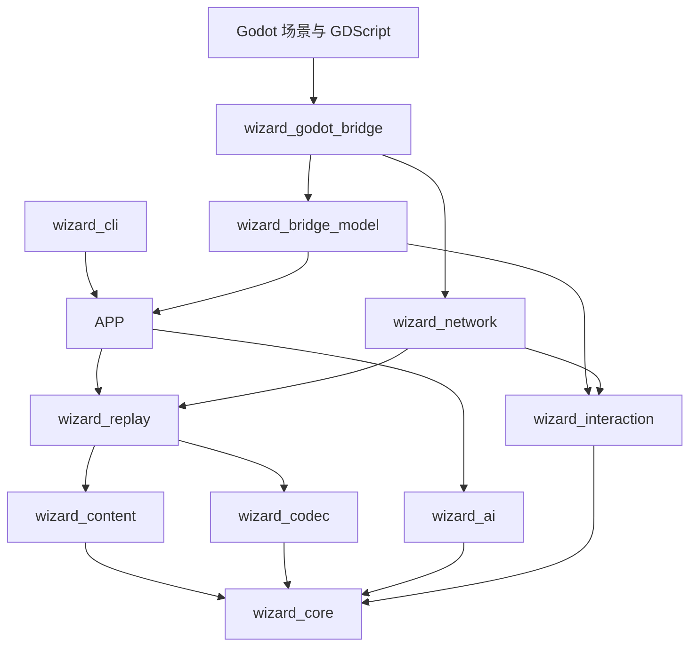
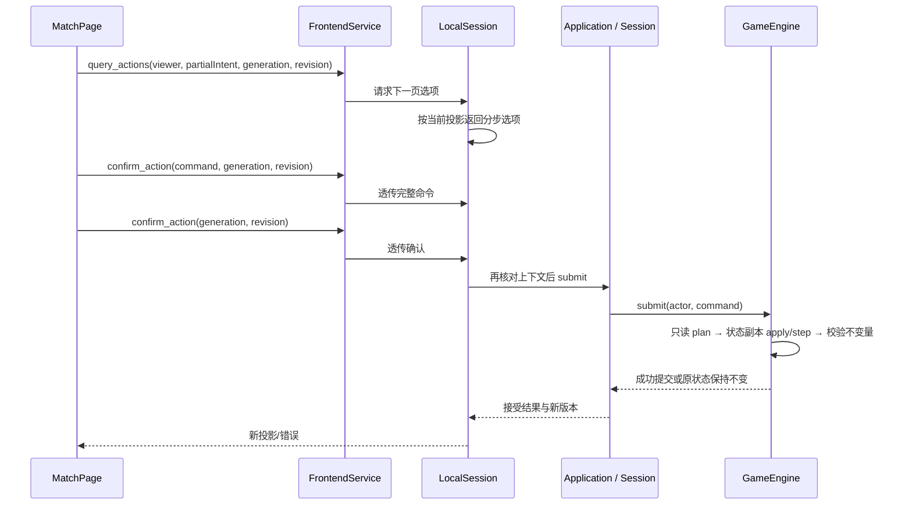

# WizardCard 开发者指南

> 更新日期：2026-10-29。项目规则与模块边界以当前源码、[ADR-0001](adr/0001-alpha-v2-modular-native-engine.md) 和 [ADR-0002](adr/0002-current-rules-and-projection-queries.md) 为准。配套源码索引仍是 2026-10-27 的静态快照，文件数、行数和被删除路径只代表当日基线。
>
> 配套文档：[逐文件源码索引](developer-source-index.md)。索引用于查阅历史调研时的文件职责，不是当前工作区清单；新模块、测试、辅助脚本和资源入口应直接从 `CMakeLists.txt`、`godot/project.godot`、清单与测试注册处确认。

## 目录

1. [项目定位与版本](#1-项目定位与版本)
2. [构建、启动与开发环境](#2-构建启动与开发环境)
3. [模块地图与依赖方向](#3-模块地图与依赖方向)
4. [领域对象与标识符](#4-领域对象与标识符)
5. [一次玩家操作如何执行](#5-一次玩家操作如何执行)
6. [开局、阶段、连锁与效果](#6-开局阶段连锁与效果)
7. [资源、区域与状态维护](#7-资源区域与状态维护)
8. [卡池与内容开发](#8-卡池与内容开发)
9. [应用、卡组、AI 与教学](#9-应用卡组ai-与教学)
10. [桥接协议与信息可见性](#10-桥接协议与信息可见性)
11. [Godot 前端开发](#11-godot-前端开发)
12. [联机、计时与重连](#12-联机计时与重连)
13. [复盘、确定性与兼容性](#13-复盘确定性与兼容性)
14. [测试、CI 与发布](#14-测试ci-与发布)
15. [常见开发任务的修改路线](#15-常见开发任务的修改路线)
16. [排障与维护重点](#16-排障与维护重点)
17. [阅读顺序与本次核验记录](#17-阅读顺序与本次核验记录)

## 1. 项目定位与版本

WizardCard 是双人卡牌对战项目。当前结构由纯 C++17 权威规则核心、内容与复盘层、应用编排、TCP 主客机联机，以及 Godot 4.7.2 前端组成；CLI 和网络探针用于验证与诊断。Godot 是唯一产品前端。

最重要的架构约束是：**对局事实由 C++ 引擎产生，界面与 AI 消费按玩家过滤的投影，并提交命令。** UI 不自行扣费、移动卡牌或推导另一套合法性。联机沿用相同规则引擎，由房主执行权威判定。

设计依据见 [GLOSSARY.md](../GLOSSARY.md)、[领域文档约定](agents/domain.md)、[ADR-0001](adr/0001-alpha-v2-modular-native-engine.md) 和 [ADR-0002](adr/0002-current-rules-and-projection-queries.md)。新改动应遵循术语和模块方向；若要将规则移入脚本、让应用直接依赖 TCP 等，应先重新讨论 ADR。

| 项目 | 当前源码值 | 入口 |
|---|---|---|
| 显示程序版本 | `2.5.5-hotfix.1` | `include/wizard/core/types.hpp` |
| CMake 项目版本 | `2.5.5.1` | `CMakeLists.txt` |
| 规则 / 卡集版本 | `2.5.5` / `2.5.5` | `assets/catalog.json` |
| 机制修订号 | `9` | 同上，唯一生产规则入口 |
| 正式卡池 | 119 种：阵法 23、解析 40、言灵 26、咒符 16、符文 14 | 清单逐文件统计 |
| 内容指纹 | `22cda557d84afc82` | 当前 CLI `validate assets` 实测 |
| 生命 / 魔素常量 | 起始与常规最大生命 40，魔素上限 20 | `types.hpp`，专有规则可修正生命上限 |
| 主牌组 / 副牌组 | 40 / 10；副牌组为阵法；同名限制分别计算 | `decks.cpp`、`state.cpp` |
| Godot | `4.7.2.stable.official.ed1daf0bf`，API `4.7` | `godot/toolchain-lock.json` |

测试夹具和卡牌内容仍保留历史名称，但生产装载只接受当前规则版本。测试名称中出现旧 Alpha 版本，不代表生产内核仍提供对应规则执行器。历史美术生成程序、预览卡池、场地演示也不等于正式游戏规则。

## 2. 构建、启动与开发环境

### 2.1 原生 Windows 开发

需要支持 C++17 的编译器、CMake 3.28+、Git；仓库 Windows preset 使用 Visual Studio 2022 x64。Python 用于检查、内容和打包工具；涉及图像处理的脚本另需 Pillow，部分脚本需 NumPy。CI 固定 Python 3.12、CMake 3.31.6、Ninja 1.11.1.3，便于复现。

在仓库根目录执行：

```powershell
cmake --preset windows
cmake --build --preset windows --parallel 4
ctest --preset windows
```

典型产物在 `build/windows/Release/`：`wizard_cli.exe`、`wizard_tests.exe`、`wizard_network_probe.exe`。产品图形前端由 Godot 工程和 GDExtension 组成。

```powershell
build/windows/Release/wizard_cli.exe validate assets
build/windows/Release/wizard_cli.exe smoke assets build/smoke.json 42
build/windows/Release/wizard_cli.exe replay assets build/smoke.json
build/windows/Release/wizard_cli.exe ai-match assets build/ai-replay.json 42 2
build/windows/Release/wizard_cli.exe tutorial-smoke assets build/tutorial-replay.json
```

`validate-catalog` 只验证卡池，适合开发者卡包；`validate` 会加载完整 Content，包括默认牌表。`smoke` 是确定性场景驱动，不能用来代表 AI 强度或平衡性。`play` 是开发交互入口，`script` 按 JSON 命令序列执行；不应把它们当作同机双人隐私界面。

### 2.2 无界面与纯核心构建

```powershell
cmake --preset headless
cmake --build --preset headless --parallel 4
ctest --preset headless
```

`headless` 使用 Ninja 和 Debug 配置，构建内容、AI、网络、CLI 和原生测试；Windows 下先进入已初始化编译器环境。不要将已有 Visual Studio 构建目录改成 Ninja，另用目录即可。

```powershell
cmake -S . -B build/core-only -DWIZARD_CORE_ONLY=ON
cmake --build build/core-only --config Release
```

`WIZARD_CORE_ONLY=ON` 在创建 `wizard_core` 后提前返回，适合验证核心无第三方依赖；**不会**同时构建内容、网络或测试。它与 headless 不是同一个配置。

### 2.3 Godot 前端

以 [godot/README.md](../godot/README.md)、[工具链锁](../godot/toolchain-lock.json) 和 [GodotBridge.cmake](../cmake/GodotBridge.cmake) 为准。引擎、API、godot-cpp、精度和架构须匹配；不能直接拿 Godot 4.x 的任意版本替换。

```powershell
cmake -S . -B build/godot-dev -G "Visual Studio 17 2022" -A x64 `
  -DWIZARD_BUILD_GODOT=ON `
  -DGODOTCPP_TARGET=template_debug
cmake --build build/godot-dev --config Debug --target wizard_godot_bridge --parallel 4
powershell -ExecutionPolicy Bypass -File tools/run_godot_frontend.ps1
```

启动脚本默认寻找 `.cache/godot-portable/Godot_v4.7.2-stable_win64_console.exe`，也可传 `-EditorPath`、`-AssetsPath`、`-UserDirectory`。脚本检查精确引擎版本及 debug 桥 DLL，先冷导入再启动。首次导入使用 `--frame-delay 1000`，对应已有的扩展文档回调退出时序规避措施；不要因为“看起来多余”删掉。

桥库输出到 `godot/bin/wizard_godot_bridge.debug.dll` 或 `.release.dll`，描述文件为 `godot/wizard_bridge.gdextension`。debug 与 release 使用独立构建目录。需要注册 Godot CTest 时，配置 `-DGODOT_BIN=引擎绝对路径`；测试配置会验证其版本。

## 3. 模块地图与依赖方向

下图箭头表示“使用/依赖”，不是运行时消息方向。桥的纯模型与实际 Godot 扩展分开，应用层通过工厂获得房间适配器。



| 目录 / 目标 | 承担的职责 | 修改边界 |
|---|---|---|
| `include/wizard/core`、`src/core` / `wizard_core` | 状态、规则、合法命令、阶段、效果、投影、确定性 | 仅标准库；不包含渲染、音频、套接字或 JSON 库 |
| `src/content/content.cpp`、`catalog_loader.cpp` / `wizard_content` | 卡池解析、输入校验和内容装配 | 数据转领域定义，不自行执行业务回合 |
| `src/content/command_codec.cpp` / `wizard_codec` | 命令 JSON 协议 | 修改命令时同步考虑兼容 |
| `src/content/replay.cpp` 等 / `wizard_replay` | MatchSession、日志、重放、计时和调试 | 保留引擎接受记录与会话状态的区别 |
| `src/application` / `wizard_application` | 模式、设置、卡组、AI/教学、生命周期 | 不依赖具体网络库 |
| `src/ai` / `wizard_ai` | 依据投影选合法动作 | 禁止读取完整 GameState |
| `src/interaction/interaction.cpp`、`presentation.cpp`、`sound.cpp` / `wizard_interaction` | 交互意图、视觉及声音语义 | 不依赖具体前端 |
| `src/bridge` / `wizard_bridge_model` | UI DTO、版本令牌、确认和复盘服务 | 与 Godot Variant 注册层分离 |
| `src/network` / `wizard_network` | 权威主机、客机投影、TCP、重连 | 套接字只停留在适配层 |
| `src/cli`、`godot_bridge.cpp` | 命令行与引擎组合根 | 注入会话、内容与网络工厂 |
| `godot/app`、`models`、`pages`、`ui` | 前端网关、投影模型、页面和控件 | 动作从桥快照取得，展示不重写规则 |
| `tools`、`assets/art/`、`godot/art/` | 数据、源素材、资源清单、检查、验收和发布；`godot/art/` 是 Godot 运行时镜像 | 运行时来源以 `godot/art/assets.json`、`assets/art/runtime.json` 和各批次 manifest 为准；不按目录年代猜测用途 |

`CMakeLists.txt` 才是目标到文件的最终映射；同在 `src/content` 的文件不一定属于同一目标。`python tools/check_module_dependencies.py` 检查目标依赖无环、应用与传输解耦和投影头文件隐藏权威状态；它是静态规则检查，不等于通用 C++ 架构证明。目标数量随 CMake 配置变化，以脚本当前输出为准。

核心规则按职责拆在 `planning.cpp`、`legal_actions.cpp`、`action_query.cpp`、`current_commands.cpp`、`current_effects.cpp` 和 `current_phases.cpp`；旧规则 `.inc` 执行文件与 SFML 产品源码已删除。CLI 仍有文本包含实现，`tests/phase2-interaction.inc` 仍由测试包含；不要将文本包含文件重复加成编译单元。

## 4. 领域对象与标识符

| 对象 | 含义 | 主要入口 |
|---|---|---|
| `CardDefinition` | 卡种配置：费用、效果、特性、类型、图像、响应、配方等 | `core/catalog.hpp` |
| `CardInstance` | 对局中的某张牌：拥有者、控制者、区域、宿主、进度、支付和标记 | `core/instances.hpp` |
| `CardCatalog` | 定义集合、内容版本、机制能力及指纹 | `core/catalog.hpp` |
| `GameState` | 完整权威状态，含私密牌序和待结算工作 | `core/state.hpp` |
| `GameView` / `CardView` | 某玩家可见状态、待决摘要、操作摘要及时钟；不携带动作组合或累计事件 | `core/view.hpp` |
| `ActionOptions` / `LegalAction` | 分步分页的可选字段；内核流式候选仅供受限 AI、教学过滤和查询使用 | `core/action_query.hpp`、`core/view.hpp` |
| `PendingDecision` | 必须由指定玩家处理的选择，含 ID、选项及能否放弃 | `core/chain.hpp` |
| `Trigger` / `ChainLink` | 已捕获的触发/连锁信息，而非只保存原卡指针 | 同上 |
| `EffectFrame` | 暂停后可恢复的效果执行帧 | 同上 |
| `MatchConfig` | 两位玩家的牌表和确定性随机种子 | `core/config.hpp` |
| `Session` / `RoomSession` | 本地/联机共同的投影、提交、轮询和生命周期接口 | `session.hpp`、`room.hpp` |

需要明确区分四种身份：

- 定义 ID 是稳定字符串，例如 `fireball`；显示名可以修改，不要用中文名称作持久键。
- 实体 `CardId` 是 `uint32_t`，只标识某场对局中的一张牌；同卡种的多张牌有不同实体 ID。
- `DecisionId`、`ChainId`、`LinkId` 是 `uint64_t`；桥与网络边界使用十进制字符串，避免脚本/JSON 数值转换丢失精度。
- 查询响应绑定 generation、revision、viewer 和待决策 ID；没有基于完整动作列表下标的 action ID。命令确认时仍由权威重新验证。

`owner` 表示拥有者，`controller` 表示控制者；旧数据控制者为未指定时，`controllerOf()` 回退到 owner。场上效果、荷载和控制权判断必须按对应规则使用，不能全局替换为 owner。

当前待决选择使用 `ChoiceValue`，由 `ChoiceKind` 区分卡牌、玩家、荷载来源、模式、支付、链节和触发；新规则不会用高位整数给不同选择类型复用含义。`ChoiceKind::Legacy` 仅服务格式 4 输入适配。命令目标字段仍保留 `playerTarget(p)` 的内部 CardId 编码，不要把命令目标数值当作 `PendingDecision.options` 的类型判定依据。

稳定命令编号显式映射到 `CommandKind`，协议不使用 C++ variant 的顺序。当前运行入口只接受规则 `2.5.5`、`mechanicsRevision=9`；内部仍有历史命名的辅助函数，但没有可选的旧规则执行分支。

## 5. 一次玩家操作如何执行

以 Godot 选择并确认一张牌的动作为例：



本地关键路径为 [bridge/session.cpp](../src/bridge/session.cpp) → [application.cpp](../src/application/application.cpp) → [replay.cpp](../src/content/replay.cpp) → [engine.cpp](../src/core/engine.cpp)。联机客机走发送队列，再由房主的 MatchSession 执行。

### 5.1 原子性与失败语义

`GameEngine::submitAuthority()` 先复制引擎到临时对象，在副本上执行命令和自动推进；规则错误返回失败，不提交部分变更。执行成功后调用 `Rules::invariants()`，通过才整体提交。一个非法费用选择不应让正式状态少一张牌、少一点魔素或多一条日志。

不变量失败属于实现错误，应定位维护路径，而不是由 UI 忽略错误继续游戏。测试会比较拒绝前后的摘要，覆盖这种原子性。

### 5.2 合法动作不是 UI 猜测

`planning.cpp` 提供无副作用验证与命令规划，`legal_actions.cpp` 流式产生候选并用同一规划逻辑验证；查询逐字段取得有限选项，不复制引擎逐个试执行候选。UI 只提交完整命令，权威会再次规划与验证。

材料、目标和多目标仍按规则逐步筛选；候选访问者必须及时停止，AI 的预算同时限制生成和评分。不要为了提速跳过最终权威验证或改由 UI 决定合法性。

### 5.3 三层过期操作保护

`generation` 隔离重开/更换对局；`revision` 隔离同场对局已改变的状态；`decision` / `phaseGate` 隔离具体选择或阶段许可。AI 计划、确认弹窗、延迟自动动作都必须带回原上下文。

客机发送成功通常返回 `accepted && pending`，其含义是进入传输队列，尚不是权威接受。不要提前移动卡牌、增加 revision 或写入成功战报。

## 6. 开局、阶段、连锁与效果

### 6.1 当前开局流程

1. 引擎验证双方牌表，创建主牌组与副牌组实体，进入 `opening`，全局回合为 0。
2. 双方分别从自己的副牌组选择等级 1 阵法，另一方只看见“已确认”，不能提前看到选择身份。
3. 双方完成后，统一公开初始阵法，确定性洗牌并各抽 5 张，选出先手，进入正式阶段推进。
4. 当前修订起始魔素为 0；先手自己的首个抽牌阶段跳过常规抽 1。阶段收入等规则仍按实现执行。

初始阵法选择属于对局内私密操作，不是当前格式卡组文件的固定 `baseFormation`。历史格式迁移保留旧资料，并不意味着新对局跳过选择。

### 6.2 阶段不只是一个枚举

宏观阶段是 `Draw → Prepare → Main → Cast → End`。每个阶段内部还包含 `Enter`、`PrepareIncome`、`StartWindow`、`Body`、`EndWindow`、`EndTriggers`、`Cleanup`、`Finish` 等微步骤，不能用 UI 的五个按钮直接替代。

当前阶段微步骤位于 [current_phases.cpp](../src/core/current_phases.cpp)，规则步进和预算位于 [phases.cpp](../src/core/phases.cpp)：

- 抽牌阶段先处理到期资源、阵法收入和因此产生的选择，再继续抽牌；收入引发的效果不能被抽牌越过。
- 场上触发按阵法入场顺序、法环与卡牌顺序稳定推进，相关游标记录在状态里。
- 主阶段的 `AdvancePhase` 可带 `skipCast`，但仍先走主阶段结束窗口，不能跳掉待决响应。
- 施法结束后，需保留的持续法术根据有效宿主和空法环回场；可能产生 `ReturnSpell` 选择，没有宿主则离场。
- 结束阶段处理触发、持续时间、未回场卡、手牌超过 8 的弃牌选择、临时状态及终局维护；持续时间有“本次是否已处理”标记，避免因重复选择重复扣减。

阶段推进要提交当前 `phaseGate`。自动推进只适用于引擎已给出许可、没有决策/连锁且满足设置的阶段；主阶段不会被通用自动推进无条件跳过。

### 6.3 命令入口

[commands.hpp](../include/wizard/core/commands.hpp) 的 variant 包含：

| 类别 | 代表命令 | 开发要点 |
|---|---|---|
| 开局 | `SelectInitialFormation` | 只允许私密开局期选己方合法阵法 |
| 场地/设置 | `SetFormation`、`StartAnalysis`、`SetAmbush`、`FlipAmbush` | 校验控制者、阶段、速度、阵体/宿主/环位和费用 |
| 发动 | `PrepareCast`、`ActivateSpell`、`ActivateAbility` | 支付与荷载先后、材料、目标、持续状态需遵从当前分支 |
| 其他当前动作 | `PlayAction`、`PreloadWord` 等 | 规则语义只按 2.5.5 / revision 9 解释 |
| 附件/离场 | `AttachSeal`、`RemoveSeal`、`RemoveFormation`、`Abandon` | 通过统一维护清理依赖 |
| 连锁与决策 | `Respond`、`PassResponse`、`Choose` | 带有效决策/连锁上下文；选项令牌不总是卡牌 |
| 流程 | `Advance`、`AdvancePhase`、`Surrender` | 阶段门与终局清理仍由核心处理 |
| 权威专用 | `Timeout` | 普通玩家提交会被拒绝，由会话计时路径触发 |

当前规则命令位于 [current_commands.cpp](../src/core/current_commands.cpp)；`commands.cpp` 负责开局、待决选择、连锁响应和恢复入口。支付、分析完成、快速解析、响应中的设置和发动共享辅助逻辑，新增分支时要检查普通行动与响应行动是否都需支持。

### 6.4 连锁与可恢复效果

`chain.cpp` 管理优先权、连续放弃计数、响应窗口和连锁项。连锁后加入的项先结算。触发/连锁项捕获必要信息后，不必然因原卡离场而整体消失；是否要求来源仍有效取决于对应标记。结算时还要重新校验目标和来源，不能假设声明时有效就永久有效。

`EffectFrame` 保存当前效果列表、cursor、已解析数量、待清除数量和关联连锁。遇到目标、费用、分配或回场选择时，创建 `PendingDecision` 并暂停；玩家提交 `Choose` 后恢复原帧。这正是“一个效果可跨多次 UI 操作”的实现方式。

效果分层：

1. `effects.cpp`、`current_effects.cpp`：伤害、抽牌、资源、区域等通用效果与内容能力处理。
2. `rules_effects.cpp`：资源、阵法、法术和配方四类专有效果及对应选择恢复。
3. `card_rules.cpp` / `card_rules.hpp`：特性查询、代价、免疫、系列修正等共享计算。

`arcana.hpp` 和 `sique.hpp` 是历史名称兼容包装，新代码优先调用 `card_rules`。无需为了新增系列再建立一套平行引擎。

### 6.5 自动结算终止条件

`pump()` 在待选决策或终局时停止。真实规则循环按规则裁定；10,000 步安全预算耗尽会抛出 Fault，由会话回滚当前命令并进入技术暂停，冻结时钟且保留诊断。新增效果必须保证 continuation 游标向前，避免无进展循环。

## 7. 资源、区域与状态维护

### 7.1 荷载与魔素是不同资源

`Rules::load()` 汇总卡牌的 analysisLoad / castLoad 和临时荷载；`Rules::capacity()` 汇总基础容量、场上阵法和有效附件修正。不能用卡面 cost 直接代替当前荷载。

新增正荷载时走 `ResourceRules::increasedLoad()`，参数应是这次**实际增加的正数**。它用于当前超载伤害规则；不能先让一张牌离场，再用前后净荷载差代替本次增加，否则会漏算。当前超载条件和减免由规则辅助统一判断，通常伤害按新增量的 2 倍计算。

`card_rules::canPay/pay` 处理支付能力与系列替代代价；`Payment` 保存已支付及荷载记录。取消、无效、来源丢失和成功结算有不同清理/返还规则，不能共用“失败就退费”。新增效果应分别测试这些结果。

### 7.2 临时生命与伤害

临时生命既有总量，也有逐条授予记录及到期回合。伤害按规则消耗，临时生命先吸收；到期与吸收顺序须保持稳定。直接改 `players[p].temporaryLife` 会破坏记录与聚合一致性。

`ResourceRules::damage` 和专有修正统一处理免疫、抗性、伤害减免、上限与实际损失；规则伤害与法术伤害并非同一类。表现反馈使用实际事件字段，不能从中文日志中的“造成 X 伤害”猜实际扣血量。

空牌库抽牌触发疲劳，失败抽牌次数累计，伤害依次递增。它不是固定 1 点伤害，也不能只对一次 Draw 效果计一次。

### 7.3 离场必须清理关系

`StateMaintenance::leave()` 负责相关区域变更、宿主、法环、附件、荷载及触发等清理，`StateMaintenance::check()` 检查维护和终局。阵法离场时，要先按规则处理依附物，再计算剩余状态，不能在中间状态提前判超载。

不变量包括：牌库向量与实体区域一致、同宿主不能重复法环、附件类型正确、分析法术拥有合法宿主、灰烬无残留荷载、临时生命总量一致、终局无待执行链等。新增字段或区域操作应扩展这些约束，而不是只修显示结果。

## 8. 卡池与内容开发

### 8.1 正式源与生成物

正式数据链路是：

```text
assets/catalog.json（显式清单、版本、机制修订）
  → assets/cards/<type>/<stable-id>.json（单卡定义）
  → readCatalogJson / parseCatalog / loadContent
  → CardCatalog / Content

同一清单 → tools/catalog_source.py → assets/cards.json（兼容聚合）
同一内容 → tools/generate_card_catalog.py → docs/card-catalog.md / .html
```

读取器按照清单顺序装配，检查重复 ID、重复文件、ID 与清单不符、非法相对路径和目录越界；任一卡错误会使装载失败。无清单时才考虑旧 `cards.json` 回退。不要靠遍历整个目录猜正式卡池，否则会把草稿和历史卡混入。

### 8.2 定义不是可执行自然语言

卡牌正文 `text` 服务展示；执行依赖类型化字段 `effects`、`traits`、`responses`、`recipe` 和阶段钩子。修改正文不会自动修改伤害或发动条件。

以下来自正式 `fireball.json` 的执行字段节选（非独立完整卡定义）：

```json
{
  "id": "fireball",
  "type": "analytic",
  "cost": 3,
  "castCost": 1,
  "level": 3,
  "analysisTurns": 1,
  "target": "player",
  "effects": [{"kind": "damage", "amount": 10, "damageType": "fire"}],
  "speed": 1,
  "illustrationId": "fireball"
}
```

字段依类型与机制版本校验，不能把这段复制后省略正式要求的编号、名称等字段。支持的效果字符串、特性与数值范围以 [content.cpp](../src/content/content.cpp) 为准。解析器为兼容会忽略部分未知字段，拼错字段名未必立即报错，因此内容回归断言仍很重要。

### 8.3 当前能力注册

`CardCatalog` 在装载时将源 trait 编译为静态 `Capability`，并绑定当前规则的有类型处理器。生产构造只接受规则 `2.5.5`、mechanics revision `9`，不再按版本阈值分派旧规则。内容哈希仍基于原始定义，编译结果不改变对外卡池指纹。

### 8.4 推荐内容工作流

1. 确定稳定 ID、卡号、类型、执行字段与插画映射，更新单卡文件和显式清单。
2. 执行 `python tools/catalog_source.py` 同步聚合；再运行 `--check`。
3. 构建 CLI，执行 `wizard_cli validate assets`；补充对应机制的行为断言，覆盖费用、目标失效、响应及隐藏信息。
4. 如增加正式卡种，核对预设牌表和卡组上限；不要仅改数量报表。
5. 运行 `python tools/generate_card_catalog.py` 更新玩家图鉴；核对文案与执行效果。
6. 有资源改动时，验证源清单与 `godot/art/assets.json` 的运行时映射，执行资源检查。

`import_alpha_v252/v253/v254_content.py`、`build_rc_catalog.py`、`align_preview2_catalog.py` 等是特定历史快照的导入/协调工具，可能写正式数据；并非每次开发都应重跑。2.5.2/2.5.3/2.5.4 源快照现保存在 [`assets/source-archive/card-pool-snapshots.zip`](../assets/source-archive/README.md)：普通导入从 ZIP 解压到系统临时目录读取，不会恢复仓库目录；显式使用 `--design-dir` 刷新时才会在仓库恢复可写的 `assets/design/<版本>/` 工作目录。刷新完成后按需保留或移除该工作副本，源归档仍是常规导入的数据来源。

`card_pack.py` 是开发者内容包工具，处理自包含卡池、资源、路径约束与原生验证；它与玩家卡组交换格式是两种用途。`analyze_balance.py` 输出分析模型，不进行真实对局模拟，结论受参数假设影响。

## 9. 应用、卡组、AI 与教学

### 9.1 Application 是生命周期编排点

`Application` 拥有 Content、设置、卡组库、预设、本地会话或注入的房间会话，以及 generation / revision。它处理开始、重开、暂停、保存、投降与离开确认。

开始本地对局时先构造新会话、生成复盘路径并完成初始原子写入，成功后再替换应用状态；重开失败时恢复旧会话。设置和卡组保存也采用“验证/写盘成功后提交内存”的方式。不要在 UI 先切换成“成功页面”再尝试保存。

本地 `Application::saveReplay()` 使用原子写入；底层 `MatchSession::save()` 是普通 JSON 写入接口。两者不能混称“所有复盘保存都原子化”。离开/保存失败应保留可重试状态。

默认用户目录由入口决定：原生应用有平台路径计算；Godot 主入口使用 `user://alpha-v2-frontend`，可通过 `--user-data` 覆盖。`user://` 的实际根目录受 `project.godot` 的应用名称影响，当前为 `WizardCard Alpha v2.5.5-hotfix.1`。排查数据时先打印/检查实际路径，不沿用旧 README 中 v2.5.4 的目录示例。

### 9.2 卡组草稿与合法对局牌表

当前草稿格式为 3，卡组库外层 `decks.json` 格式为 1。`constructionProblems()` 与 `deckProblems()` 分开处理构筑问题和能否开始对局；编辑器允许保留待修复草稿，不应把“已保存”显示成“可开局”。

同名最多 3 张的限制分别适用于主牌组和副牌组；主牌组 40，副牌组 10，并需要可作初始阵法的等级 1 阵法。当前初始阵法不固定写入 format-3 草稿。

`DeckLibrary` 读取整个文件后才提交内存；文件损坏会进入只读状态，保留原文件并给出提示，阻止后续保存/删除覆盖证据。内容指纹变化时保留失效卡牌 ID 供修复。save/erase 先复制列表、原子持久化，再替换正式列表。

`godot/app/deck_exchange.gd` 使用 `wizardcard-deck` v1 交换格式；导入后仍要走草稿和原生校验，交换文件本身不是可信的合法对局凭证。

### 9.3 AI

[ai.cpp](../src/ai/ai.cpp) 只收到查看者投影和受限候选流，以有限预算评估资源、伤害、目标、场面及响应价值；它不获取引擎、卡池或隐藏状态。难度影响策略和预算；它不是平衡性证明工具。

`planAi()` 捕获 generation 和 revision；`commitAi()` 再检查是否仍为同一状态、未暂停且轮到 AI。UI 延迟后不能直接提交旧计划。效果中的强制选择也必须给出合法投影选项。

### 9.4 教学与调试

教学用真实引擎、合法命令和固定配置，通过 `allows/observe/opponent` 控制步骤。不得为“讲解顺利”直接改 GameState 或跳过费用。

调试控制台只在本地 AI 模式启用，教学、同机双人、网络和观战/复盘浏览不开放。调试操作会改变 revision，记录调试标记及操作日志；带调试操作的复盘应与正常对局区分。

## 10. 桥接协议与信息可见性

### 10.1 两个边界

`GameEngine::viewFor(viewer)` 先过滤核心信息；`snapshot.cpp` 再把允许的字段组织成脚本 DTO。`godot_bridge.cpp` 负责 `WizardBridge` 的 ClassDB 注册、Variant/JSON 转换和异常到错误对象的转换，不应实现具体卡牌效果。

桥响应主要采用：

```json
{"ok": true, "data": {}}
```

```json
{"ok": false, "errorCode": "stale_match", "error": "对局操作已过期"}
```

错误码用于程序分支，中文错误用于展示。不要用中文错误文本匹配业务逻辑。`FrontendService._request()` 集中处理调用和错误，页面不各自创建桥实例。

### 10.2 可见性规则

- 对方手牌、主牌组与副牌组身份通常不投影给当前玩家；检索等效果仅公开规则允许的选择。
- 盖放卡保留可见位置/宿主/环位等公开信息，但清除定义身份，展示为匿名卡；显式揭示或侦察权限另按规则处理。
- 只给当前决策玩家其 `PendingDecision` 和可选动作；事件按 audience 过滤。
- 热座允许切换双方查看，但要经过隐私遮罩；AI/教学只向人类显示自己的席位，网络只允许本地席位。
- `CardPresentation`、详情、卡图、悬浮提示、拖放载荷和动画历史都要遵守同一过滤；“界面不画名字”不等于没有泄露。

核心投影包含连锁快照，桥 DTO 与网络 DTO 对这些结构的序列化路径不同。新增私密字段时逐层审查，不能因为主画面匿名就假定链、事件和调试数据均安全。

`selectAction()` 只记下待确认命令；`confirmAction()` 再检查版本并提交。自动结束阶段、自动放弃响应、AI 延迟和目标选择也不能绕过这一约束。

## 11. Godot 前端开发

### 11.1 入口与场景结构

`project.godot` 入口是 `app/main.tscn`。`main.gd` 维护页面字典并注入同一个 FrontendService，负责导航、网络轮询、关窗流程、背景和跨页反馈。唯一配置的 Autoload 是 `GlobalTypography`，不需要把每个服务做成单例。

渲染使用 GL Compatibility，设计视口 1920×1080，最小窗口 1280×720；首启 Godot 设置会调整到设计尺寸。`FrontendDisplay` 与 Typography 负责应用窗口/字体设置，页面不要各自再乘一次全局字号比例。

| 层 | 主要文件 | 职责 |
|---|---|---|
| app | `main.gd`、`frontend_service.gd`、`frontend_display.gd`、`deck_exchange.gd` | 路由、桥调用、窗口与交换格式 |
| models | `card_presentation.gd`、`match_projection.gd`、`decision_presentation.gd` 等 | DTO 转显示模型，不修改权威状态 |
| pages | `match_page.gd`、`deck_editor_page.gd`、`rooms_page.gd`、`replay_page.gd` 等 | 页面交互协调 |
| ui | `field_canvas.gd`、`card_painter.gd`、`decision_panel.gd` 等 | 绘制、命中、控件与信号 |
| resources | `.tscn`、`.tres` | 节点装配、主题、场地几何 |

配套索引按 2026-10-27 快照逐项列出当时的脚本和场景、函数入口、资源依赖及场景节点；重构后新增文件不在该快照中，应以当前 `godot/` 目录和 `project.godot` 为准。

### 11.2 对局页面与操作状态

`match_page.gd` 负责对局布局与信号连接。选择状态由 `action_selection_controller.gd` 管理，自动动作、网络恢复与事件日志分别由 `automatic_action_controller.gd`、`network_recovery_controller.gd` 和 `match_event_log.gd` 管理；`match_state.gd`、`match_projection.gd` 持有页面消费的类型化状态和投影。新增流程应延续这些职责边界，不要把选择游标、网络重试或日志扫描重新放回页面帧循环。

新增操作时优先复用 `MatchProjection` 的操作摘要及桥返回的分步 `ActionOptions`，不应在页面内枚举或构造完整动作组合。选择控制器在请求和响应中绑定 generation / revision / viewer / decision；上下文改变时旧选项、目标和确认必须失效。延迟自动操作在提交前再次检查页面存活、暂停、遮罩、网络阻塞和版本。

`ResponseTiming` 管理玩家的响应询问偏好，只能选择当前存在的合法 Pass；`PhaseSelector` 选择已投影阶段动作。`DecisionPanel` 收起托盘不代表自动完成强制选择。

### 11.3 场地绘制与几何

`FieldCanvas` 绘制阵法、法环、附件、施法区、手牌扇形和牌堆；命中测试要把鼠标坐标逆变换到旋转卡牌的局部空间。修改扇形布局时同时检查绘制与命中，不能只调整可见矩形。

`FieldLayout` 是 Resource，默认值保存在 `ui/default_field_layout.tres`。场景可覆盖几何；调整场地位置优先改布局资源，不在多处脚本写不同坐标。`field_page` / `FieldShowcase` 是演示入口，不能据此推断真实 MatchSession 行为。

卡面由通用 CardPainter、卡组专用 DeckCardPainter、简化绘制器及 CardFace/Tile/Detail 包装协作。新增卡牌显示字段时同步核对图鉴、卡组、战场和详情。

### 11.4 美术、声音与缓存

`ArtBank` 根据 `godot/art/assets.json` 加载纹理或 AtlasTexture，缺失时输出带 ID/路径的警告并生成醒目占位。当前页用过的插画必须驻留，因为自绘命令不一定保留 Texture2D 资源；页面切换时 `trim_illustrations()` 才清除插画缓存。不要改成简单“超过 48 张就立即淘汰”，会使仍在显示的卡图丢失。

`GlobalTypography` 处理已有和动态加入控件的字体缩放；`FieldTransition` 只表现投影变化；`MatchFeedback` 消费语义声音并处理冷却和减弱动态偏好。动画不应改变权威回合推进，也不应阻止联机轮询。

当前美术结构与操作步骤见[美术资源说明](../assets/art/README.md)和[资源索引](../assets/art/RESOURCE_INDEX.md)。`godot/art/assets.json` 记录 364 个 Godot 运行资源及对应 `source` / `authoringSource`；`assets/art/ART_INVENTORY.json` 校验当前源素材集合；传统卡牌图片另由 `assets/art/runtime.json` 映射。已清理旧 `assets/art/design`、`prototypes`、`ui` 和根级 `branding` 导出目录；不要把已移除目录重新当作运行时输入。历史源码索引中的 SFML 条目只说明基线快照，不代表当前构建目标。

## 12. 联机、计时与重连

### 12.1 当前拓扑

当前是双人 TCP 直连、房主权威架构。`HostSession` 拥有 MatchSession，`GuestSession` 保存自己可见的 GameView 和待发送请求，`Peer` 实现 RoomSession 并管理传输。没有现成中央匹配、多房间权威服务或 relay 部署程序。

`Application` 仅依赖 `RoomFactory`，真实组合根注入 `net::createRoom`。这使本地/网络共享会话接口，同时避免应用库链接具体 TCP 实现。

### 12.2 协议与请求生命周期

`codec.cpp` 处理 JSON DTO 与带长度帧；Decoder 允许分片到达并执行大小限制。当前单消息最大 1 MiB、接收缓冲 2 MiB、发送缓冲 4 MiB，超限应按协议错误处理，不能无界累积。

握手 Hello 带协议、程序、规则、卡集和内容指纹；当前协议为 4，要求双方使用相同规则与内容。HostSession 实际握手比对 protocol/rules/cards/hash；双方牌表经验证并准备后开始对局。

客机命令含 session、sequence、request、revision、decision 和 command。主机检查会话、顺序、状态版本与决策，并以对端席位执行。已处理 sequence 的相同 request 返回缓存响应，冲突请求拒绝；当前回复缓存保留最多 256 项。不要用客户端提交的 actor 指定任意玩家。

客机收到旧 revision 的 View 会忽略；同 revision 时仍可能有更新的 clock.sequence。只刷新计时信息时不必关闭目标选择或确认弹窗。

### 12.3 断线与复盘

Peer 负责连接、心跳、超时、重试、冻结和恢复。重连使用 session 与 credential；不是新建对局重新发相同种子。正常终局后才提供完整复盘，支持传输分块和异步验证；销毁/取消应处理未完成的验证任务。

联机 tick 必须独立于对局页面、设置和动画。`main.gd` 使用独立 Timer 轮询网络，不应因为玩家打开设置就停掉心跳或权威计时。

### 12.4 权威计时

`session_clock.cpp` 通过可注入的单调 TimeSource 计算耗时。启用时每位玩家有 300 秒，自己回合增长时补 60 秒，上限 300 秒；需要决策的玩家计时，开局等情况下可能同时计时。自动可跳过的非主阶段在满足条件时不收取思考时间。

冻结时停止计费；同步规则执行耗时从玩家时间中排除。超时由引擎权威入口产生 Timeout 并记入日志，复盘不依赖重新等待同样的真实时间。测试用假时钟验证边界，不要靠真实 sleep 测试计时正确性。

## 13. 复盘、确定性与兼容性

`MatchSession` 记录被权威接受的 actor、command 和执行后 digest；新记录格式为 5，显式标记 content、command 与 digest schema。它保存程序/规则/卡集版本、内容指纹、种子、双方实际牌表、最终摘要、统计、事件和调试标记。仅为当前 `2.5.5-hotfix.1` 保留 format 4 命令与摘要适配，不运行旧规则执行器。

`replay()` 验证格式与版本、内容指纹和配置，从头重建对局，逐命令执行并核对每一步摘要及最终摘要。它不是直接信任文件中的最终状态，也不是任意时刻保存 GameState 的继续游戏接口。

确定性依赖相同内容、相同种子、相同被接受的命令序列，以及稳定的遍历/触发/随机取样顺序。规则中不能加入系统时间、平台差异排序或无记录随机源。网络凭据的随机性属于传输身份，不进入规则随机序列。

`canonicalState()` 用于完整状态摘要，`cycleKey()` 用于逻辑循环检测，后者有意忽略部分分配/日志差异。两者不能互换。当前 fingerprint/digest 使用 64 位 FNV-1a，16 位十六进制，用于一致性检查，不能充当密码学签名或防作弊证明。

增加权威状态字段后至少检查：初始化、命令执行、自动推进、不变量、规范序列化、循环键、投影、网络 DTO、桥 DTO、复盘兼容与测试。遗漏序列化会造成“状态变了但摘要没变”；遗漏循环键可能误判或漏判循环。

历史复盘导入仅接受明确列出的当前版本与匹配内容哈希；更早规则版本明确拒绝。需长期保存的录像，应同时保留相应内容和程序版本信息。

桥复盘浏览使用引擎缓存与检查点，避免每次拖动从头执行；缓存要随文件路径、修改时间/大小和内容上下文失效。新增复盘 UI 时仍要通过对应查看者投影。

## 14. 测试、CI 与发布

### 14.1 测试布局

| 范围 | 文件组 | 关注点 |
|---|---|---|
| 核心规则 | `rules`、`chain`、`alpha_*`、`card_rules_*`、`storm*`、`sique` | 支付、阶段、连锁、系列效果、失效、边界与不变量 |
| 内容/卡组 | `content`、`rc_content`、`decks`、`alpha_v252_content/pool` 等 | 严格解析、版本、正式卡池、构筑及持久化 |
| 应用/AI | `application`、`ai`、`session`、`session_clock` | 暂停/旧计划、教学、保存、时钟与确定性 |
| 投影/交互 | `bridge`、`interaction`、`presentation`、`sound` | 隐私、确认、动作状态、提示与声音 |
| 网络 | `network`、`probe.cpp`、`network_smoke.py` | 帧、去重、重连、终局复盘及双进程一致性 |
| Godot | `godot/tests/*.gd` | 导入、桥边界、页面、选择、响应、字体、卡图驻留和性能 |
| Python | `test_alpha_v254_content.py`、`test_card_pack.py` | 内容快照、稳定 ID、资源及卡包回归 |

当前 `CMakeLists.txt` 把原生核心、内容、会话、网络和架构契约测试注册到活动 CTest 目标。测试名称中可能保留 Alpha 版本标签；应检查测试实际加载的规则版本、fixture 和断言，不要仅凭名称判定覆盖范围或将测试一概排除。源码索引中的静态 `TEST_CASE` 数是 2026-10-27 快照，当前注册数以 `ctest --test-dir build/windows -C Release -N` 为准。

### 14.2 常用检查

```powershell
python tools/check_module_dependencies.py
python tools/catalog_source.py --check
python tools/prepare_godot_frontend_assets.py --check
python tools/check_art_assets.py --check
python tools/test_alpha_v254_content.py
python tools/test_card_pack.py
ctest --preset windows --output-on-failure
python tools/network_smoke.py --exe build/windows/Release/wizard_network_probe.exe `
  --assets assets --output build/network-local
```

`test_card_pack.py` 默认使用当前 Windows CLI，也可通过 `WIZARDCARD_CLI` 指向其他构建。先编译当前 validator，避免 Python 测试调用旧版本程序。

改动源美术后，先按 [美术维护说明](../assets/art/README.md) 更新源 manifest 和 Godot 运行清单；`python tools/prepare_godot_frontend_assets.py` 会同步文件并改写运行清单，`--check` 只验证已提交镜像。确认文件增删后再运行 `python tools/check_art_assets.py --update-inventory` 更新盘点，并以 `--check` 复核。

Godot 测试需要配置匹配的 GODOT_BIN 并构建扩展，然后使用相应构建目录的 `ctest -C Debug -R godot_ --output-on-failure`。保留 fixture、冷导入和串行限制；共享输出 DLL 和导入缓存时，盲目并行容易产生干扰。

### 14.3 CI 的含义

[ci.yml](../.github/workflows/ci.yml) 覆盖 Windows、Linux 核心/无界面、Godot 桥和跨平台重放。跨平台任务使用 Windows 产出的录像在 Linux 验证，检测确定性差异。验收矩阵生成工具只建立“要求—测试证据”索引，源码里存在测试不等于 CI 已执行通过。

### 14.4 打包

原生开发包走 `cmake --install`；Godot 正式包使用 [package_godot.py](../tools/package_godot.py)，要求已有匹配编辑器、导出模板与 release GDExtension。参数包括 `--godot`、`--build`、`--configuration`、`--output`、可选 `--crt`。

打包器选择运行时内容，避免把历史美术、玩家数据和测试一起带入；不要直接将工作区整体压缩当发布包。原生 `cmake --install` 排除 `docs/archive/`；Godot 打包器只复制发行所需规则、图鉴与发行说明，不复制历史文档 ZIP 或卡池源快照。发布前验证从任意工作目录启动能找到同目录 assets，并在干净用户目录测试首次运行、卡组、设置和复盘保存。

### 14.5 工作区归档与清理

- 当前设计快照归档在 [`assets/source-archive/README.md`](../assets/source-archive/README.md)，旧发行文档、设计稿和证据归档在 [`docs/archive/README.md`](archive/README.md)。先检查清单与校验值，再从归档恢复；不要把 ZIP 内容解压进产品资源目录。
- 清理美术前检查 `godot/art/assets.json` 的 `source`、`authoringSource`、`sourceManifest` 与 `additionalSourceManifests`，以及 `assets/art/runtime.json` 和 CMake 安装清单。被这些清单或生成工具引用的源文件仍是开发输入，即使它本身不进入运行包也不能直接删除。
- `dist/` 按完整语义版本（包括预览版、RC 和 hotfix）保留一份最新已验证 ZIP 及对应 `.sha256`；同一版本的 `final`、`rebuilt`、日期等重打包后缀不构成新版本。不要留重复版本包或已解压的发行副本；重新生成 ZIP 后必须同时重算旁置校验文件。独立的美术归档不计作游戏发行版本。
- 更新文档目录后，检查保留文档的相对链接，并确认 `cmake --install` 及 `tools/package_godot.py` 仍只打入需要的文件。

## 15. 常见开发任务的修改路线

### A. 只改卡牌数值或文案

修改对应单卡 JSON → 同步聚合和图鉴 → 原生验证 → 对应规则断言。保留稳定 ID 和插画映射。数值改动会改变内容指纹与复盘匹配，应作为内容兼容变更处理。

### B. 增加一种新效果或特性

1. 判断已有组合效果能否表达；不能时在类型/解析器注册明确能力，不依赖卡名字符串或正文解析。
2. 在通用 EffectResolver 或 card_rules 专有效果组实现；需要玩家选择时保存进 EffectFrame，生成决策后恢复。
3. 接入正常行动、响应、触发等可能入口；明确来源离场、目标失效、部分多目标和取消结果。
4. 将新状态纳入不变量、摘要、投影、桥/网络与复盘；为 AI 添加必要估值或强制选择支持。
5. 用最小状态测试核心行为，再用正式内容回归测试确认配置真正接到实现。

### C. 增加一个玩家命令

检查 `commands.hpp`、命令 codec、核心分派、合法动作枚举、桥交互 DTO、网络、AI 和复盘。保留旧命令序值兼容策略，拒绝伪造席位与过期 token。测试成功、拒绝原子性、往返编解码和重放，不只测试按钮能点击。

### D. 增加设置项

扩展 Settings 与 encode/decode/默认值/范围 → Application 原子保存 → 桥 DTO → FrontendService → settings_page → 实际消费者。页面取消应恢复编辑状态；保存失败仍显示失败。需要首次运行迁移时区分原生默认值和 Godot 专用默认值。

### E. 调整战场布局或卡牌交互

先定位 FieldLayout/.tres 和 FieldCanvas；若涉及动作，再改 MatchProjection 与页面协调。同时检查鼠标命中、缩放、旋转、键盘/Esc、隐藏卡、窄窗口、强制决策和目标过期。只改布局无需触碰 C++ 规则。

### F. 扩展网络或部署服务

保持 Session/RoomSession 契约，由组合根选择适配器；先在 HostSession/GuestSession 测试消息状态机，再在独立进程测试重连和复盘。若开发中央权威多房间服务器，这是当前直连架构之上的新功能，需要明确房间生命周期、资源和持久化，不能直接把 Peer 当现成服务器部署。

### G. 增加美术资源

确认原始文件与来源记录 → 正式资源清单 → Godot 运行时清单/拷贝 → 插画 ID 或控件映射 → 图鉴/卡组/战场核对 → 资源检查。历史源批次脚本可能依赖本地原稿，CI 应优先使用无需外部原稿的 `--check` 路径。

## 16. 排障与维护重点

| 症状 | 优先检查 | 下一步 |
|---|---|---|
| WizardBridge 不存在 / 原生模块未加载 | DLL 风味、工具链锁、`.gdextension`、导入日志 | 用匹配引擎冷导入，确认当前进程没有锁住旧 DLL |
| 点击返回过期操作 | generation/revision/decision/phaseGate | 更新快照并取消旧确认；不要去掉校验 |
| 开局卡住或未进入抽牌 | 双方初始阵法确认和副牌组合法性 | 区分自己已确认与双方完成 |
| 新卡文字正确但效果没变 | 单卡 effects/traits、聚合文件、加载的 assets 路径 | 用 CLI 验证实际指纹与字段 |
| 荷载/返费异常 | 支付记录、increasedLoad 参数、离场顺序 | 构造最小响应取消与宿主失效场景 |
| 复盘不匹配 | 程序/内容版本、首个失败命令与 digest | 不先跳过校验；比较规范状态和规则分支 |
| 盖牌从详情/音效泄露 | core view、bridge DTO、models、事件/历史缓存 | 用两份隐藏状态相同投影的测试验证 |
| 卡图随滚动消失 | ArtBank 驻留、页面切换、运行时清单 | 检查纹理生命周期与绘制命令 |
| 设置/卡组“丢失” | 当前 user_directory、应用名、只读 notice | 核对实际路径、保存错误与内容迁移 |
| 打开设置后掉线 | 根级网络 Timer、tick 与冻结逻辑 | 避免把网络生命周期绑定在 match_page |
| 规则修改未生效 | 当前命令/效果实现、能力注册、运行的可执行路径 | 构建对应目标并核对输出时间/版本 |

以下是维护时应优先测量或管理的点，属于结构分析结论，不是未经复现的缺陷清单：

- `match_page.gd` 和 `rules_effects.cpp` 仍汇合多个子流程。选择控制器、自动动作调度、网络恢复和事件日志已拆到独立 Godot 模型；新增功能前先找内部职责边界，避免重新增加跨流程隐式状态。
- 命令原子执行仍复制运行状态，动作查询按字段懒取候选，稳定投影按 revision 缓存；需以同一组长局和复杂目标场景持续测量。
- 桥和网络各有 DTO 编码路径；新增字段最容易只同步一端。核心、投影和持久化检查清单应随改动一起执行。
- 当前只运行 2.5.5/revision 9；format 4 仅适配当前 hotfix 的历史摘要，不恢复更早规则执行器。
- 个别 README 的版本路径、旧制说明或“尚未实现”描述已落后于源码。本指南以当前实现为依据，未来维护仍以源码与可执行检查为准。
- 工具脚本有“只检查”和“生成/导入”两种行为；历史批次脚本不能当作通用构建步骤盲目运行。

## 17. 阅读顺序与本次核验记录

### 17.1 推荐上手顺序

1. 领域词汇、ADR、`types.hpp`、`catalog.hpp`、`instances.hpp`、`state.hpp`、`view.hpp`：先理解定义/实体/投影的区别。
2. `engine.cpp`、`planning.cpp`、`commands.cpp`、`current_commands.cpp`、`chain.cpp`、`phases.cpp`、`current_phases.cpp`：理解规划、命令与可暂停状态机。
3. `resources.cpp`、`resource_events.cpp`、`zones.cpp`、`invariants.cpp`、`effects.cpp`、`current_effects.cpp`、`card_rules.cpp`、`rules_effects.cpp`：理解资源与具体规则。
4. `catalog_loader.cpp`、`content.cpp`、`command_codec.cpp`、`replay.cpp`：理解输入、协议和确定性。
5. `application.cpp`、`decks.cpp`、`ai.cpp`、`tutorial.cpp`：理解应用编排。
6. `bridge/session.cpp`、`snapshot.cpp`、`godot_bridge.cpp`，再到 Godot service/models/pages/ui。
7. `network/session.cpp`、`codec.cpp`、`peer.cpp`、`tcp.cpp` 与 network tests：最后研究传输适配。
8. 根据要改的行为读对应测试；完整路径、文件职责、符号和测试场景见[逐文件源码索引](developer-source-index.md)。

### 17.2 本次实际执行

以下为 2026-10-29 工作区本地执行结果，不代表远端 CI 或所有平台结果：

| 检查 | 结果 |
|---|---|
| 当前 Windows Release 构建 `wizard_tests`、`wizard_cli`、`wizard_network_probe` | 成功 |
| `ctest --test-dir build/windows -C Release --output-on-failure` | **278/278 通过**，73.57 秒 |
| `check_module_dependencies.py` | 通过：13 个目标无环，应用不依赖传输，投影头文件不暴露权威状态 |
| `catalog_source.py --check` | 通过：正式清单与兼容聚合一致 |
| `prepare_godot_frontend_assets.py --check` / `check_art_assets.py --check` | 通过：364 项运行资源，187,736,156 字节；976 个源美术文件，432,616,004 字节 |
| `test_alpha_v254_content.py` | 5/5 通过 |
| CLI `validate assets` | 135 定义，默认主牌组 40，指纹 `22cda557d84afc82` |
| Windows 原生安装 | `cmake --install` 成功；安装副本不含 `docs/archive/`、`assets/source-archive/`、旧 UI 或品牌导出 |
| 归档与目录检查 | 文档 ZIP 与卡池源 ZIP 均通过 CRC；保留文档相对链接无失效；`dist/` 的 19 个游戏发行 ZIP 及 1 个美术归档通过 ZIP 检查，12 个 `.sha256` sidecar 均匹配 |

本次没有重新执行 Godot 图形界面全流程、Godot 专用 CTest、Linux 构建及 Godot 正式导出包验收；相关章节给出的是源码核对后的运行方法。逐文件覆盖表示结构登记与模块/关键路径分析，不能解释为逐行形式化证明、完整安全审计或对所有输入行为的保证。
