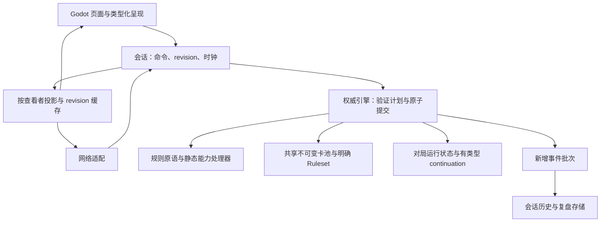

# WizardCard 程序源码架构审计

日期：2026-10-27。审计基线：`5b8651e`，审计开始时工作区干净。

## 结论

存在值得主动重构的架构问题，尤其会影响继续扩充卡池、长局运行和前端交互。但应重构的是内核内部的职责与数据流，而不是推翻 C++ 权威规则 + 单进程模块化 + Godot 表现层这条路线。

激进建议：停止继续向版本分支、全局状态字段和巨型效果分派中追加特例；先把规则查询、命令执行、事件历史和版本兼容分开，再扩张卡池。保留命令原子性、查看者投影、确定性复盘及现有回归资产。

本次为源码与架构审计，不是逐张卡牌的规则符合性验收、网络渗透测试或性能基准。下面的复制、遍历和调用行为已由源码确认；耗时、吞吐量和内存数值尚未实测。优先级表示重构价值与风险，不等于已经发生线上故障。

## 应保留的基础

- `CMakeLists.txt` 已拆分 core、content、codec、replay、ai、application、interaction、network、bridge；`tools/check_module_dependencies.py` 实际通过，报告 14 个目标无依赖环，应用层独立于网络实现。
- `include/wizard/session.hpp:10` 提供本地与联网共同会话接口，读的是查看者投影。AI、交互、表现等公开头文件受到依赖检查保护。
- `src/core/engine.cpp:129` 的复制后提交保证拒绝命令不污染原状态，并在提交前执行不变量检查。这是正确性资产；不能为了性能直接删除。
- `src/content/replay.cpp:79` 校验程序、规则、卡池、内容哈希和逐命令摘要；CI 已配置 Windows/Linux 回归、跨平台复盘、网络及 Godot smoke。不能将项目描述为“没有测试”。
- `docs/adr/0001-alpha-v2-modular-native-engine.md` 明确保留原生权威内核和模块化单进程。以下主方案与该 ADR 一致；改为全 GDScript 或多进程需要先重新论证此 ADR。

## A1：合法动作查询依赖大量完整引擎复制与试执行（高）

证据：

- `src/core/legal_actions.cpp:13` 的 `add()` 对每个候选动作复制 `*this`，再执行 `execute()`。
- `include/wizard/core/engine.hpp` 按值持有 `CardCatalog`、`GameState`；复制包括卡牌定义、场上状态、队列及累计事件。
- `src/core/legal_actions.cpp:252` 的阵法材料组合先复制并 `executeV2()`，成功后进入 `add()`，还会再次复制验证。
- `src/core/card_rules.cpp:211` 对不同支付组合进一步复制引擎并试执行。
- `src/core/view.cpp:126` 每次获取视图都调用动作枚举，`src/bridge/session.cpp:113` 获取快照和选择动作也重新获取视图。

问题不是单次提交使用事务副本，而是普通读取也进入高成本模拟路径。多目标、材料、宿主和支付方式组合会放大候选数量。枚举存在最多 5 个目标/材料的限制，但这不能消除组合数量增长。

方案：

1. 将只读卡池改为共享不可变数据，复制仅涉及对局运行状态。
2. 建立无副作用的 `validate/plan`：返回明确错误或可执行计划。合法动作枚举与提交共享这一实现，避免维护两套判定。
3. 按查看者、对局代次和 revision 缓存稳定投影；时钟独立更新，教学过滤、暂停和 UI 待确认状态单独叠加或进入缓存键。
4. 将全量目标组合改为分步候选查询：先选动作/来源，再返回合法宿主、目标和支付选项；最后由权威端完整复核。

验收：同一 revision 的重复读取不重复执行候选命令；所有已枚举动作在相同状态可提交；拒绝动作保持原子性；对小规模场景将新枚举与旧实现作集合对比，检查漏项与额外项。

## A2：调试回退存储污染所有对局的常规内存路径（高，优先快修）

证据：`src/content/replay.cpp:23,30` 在构造和每次成功提交后调用 `captureTurn()`；`src/content/debug_session.cpp:57` 每个新回合保存完整 `engine_`，没有检查 `debugEnabled_`，也没有普通运行中的保留上限。`canRewindPreviousTurn()` 才检查调试开关。

因此未开启调试的对局也会累计回合快照；快照又复制卡池和此前所有事件。若每回合事件大致增加固定数量，历史事件在这些快照中的累计存储可呈二次增长。这是数据结构推导，不是已测得的内存曲线。

方案：关闭调试的会话不保存调试检查点；显式制定回退深度和检查点预算；启用时捕获所需起点，避免简单加开关后破坏第一次回退。检查点共享不可变卡池，事件历史通过位置引用。离线复盘浏览的检查点缓存也应独立设预算。

验收：联网与非调试会话检查点数为零；调试开启后首个可回退回合正确；回退后命令日志、时钟、revision 和复盘结果一致；长局检查点内存受预算约束。

## A3：历史版本与当前规则在同一执行路径内交织（高）

证据：`include/wizard/core/catalog.hpp:61` 同时存在 `advancedRules`、`alphaV2Draft`、`alphaV2`、`mechanicsRevision` 以及多个 `usesAlphaV...()`；本次检索在 18 个 core 源文件中发现相关判断。`commands.cpp`、`phases.cpp`、`effects.cpp` 还分别文本包含 v2 `.inc` 实现。

关键矛盾：当前复盘加载对新规则要求程序版本精确匹配（`src/content/replay.cpp:84`），而运行内核仍承担大量旧规则分支。因此“保留旧分支”不等于“已经支持跨版本历史复盘”。旧测试具有价值，但不应无限决定当前生产内核的形状。

方案：将规则版本在装载时解析成明确的 `RulesetId` 与规则配置；数值差异走配置，语义变化显式分派。旧引擎可先隔离成兼容测试目标，保留黄金复盘。若产品确实承诺历史复盘，则实现按规则/引擎版本选择执行器和对应内容，而不是让当前引擎猜测兼容。

验收：新增版本不需要在资源、区域、阶段、动作、投影中同时追加版本判断；兼容矩阵说明哪些旧记录可播放、哪些明确拒绝。迁移之前不直接删除旧测试。

## A4：卡牌行为没有形成稳定的内部扩展接口（高）

证据：

- `src/core/rules_effects.cpp:12` 通过多个 `GameEngine` 成员函数串联分派，函数虽已分类，但都操作同一可变状态。
- `src/core/card_rules.cpp:19,46,77` 在生命上限、生命支付、费用比例等通用流程中直接判断具体卡牌 ID。
- `src/core/commands.cpp:20` 的准备流程直接识别云雾术。
- `src/core/zones.cpp:31` 的离场流程直接识别七星灯盏和恋人。
- `include/wizard/core/state.hpp:18` 与 `instances.hpp` 包含味契、七星、风暴等系列专用状态。

新增卡牌机制的知识分散在命令、资源、离场、阶段、状态和摘要中。把同一个类的方法分到更多文件，只降低文件长度，没有减少修改传播。

方案：采用“通用规则原语 + 静态能力处理器注册”两级结构。通用层负责支付、伤害、移动、触发排队、待选择；能力处理器负责卡牌特有条件与过程。可组合效果在装载时转换为有类型的描述；复杂卡牌保留专门 C++ 处理器。处理器经受控上下文提交变更，不任意修改所有 `GameState` 字段。

不要直接建一套任意脚本语言或万能 ECS：那会额外引入脚本安全、终止性、调试和复盘版本问题。先选一个跨文件特例做垂直迁移，证明通用接口有效。

验收：添加使用现有原语的新卡，只改内容和卡牌级测试；增加新能力主要修改对应处理器及注册；通用伤害、离场和支付函数不再为该卡新增 ID 判断。严格保留当前批次、连锁、检查时点与中断恢复顺序。

## A5：事件历史、稳定投影、时钟更新没有分开（高）

证据：`GameState::events` 保存累计事件；`src/core/view.cpp:122` 每次投影遍历全部事件；`src/network/peer.cpp:182` 在 revision 改变或经过 250ms 后发送视图；`godot/pages/match_page.gd:660` 每帧更新状态，间接调用 `:485` 遍历日志，本地每 0.5 秒重新请求快照。

必须保留的限定：`src/network/codec.cpp:112` 已将发送事件限制为最近 512 条，并维护 `eventBase`，测试也覆盖此机制。不能声称网络事件数量无限增长。但截断发生在完整视图构造之后，仍有全历史过滤与复制；未改变状态时还重复发送卡牌和动作数据。本地 bridge 则遍历其全部可见事件。

方案：规则步进返回新增结构化事件；会话层维护历史日志。稳定视图按 revision 更新，时钟通过轻量消息独立传送，事件按查看者游标增量拉取。断线重连仍发送完整快照，并明确游标过期时的补偿方式。UI 仅在新事件到达时追加日志。

验收：静止对局的周期包只有必要时钟/连接信息；读视图不扫描完整历史；断线重连、热座切换和隐藏信息过滤保持正确。游标不能暴露对手私密事件的数量或内容。

## A6：选择、协议和前端约定缺少稳定类型契约（中高）

证据：`PendingDecision::options` 为 `vector<uint32_t>`；`src/core/rules_effects.cpp:19,195` 用接近整数上限的 CardId 表示“是”“承受伤害”“承受荷载”；`src/core/phases.cpp:68` 还用高位区分荷载来源。`src/content/command_codec.cpp:9` 用 C++ variant 的下标作为协议 type；`godot/models/match_projection.gd:40` 根据 0、18、15 等数字识别动作。

这些约定本身可以工作，但插入/调整 variant 顺序、增加选择种类，都可能跨 C++、JSON、GDScript 发生静默语义漂移。大量 `Dictionary.get(..., 默认值)` 还可能把缺字段降级成貌似合法的空视图。

方案：稳定显式 CommandKind 编号，不依赖 variant 顺序；选择使用 `CardChoice/PlayerChoice/LoadChoice/ModeChoice` 等有类型 payload。用一个 schema 生成或校验枚举、字段和转换代码；GDScript 接口处校验后转为有类型模型。继续保留跨脚本接口的 64 位 ID 字符串策略。

验收：重排 C++ 内部 variant 不改变网络格式；未知类型/缺失必填字段明确报错；旧格式具有明确版本门槛或迁移路径；高位整数不再兼任多种选择含义。

## A7：规则调度状态过于分散，运行预算与游戏裁定混合（中高）

证据：`include/wizard/core/state.hpp` 同时包含 phase、flow、phaseStep、多种 cursor、decision、effect、chain、payment 以及多个布尔标志。`EffectFrame::clearRemaining/resolvedCount` 被不同效果复用。`src/core/phases.cpp:33` 将达到 10000 步和检测到重复 cycleKey 合并处理为“强制循环：平局”。

这要求维护者理解很多字段组合与恢复顺序。步数预算耗尽只证明执行过长，不自动证明规则上的无限循环；当前代码将两者落入相同结果，至少失去了诊断区分。

方案：优先将费用选择与效果恢复封装为有类型的 continuation，逐步收拢调度状态，不把所有正交状态强行塞进单一大枚举。将 `Progress/AwaitChoice/Finished/Fault` 作为显式步进结果。分离“按规则判定循环”和“预算耗尽”；后者的产品策略需明确，可以记录技术终止或进入恢复处理，不能在重构时悄悄改变裁定。

验收：每种等待状态有唯一恢复路径；序列化包含所有会影响后续行为的 continuation 数据；预算耗尽和循环判定有不同诊断与测试；重放中断点前后状态一致。

## A8：Godot 对局页面与桥接门面承担过多编排职责（中）

证据：`godot/pages/match_page.gd` 本次为 1537 行，包含目标选择、确认、隐私遮罩、自动响应、AI 驱动、调试、网络恢复和日志；`include/wizard/bridge.hpp` 的 LocalSession 同时承担卡组库、设置、对局、网络、复盘浏览与检查点缓存。这里的问题是职责和生命周期叠加，不是行数本身。

方案：沿可独立验证的行为提取目标选择状态、决策呈现、自动动作调度和网络状态显示。让页面消费已有类型化 presentation 模型并发出用户意图。bridge 可以继续提供一个对外入口，但内部将卡组工作区、对局会话、复盘浏览分别拥有自己的状态与缓存。

若 Godot 是唯一产品前端，可将 SFML 冻结为维护/诊断目标，停止双端同步新 UI；这需要产品取舍，不能由审计擅自删除。两端继续共用规则与可复用交互逻辑。

验收：离开页面不停止权威计时；自动动作只调度一次；旧 revision 的目标选择自动失效；热座遮罩不会短暂展示另一方私密牌；现有 Godot smoke 持续通过。

## 推荐目标形态

这是内部职责图，不是增加进程或为每个方框新建一个公共框架。网络端仍然只接收授权投影，权威端始终复核命令。

## 迁移顺序与完成条件

可选改造强度：

| 方案 | 改造范围 | 判断 |
|---|---|---|
| 保守优化 | 只处理复制、缓存、日志和检查点 | 可快速改善成本，但卡牌耦合与版本分支仍继续积累 |
| 内核内部重构 | 保留 submit/view/会话契约，替换动作查询、能力分派和恢复状态实现；隔离旧规则 | 推荐的激进方案：集中解决主要结构问题，同时复用客户端与回归资产 |
| 全面换语言或框架 | 重做规则内核、桥接、前端与复盘 | 当前证据不足以支持；将同时迁移运行语义与产品行为，且与 ADR 0001 冲突 |

推荐采用第二种目标、第一种起步。改造预算不足时，也应停止继续扩张版本旗标和通用流程里的卡牌 ID 分支，而不是等到整个内核必须一次性重写。

| 阶段 | 主要工作 | 完成条件 |
|---|---|---|
| 0：建立基线 | 当前版本长局、复杂材料/多目标场景；记录 submit/view/动作枚举耗时、复制次数、快照字节、内存 | 可重复测量，并区分规则变化与性能变化 |
| 1：低风险止损 | 按需且有界的调试检查点；共享只读卡池；稳定视图缓存；增量日志与时钟 | 不改规则语义，复盘与投影测试通过，静止读取成本下降 |
| 2：规则接口 | 共享 validate/plan、分步候选查询、类型化选择；迁移一个卡牌能力切片 | 新旧动作集合、状态及事件序列可对照，无重复判定实现 |
| 3：清理历史 | 隔离旧 ruleset、冻结兼容测试、明确历史复盘支持；提取 UI 编排 | 当前运行路径不继续追加版本旗标，页面不承担规则解释 |

测试应扩展现有资产，而非重写一套同构实现：当前已有随机合法/非法序列测试，但 `tests/rules.cpp:193` 使用的是 alpha-v1 fixture。应为当前卡池补充随机序列、选择中断/恢复、费用/控制权/离场组合、隐藏信息非干扰及跨平台复盘测试。不能仅以“新旧摘要相同”验收原先未覆盖的规则；同时断言用户可观察结果与关键事件顺序。

## 验证记录

- 模块依赖检查：通过，14 个目标无环。
- `cmake --build build/alpha-v2-modular --config Release --target wizard_tests --parallel 4`：成功；测试源码存在 C4389 有符号/无符号比较警告。
- `build/alpha-v2-modular/Release/wizard_tests.exe --reporter compact`：452 个测试用例、45,261 条断言全部通过，随机种子 3906244233。
- 未运行 Godot 编辑器/视觉 smoke，未进行性能或服务器容量实测。
- 本次只新增审计报告，没有修改程序源码。
