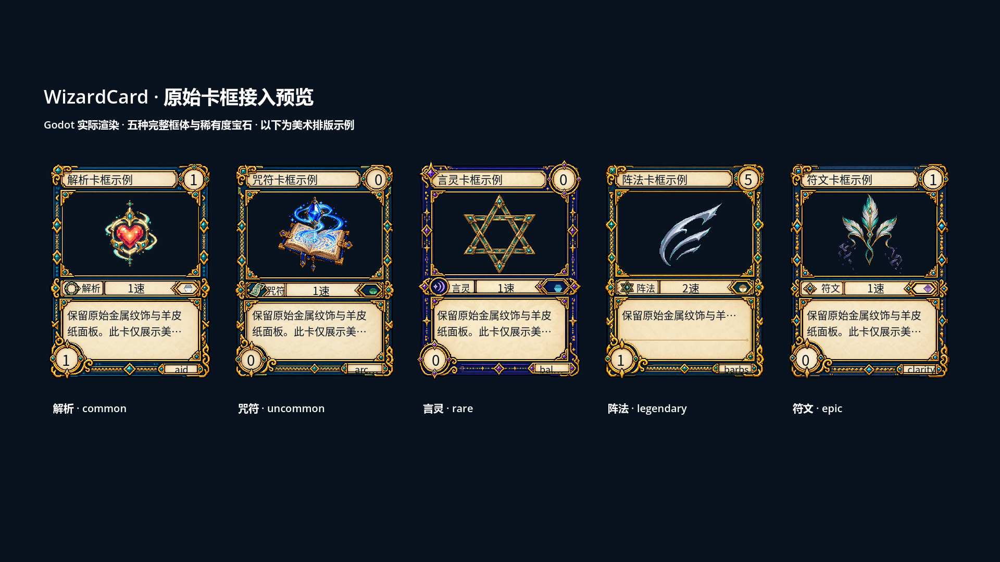
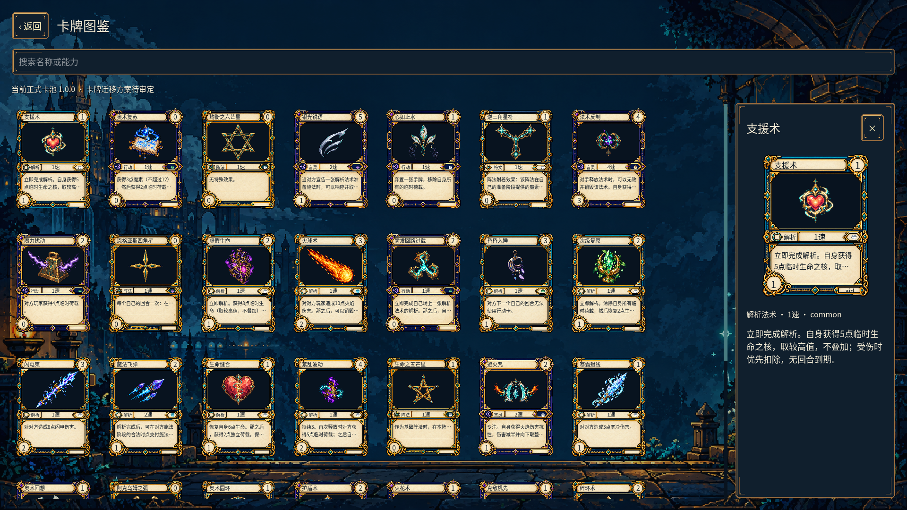

# 原始 AI 卡框接入报告

日期：2026-10-11。用户明确要求直接使用之前 ImageGen 生成的精细卡框，覆盖此前“小卡用简化模板”的资产选择策略。本轮保留工作树已有修改，不涉及提交或推送。

## 接入结果

- 原始解析、咒符、言灵、阵法、符文卡框及匿名卡背进入 Godot 运行清单，PNG 与来源 SHA-256 完全一致。
- `CardPainter` 在场上卡、手牌、图鉴和详情统一选择原始框体，保持 3:4 比例、透明轮廓与完整装饰。
- 根据原稿留白测量 `runtimeLayout`，动态放置名称、费用、阶级、类型、速度、稀有度宝石、能力文本与详情编号。
- 插画完整缩放到绘图区；卡面能力文本换行并在空间不足时省略，详情保留完整可滚动正文。极小卡面保留框体和数值，通过点击查看详情。
- 图鉴移除按钮原先的默认矩形底框。新增 `CardFace`，详情显示完整卡面；窗口高度变化时调整预览高度。
- 稀有度继续使用独立组件，传说对应金黄色宝石。盖伏卡只使用统一匿名卡背，公开前不查找真实插画与类型框体。
- 21 项简化卡框/卡背从运行清单中排除，历史文件原位保留。同步脚本重复运行不会恢复简化模板；当前清单共 234 项、58,932,888 字节，包含原有 30 张插画与七份主菜单资产。

## 验证

- 资产同步与 `--check` 通过：校验哈希、PNG 尺寸、纹理区域与卡面安全矩形。
- 最终 headless 回归 325 项通过，包括原生桥接、正式卡池、隐私、详情、输入和设置持久化。
- Windows OpenGL 实际渲染回归 **385 项通过**，覆盖 1280×720、1600×1000、1920×1080。
- 查看三个尺寸的详情截图、1080p 场地和五种卡框对照；修正了窄类型栏的字号。对照示例只在测试截图中构造，不修改正式卡池。





报告与原始截图位于 `build/card-frame-integration-smoke/`。编辑器首次导入曾提示临时桥接库复制失败；后续实际运行与最终回归均成功加载原生桥接，无脚本或运行错误。当前场地仍为展示页，正式单人、多人与构筑流程保持原来的开发状态。

## 复现

```powershell
python tools/prepare_godot_frontend_assets.py --check
E:/Project/Godot/Godot_v4.7.2-stable_win64_console.exe --path godot
```

从主菜单底部“卡牌图鉴”与“场地预览”入口查看。需要现有 `godot/bin` 原生桥接库。
