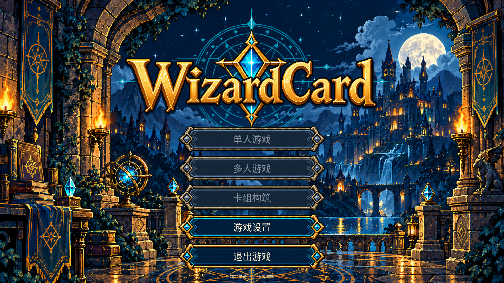

# C 版主界面美术接入 Godot

日期：2026-10-11。本轮使用当前工作树已有 Godot 4.7.2 前端，接入主菜单七份 1080p 素材。原有未提交的前端工作继续保留。

## 已接入

- 菜单背景改用重绘月夜城堡；其它页面继续使用原背景与遮光层。
- 透明 LOGO 与按钮五态加入 `godot/art/assets.json`，同步脚本重复运行会保留该批次。
- `ArtBank` 按 manifest 区域生成 `AtlasTexture`，避免把整张 1080p 透明画布压进按钮。
- 新菜单专用按钮支持尖角命中，禁用、按下、焦点、悬停、普通依次优先。焦点填充不会盖住按下态；正文使用主题中文字体。
- 1080p 按钮采用 560×100；小窗口使用独立尺寸与字号，辅助入口位于底部。

五个正式入口按已确定的文案显示。单人、多人、构筑对应的功能流程尚未实现，因此禁用并显示“暂未开放”提示。设置与退出保持可用，场地预览和图鉴保留为辅助入口。本轮没有把展示页伪装成真实对局，也没有新增联网、规则或构筑业务。

## 验证

- 249 项运行资产：哈希、PNG 尺寸与 Atlas 区域检查通过，保留 30 张插画。
- Godot 编辑器导入、脚本编译通过。
- 首轮 headless 回归 305 项通过。
- 最终 Windows OpenGL 实际渲染回归 **355 项通过**，1280×720 / 1600×1000 / 1920×1080。
- 通过真实鼠标输入与键盘焦点检查悬停、按下、焦点优先级；检查按钮尖角、布局边界与设置导航。已查看实际 1080p 和 720p 截图。



运行报告位于 `build/menu-integration-smoke/rendered.json`，截图位于 `build/menu-integration-smoke/screens/`。未执行提交或推送。

## 复现

```powershell
python tools/prepare_godot_frontend_assets.py --check
E:/Project/Godot/Godot_v4.7.2-stable_win64_console.exe --path godot
```

需要现有 `godot/bin` 原生桥接 DLL。正式单人、多人与构筑导航待对应业务页面接入；手柄、真实多 DPI 与长期运行仍未专项验收。
