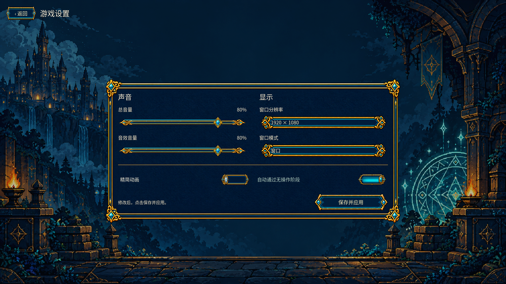

# 设置界面与共享 UI 重绘接入

日期：2026-10-11。用户要求其余 UI 沿用当前卡框的美术风格重绘，本轮完成设置界面与共享组件。

## 结果

- 内置 ImageGen 生成六份透明原稿：纹饰面板、输入/下拉框、滑条轨道、宝石把手、开关开启和关闭。保留原稿，并按既有授权进行尺寸归一化，六份导出均为 1920×1080 RGBA。
- Godot 通过 `AtlasTexture` 使用各组件的实际区域；面板、输入框、滑条采用九宫格，避免把整张透明画布压进控件。
- `ArtBank` 共用主题接入设置面板、下拉弹层、搜索框、开关、音量控件、页签及滚动条材质。通用按钮复用已经生成的 C 风格按钮素材，悬停/按下/禁用使用对应原图，焦点保持透明描边。
- 设置页改为声音与显示双列，以及操作开关与保存区。控件始终由真实 Godot 控件处理输入，名称、百分比、选项与反馈由实时文字显示。
- 保存字段、默认值、显示模式应用与原生持久化不变。已有战场独立皮肤继续保留，不把展示页描述为正式对局。
- 修复滑条进度色块遮住金边的问题；图鉴详情采用较紧凑的内边距与小窗口卡面高度，避免 720p 溢出。

## 验证

- 运行清单 **240 项、59,290,092 字节**；同步与校验通过，保留现有卡框、30 张插图、七份菜单素材。战场专用资源继续由其独立清单加载，不计入这个共享资产数字。
- Godot 导入无脚本错误，最终 headless 回归 **389 项通过**。
- Windows OpenGL 实际渲染回归 **463 项通过**，覆盖 1280×720、1600×1000、1920×1080。
- 真实输入验证：键盘方向键调整音量、鼠标点击切换开关、打开分辨率下拉菜单；保存与重新打开设置仍通过原生服务验证。
- 查看设置在 1080p 与 720p 的截图、1080p 下拉菜单及图鉴详情。没有用概念图代替运行界面。

源稿、导出、完整提示词、组件区域与预览见 [资源包说明](../../assets/art/godot-2d-v2/ui-components-1080p-v1/README.md)。机器报告位于 `build/refined-ui-integration-smoke/`。本轮没有提交或推送；保留其它已有前端和战场修改。
