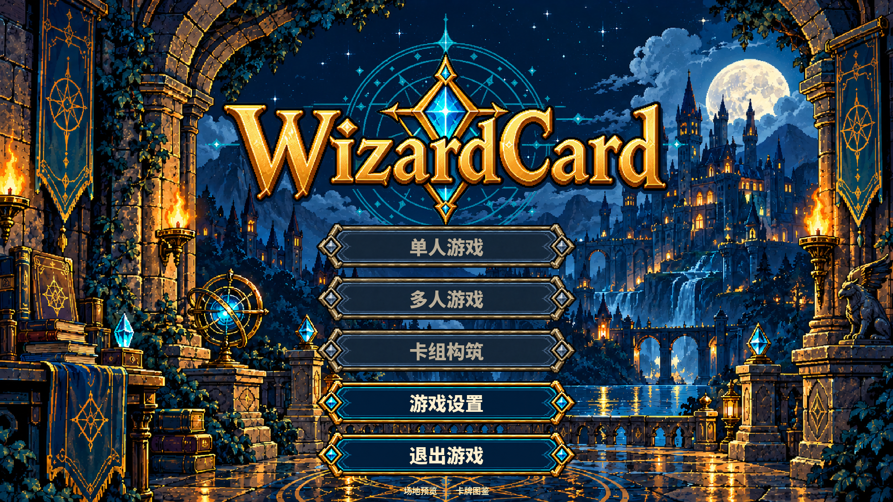

# 开源字体与字重优化

日期：2026-10-11。用户要求优化当前游戏字体，选用开源素材，并特别加粗主界面。

已接入官方 Noto Sans CJK SC Sans2.004 原始 Bold 700 与 Black 900 OTF。主菜单五个入口均使用真实 Black 900 字重：1080p 为 40px、1000p 为 36px、720p 为 30px；米金色文字配 2px 深色描边，禁用入口仍保留超粗字重并使用较暗色。页面与分组标题、按钮、开关、下拉选项、卡名和数值使用 Bold 700，规则与说明保留 Regular，避免小字号文字过重。

`Typography` 管理三种字体，主题统一分配控件字重。卡牌绘制的截断、宽度测量和基线均使用实际绘制字体，避免换字重后测量仍采用 Regular。字体未改字形或子集化；源稿清单保留官方版本、下载地址、内部版权及 SHA-256，运行包保留完整 OFL 1.1 许可原文。

## 验证

- Godot 4.7.2 导入成功，无脚本与主题错误。
- 共享运行资产校验通过：243 项，94,094,549 字节。两份完整 CJK 字体和对应许可增加约 33.2 MiB；战场专用素材仍独立管理。
- Headless 前端回归：582 项通过。
- Windows OpenGL 实际渲染与输入回归：658 项通过，覆盖 1280×720、1600×1000、1920×1080，实际卡池 30 张。
- 验证菜单实际字重为 900、所有菜单中文字符直接存在于内置字体，以及各尺寸文字和描边不会超出按钮内容区。已查看 1080p/720p 主菜单、1080p 设置和图鉴详情截图。
- 修正已有手牌测试的前提：透明角可能露出后方场地卡，因此隔离被测手牌验证逆旋转命中。保留原本的“透明角不得命中该手牌”断言；没有修改战场命中逻辑。

原始字体、许可和预览见 [字体包说明](../../assets/art/fonts/noto-sans-cjk-sc/README.md)。机器报告位于 `build/font-integration-smoke/`。本次未提交或推送，保留既有前端与美术修改。
