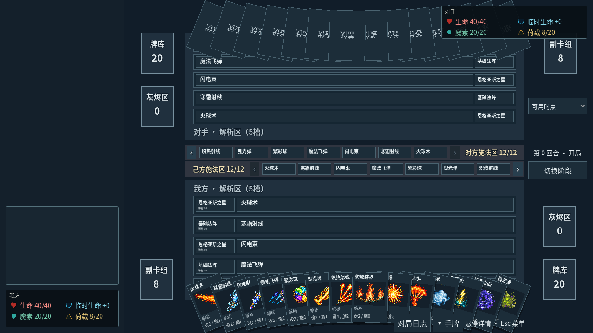
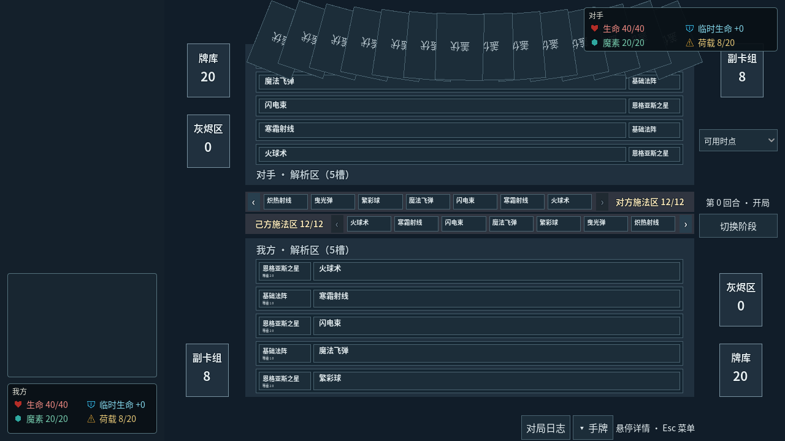
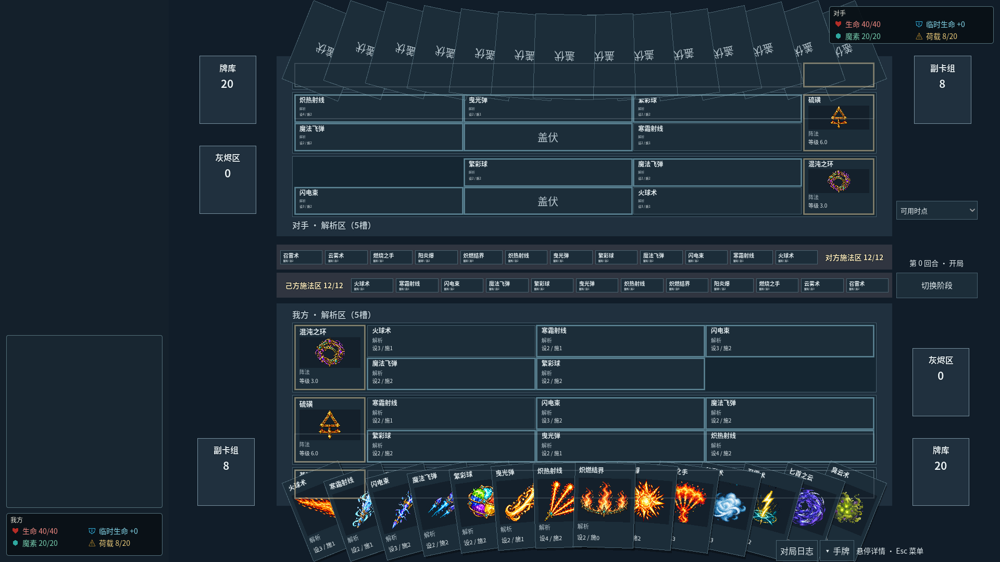

# WizardCard 对战场地视觉审计与两条改造路线

日期：2026-11-15。审计基线：`88f8271`，Alpha v2.6.3，项目所用 Godot 4.7.2。

## 判断

反馈成立。当前场地把大量横向空间分给卡片，却给它们过少的高度；手牌还会覆盖解析区。问题主要来自布局和信息展示方式，不能归因于“纯 UI 天生放不下”。

建议近期优先重做纯 UI 的信息层级与空间分配。如果长期产品目标包含明显的桌游感，可以选择固定俯视的 2D／2.5D 桌面场景；两条路线都需要概览、局部详览和独立手牌区。直接把现有界面投到 3D 桌上，不能解决这些问题。

本次没有修改游戏实现、卡牌或规则。以下方案均为评估建议，尚未选定实施。

## 证据与范围

- 阅读当前 `MatchPage`、`FieldCanvas`、布局资源、卡面绘制、字号适配及命中检测，并核对原生规则和发布卡池。
- 检查项目已有的 `docs/reports/2.6.3/full-field-hand14-1280x720.png`。
- 用当前 `MatchPage` 和正式卡定义生成展示夹具，捕获 1280×720、1920×1080、2560×1080 三种窗口尺寸；覆盖五张阵体 1、阵体 2+2+1、阵体 4+1，双方各 14 张手牌。另捕获收起我方手牌的对照，共 10 个样本。
- 夹具用于几何与显示审计，并非由原生内核推演的合法对局；未以它证明卡组重复限制、支付条件、荷载、派系限制或施法容量是否合法。施法区 12 张只是分页压力输入。
- 保存了截图、[测量数据](metrics.json)和[诊断脚本](audit.gd)。没有做玩家可用性实验，也没有对新路线做性能测试。

首次运行因本地 Godot 全局类缓存缺少 `GuideProgress` 而失败；重新导入项目后重新捕获，最终渲染日志无脚本错误。这个环境问题与场地拥挤无关。

## 先修正场地的理解

限制是每位玩家的**阵体总和不超过 5**，而不是始终有五张阵法。原生检查位于 `src/core/current_commands.cpp:691`。

当前实际游玩默认加载 `assets/release-v260/catalog.json`，其中版本元数据已经是 2.6.3；根目录旧卡池不代表当前默认内容。

| 正式卡示例 | 阵体 | 环位 |
|---|---:|---:|
| 基础法阵 | 1 | 1 |
| 阿克乌姆之弧 | 1 | 0 |
| 混沌之环 | 2 | 5 |
| 硫磺 | 2 | 6 |
| 完美法阵 | 4 | 7 |

阵体、环位数量和屏幕所需面积并不成固定比例。特别是有无环位的阵法、一个环位的阵法、多环位的阵法，不能都套一个固定比例的区域。五槽占用可以通过占用标记清楚表达，无须让五个等高长条决定所有卡片的尺寸。

## 当前画面的问题

### 1. 严重：卡槽高度导致卡图消失

`FieldCanvas._formation_slot()` 将解析区净高度固定除以 5；`_draw_formation_cluster()` 又用阵体决定环位网格行数。最后把完整卡面画进这些任意长宽比的矩形。

实测阵体 1 的卡槽如下，尺寸为当前窗口中的逻辑像素，未另作操作系统 DPI 换算：

| 窗口 | 我方阵法卡槽 | 对方阵法卡槽 | 我方单环位法术槽 | 我方阵法卡图高度 |
|---|---:|---:|---:|---:|
| 1280×720 | 83.5×28.8 | 83.5×23.4 | 597.3×28.8 | 0 |
| 1920×1080 | 134.6×53.5 | 134.6×45.3 | 972.3×53.5 | 0 |
| 2560×1080 | 188.6×53.5 | 188.6×45.3 | 1368.3×53.5 | 0 |

因此，宽屏主要把横条变长，没有增加可读高度。1080p 也不能从根本上解决。

`DeckCardPainter.artwork_rect()` 至少保留 20 像素标题和 32 像素页脚，再减内边距；剩余不足时卡图高度直接归零。阵体 2+2+1 的样本在 1080p 下，许多法术环位的卡图高度也为零。

**“拉伸”需要区分：**当前卡图贴图使用等比缩放，没有找到在这条渲染路径中把图像横向拉宽的证据；发生明显变形的是卡面和槽位的外形。卡面被重排成横条，图像消失，标题和费用挤在很小的位置。其他未提供的具体贴图失真仍需对应截图才能判定。

### 2. 严重：手牌挡住了可操作环位

双方手牌按相同尺寸绘制，对方整副手牌再绕场地中心旋转。解析区与手牌没有互不相交的空间约束。

五张阵体 1、双方各 14 张手牌的 720p 样本中：

- 我方一个环位的中心被手牌命中区域覆盖。
- 对方一个环位的中心被对方手牌轮廓覆盖；`card_at()` 对这样的点返回空，不会选择背后的法术。
- 只收起我方手牌后，我方被挡住的环位中心从 1 个变为 0 个；对方仍为 1 个。卡槽高度和卡图归零保持不变。

这证明遮挡和卡面压扁是两个独立问题。手牌收起按钮能暂时缓解前者，不能解决后者。中心被挡并不代表整张牌在所有位置都不可点击，但关键目标的完整可见性已经受到影响。





### 3. 高：屏幕很拥挤，同时又有大量无效留白

720p 时左侧栏及间距先占 268 像素，随后场地内部仍为两侧牌堆和阶段按钮保留空间；单侧解析区最终宽约 732 像素，仅为窗口宽度的 57.2%。左侧详情没有显示时，预留宽度也不归还场地。

牌库、灰烬区、副卡组主要表达计数和入口，却采用接近卡片大小的区域。相反，决定战术的环位高度只有几十像素。结果是“面积没有充分用在关键对象上”，而不是屏幕所有像素都被必要信息填满。

### 4. 高：卡牌信息没有按使用场景分层

战场和构筑页面复用完整卡面绘制，仍显示类型、费用等信息，却没有直接绘制 `CardPresentation.status`。解析剩余、已解析等状态主要进入详情文字。对战时高频需要的是“这是什么、属于哪个阵法、现在能否行动、还有多久”，目前这些信息的优先级不够。

字号适配允许一路缩至 5 像素，保证文字没有溢出不等于文字能读。当前样本中法术标题适配到 12 像素，而部分底部文字更小；缩放设置也可能被容器高度再次抵消。

### 5. 中：施法区与符文的密度处理仍偏向“塞进去”

施法区已经有分页，不应误判为完全没有溢出策略；但卡面高度被限制在 18–26 像素，仍然调用完整卡面绘制。720p 的 12 张样本每页显示 7 张，其他牌需要翻页。全场状态与当前响应来源应在翻页后仍清楚可见。

符文附件显示为最多约 13 像素的小格，很多时还会进一步缩小。可以有紧凑概览，但不能把几像素的格子作为精确选择的唯一入口。



## 路线一：纯 UI，重做战场的信息结构

**定位：**以战术阅读和操作效率为优先，保留当前投影、操作协议与 2D 前端。

推荐把战场组织为“双方阵法组 + 中央施法区 + 独立手牌带”，并让详情按需出现：

```text
对方资源 / 回合 / 对方手牌数量与紧凑背面
┌──────── 对方阵法组：名称、阵体占用、环位状态 ────────┐
└─────────────────────────────────────────────┘
               对方施法区 / 我方施法区
┌──────── 我方阵法组：名称、阵体占用、环位状态 ────────┐
└─────────────────────────────────────────────┘
我方资源 / 牌堆入口             当前操作与响应
──────────────── 独立手牌带 ────────────────────
```

具体改造：

1. **五槽是容量表达。**常驻显示五格占用标记；阵法组按实际张数、环位数量与最小可读尺寸分配空间。五张单环位阵法可以横排五组；2+2+1 可以是三组，密集组得到更多宽度。阵体占用用数字和连贯标记表达，不能因空间调整让玩家误读可设置容量。
2. **战场使用专用紧凑卡面。**阵法显示名称、图标、阵体、环位占用；法术显示小图、短名称、解析剩余／已解析／盖伏／持续等状态。图标保持等比，完整竖版卡面与效果文本放到悬停或点击详情。详情必须也能通过点击和键盘获得。
3. **默认保证全局可见。**全部阵法组、已占用环位及其关键状态常驻。空环位平时可弱化成编号点；选择设置目标时展开所有合法环位。不能只显示一个选中阵法，让其他阵法和响应来源消失。
4. **手牌有独立空间。**我方手牌下沉到固定底部区域；悬停抬起只侵入为预览保留的空间。对方手牌改为紧凑背面与数量，避免占据与我方等大的扇形区域。保持公开手牌数量，不能暴露身份。
5. **回收低价值面积。**左栏无详情时收起，牌堆变成小入口和计数；连锁仅在存在时占用主要位置。目标选择期间，详情不可遮住待选区域。
6. **按断点重排。**以 1280×720 作为必须成立的下限，而不是把 1080p 画面整体缩小。1080p 可增加图像和间距；超宽屏给详情和局部放大更多空间，并限制卡片最大宽度。

720p 概念空间预算可以先按顶部 56、对方概览 168、双施法区 76、我方概览 196、手牌 148、间隔 76 像素分配，总计 720。这里是原型起点，不是已验证的最终尺寸；需用多环位、长卡名与 120% 字号检验。

**收益：**直接解决高度浪费、横条卡面、关键状态不可见和手牌遮挡；可复用大量现有前端逻辑。**代价：**需要新的战场卡面、响应式布局和命中映射；美术感提升有限，仍偏战术面板。工作量相对中等，并非仅调几个比例。

## 路线二：桌面场景，重做卡牌的空间表现

**定位：**强调阵法、法术和符文在同一张桌上的归属关系与操作感。“桌面场景”不等于必须全 3D。

优先比较以下实现：

| 桌面形式 | 能带来的变化 | 主要负担 | 判断 |
|---|---|---|---|
| 2D 俯视桌面 | 等比卡片、阴影、移动、阵法与环位分组，文字易读 | 空间排布、遮挡与命中 | 最适合先验证桌面体验 |
| 2.5D／固定正交 3D | 层次、轻微厚度和镜头表现 | 相机、深度排序、输入映射、平台验证 | 有长期桌游美术目标时值得考虑 |
| 自由旋转透视 3D | 更强的实体桌游感 | 远端卡片变小、文字斜切、遮挡、相机负担 | 不建议用于这次拥挤问题的第一阶段 |

推荐场景结构：

```text
屏幕 UI：资源、回合、连锁、详情、响应按钮
桌面：   对方阵法簇    对方阵法簇    对方阵法簇
                双方施法公共区域
         我方阵法簇    我方阵法簇    我方阵法簇
屏幕 UI：独立手牌带 / 当前选择
```

每个阵法簇包含一个稳定的阵法锚点和它自己的环位。少量环位可采用短弧，多环位改成紧凑双排；不要坚持为每张阵法画一个巨大的完整圆环。符文用归属标记和数量入口，选中后展开。连线仅在悬停、选择和结算时强调，避免常驻交叉线。

这条路线必须同时具备：

- **概览与聚焦两种尺度。**概览显示阵法身份、环位占用和状态；点击或快捷键放大选中簇，保留其他簇的概览。不能要求玩家不停移动相机寻找可操作对象。
- **固定、高角度、尽量正交的默认视角。**对方区域仍须可读。文字、计时和高优先级提示可以放在屏幕 UI 层，避免跟随桌面透视变小。
- **跨区域目标选择。**放大某阵法时，若合法目标在其他簇，界面必须提示并提供直接跳转／恢复全景，不得把目标藏在视野外。
- **稳定位置。**新增法术不要让所有阵法不停重新排位；大布局变化应发生在明确的布局切换点。
- **等比实体与最低可点尺寸。**桌面中的卡片可保持竖版比例，但缩小后仍需要简化信息。相机离得更远只会让字更小，不能当作自动扩容。
- **只改变表现层。**沿用查看者投影和合法动作查询；卡片位置、碰撞与动画不能决定规则结果。2D 桌面符合现有 ADR；若改 3D，需要更新 ADR 对 Godot 2D 表现层的描述，继续保留 C++ 权威内核。

**收益：**阵法与法术的从属关系更直观，卡图识别和移动反馈更自然，长期视觉表现空间更大。**代价：**仍需纯 UI 路线中的信息分层，同时新增场景排布、聚焦、输入、遮挡和美术工作。2D 桌面工作量中高，完整 3D 高；未经原型无法承诺性能和工期。

## 两条路线的选择

| 维度 | 纯 UI 重排 | 桌面场景 |
|---|---|---|
| 解决当前拥挤 | 直接、风险较低 | 依赖同样的信息分层和空间规划 |
| 文字和状态阅读 | 更容易保证 | 需处理缩放、视角与远近差异 |
| 阵法归属感 | 依靠分组和高亮 | 天然适合空间表达 |
| 卡图与桌游氛围 | 有提升空间但较有限 | 更强 |
| 现有前端复用 | 高 | 状态与动作层高，绘制与输入层较低 |
| 实施负担 | 中等 | 2D 中高，3D 高 |

**建议顺序：**先定义战场专用卡面、概览必显信息、手牌安全区和五槽容量表达；优先落实纯 UI。若桌游氛围本身是重要产品目标，再用同一展示数据验证固定俯视桌面。这样两条路线的前期信息设计可以共用，避免先投入 3D 后再次压缩信息。

不建议作为主要方案：整体缩小全部卡片、强制更高分辨率、只改背景贴图、把五组全部放进滚动列表、依靠持续拖动相机查看场地，或为了界面方便直接减少五槽规则。

## 建议验收标准

以下是待采纳的设计标准，不是本次已通过的结果：

1. 覆盖 1280×720、1600×1000、1920×1080、2560×1080，以及 100%／120% 字号；关键状态不裁切，字号不因空间不足降到不可读。
2. 五张阵体 1、2+2+1、4+1、零环位阵法、多符文、动态扩环、14／20 张手牌、施法区分页、连锁响应、盖伏与持续法术均有展示用例；正式验收还需原生合法对局或回放。
3. 默认概览能识别所有阵法、占用与空环位数量、公开法术身份及状态。完整规则文本允许进详情。
4. 手牌、详情、操作按钮与目标选择互不遮挡；正常态和悬停态都检查。不能只检查“矩形仍在窗口内”。
5. 点击可操作对象的可见区域，应选到对应对象；没有手牌轮廓或不可见层吞掉背后目标。小符文必须有便捷的展开入口。
6. 建议关键状态字不低于 14 逻辑像素，次要字不低于 12；鼠标目标建议至少 32×32。更紧凑的记号仅作概览，必须提供较大的操作入口。最终以实机阅读和点选验证调整。
7. 卡图保持原始比例；有意设计的横向紧凑条与完整竖版卡面使用不同布局。无需卡图的摘要条不得伪装成被压扁的完整卡牌。
8. 桌面方案额外验证：概览中的对方卡片可读；聚焦时不遗漏合法目标；返回全景位置稳定；动画期间状态和命中区域一致。

## 当前验证为何没有发现问题

现有 `godot/tests/field_v25_smoke.gd` 检查环位是否在场内、槽位不重叠、输入命中、牌堆边界等，能发现几何越界，却没有为阵法卡图的非零面积、最低可读字号、手牌对有效目标的遮挡设置完整验收标准。

本次诊断明确复现：`host_art_height = 0`，我方被手牌覆盖的环位中心 `1 → 0`（收起手牌前后）。审计结果是发现问题，而非宣称修复通过。

## 主要实现位置

- `godot/app/main.gd:63`：默认正式卡池选择。
- `godot/pages/match_page.gd:105`：对战页覆盖默认布局；只改资源默认值会漏掉实际游玩布局。
- `godot/pages/match_page.gd:207`：固定左侧栏和场地边界。
- `godot/ui/field_layout.gd:144`：区域和内容区计算。
- `godot/ui/field_canvas.gd:317`：对方手牌。
- `godot/ui/field_canvas.gd:386`：五槽纵向切分。
- `godot/ui/field_canvas.gd:426`：阵体与环位网格。
- `godot/ui/field_canvas.gd:503`：符文附件。
- `godot/ui/field_canvas.gd:537`：完整卡面复用。
- `godot/ui/field_canvas.gd:559`：施法区分页及高度限制。
- `godot/ui/field_canvas.gd:618`、`:706`：手牌绘制与命中。
- `godot/ui/deck_card_painter.gd:28`、`:34`、`:47`：卡图区域、等比贴图、卡面内容。
- `godot/ui/typography.gd:38`：字号适配下限。
- `docs/adr/0001-alpha-v2-modular-native-engine.md`：权威规则与表现层边界。
